# Pattern catalog

Every pattern we have, one note each. This page is written by the catalog tool
(`python3 .claude/skills/pattern-catalog/scripts/catalog.py sync`); edit the notes, not this
page. How the catalog is laid out and why: [the plan](plan.md).

## Constructions made into coasters (15)

| Picture | Pattern | Catalog id | Status | Styles |
|---|---|---|---|---|
| 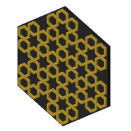 | [Simple 20-step Six-Fold Star Rosette](patterns/simple-20-step-six-fold-star-rosette-cs-1.md) | CS-1 | printed | plain, interlock, minimal, border, twist, minimal-frame, minimal-pegs, minimal-key, minimal-tab, lobed, radial, cup-band |
| 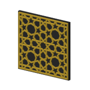 | [Geogebra for Beginners — 8-Fold Rosette Walkthrough](patterns/geogebra-for-beginners-8-fold-rosette-walkthrough-cs-2.md) | CS-2 | printed | plain, interlock, minimal, border, twist, minimal-frame, minimal-pegs, fill, cup-band |
| 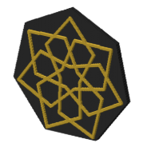 | [5-minute 7-fold Star Rosette](patterns/5-minute-7-fold-star-rosette-cs-6.md) | CS-6 | built | plain, cup-band |
| 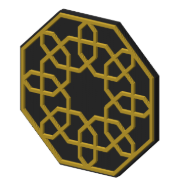 | [Pattern from the Tomb of Itimad ad-Daula](patterns/pattern-from-the-tomb-of-itimad-ad-daula-cs-7.md) | CS-7 | built | plain, cup-band |
| 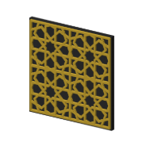 | [8-fold Star Rosette with Sequences](patterns/8-fold-star-rosette-with-sequences-cs-8.md) | CS-8 | printed | plain, minimal-frame, cup-band |
| 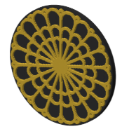 | [n-fold Flower in GeoGebra Classic 5](patterns/n-fold-flower-in-geogebra-classic-5-cs-9.md) | CS-9 | built | plain |
| 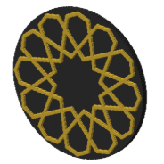 | [Variable-angled 12-6-4 Star Rosette](patterns/variable-angled-12-6-4-star-rosette-cs-10.md) | CS-10 | built | plain, cup-band |
| 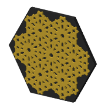 | [Pattern from the Royal Alcazar](patterns/pattern-from-the-royal-alcazar-cs-11.md) | CS-11 | built | plain, cup-band |
|  | [Imamzadeh Isma'il Shrine, Isfahan — six-fold kite rosette](patterns/imamzadeh-ismail-shrine-isfahan-six-fold-kite-rosette-cs-12.md) | CS-12 | built | plain, cup-band |
| 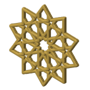 | [The Itimad-ud-Daula ten-fold rosette in a rhombus tile](patterns/the-itimad-ud-daula-ten-fold-rosette-in-a-rhombus-tile-cs-13.md) | CS-13 | printed | minimal, cup-band, minimal-pieces, split-flange, split-lip, split-pocket |
| 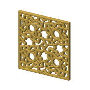 | [Sevenfold stars in a tilted square](patterns/sevenfold-stars-in-a-tilted-square-cs-14.md) | CS-14 | built | minimal, cup-band |
| 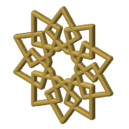 | [The Mustansiriya ten-fold interlaced star](patterns/the-mustansiriya-ten-fold-interlaced-star-cs-15.md) | CS-15 | built | minimal, cup-band |
| 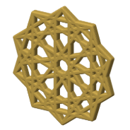 | [A pentagon after Ptolemy's *Almagest*, doubled to ten](patterns/a-pentagon-after-ptolemys-almagest-doubled-to-ten-cs-16.md) | CS-16 | built | minimal, cup-band |
| 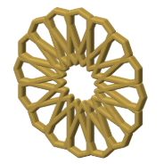 | [A 16-petal rosette in one unbroken line](patterns/a-16-petal-rosette-in-one-unbroken-line-cs-17.md) | CS-17 | built | minimal, cup-band |
| 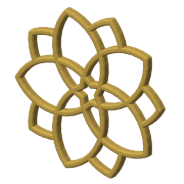 | [A ten-petal blossom from one compass setting](patterns/a-ten-petal-blossom-from-one-compass-setting.md) | CS-18 | built | minimal |

## Rebuilt from the video, not yet in naqsh (18)

Rebuilt in the youtube repo. No bikar file yet, so no coaster and no picture.

| Pattern | Creator |
|---|---|
| [12-fold pattern in a 6-4-3-4 tiling](patterns/12-fold-pattern-in-a-6-4-3-4-tiling.md) | Sarah Brewer |
| [7-fold star rosette, the 27-minute build](patterns/7-fold-star-rosette-the-27-minute-build.md) | Sarah Brewer |
| [8-fold rosettes turned 45°, with squares](patterns/8-fold-rosettes-turned-45-with-squares.md) | Sarah Brewer |
| [A Mamluk Qur'an page from seven ten-point stars](patterns/a-mamluk-quran-page-from-seven-ten-point-stars.md) | not recorded |
| [A tenfold rosette in a pentagon, ink on filmed paper](patterns/a-tenfold-rosette-in-a-pentagon-ink-on-filmed-paper.md) | Samira Mian |
| [Alhambra Hall of the Two Sisters doors, 8-fold in a square](patterns/alhambra-hall-of-the-two-sisters-doors-8-fold-in-a-square.md) | Sarah Brewer |
| [Broug's ten-point star from one circle](patterns/brougs-ten-point-star-from-one-circle.md) | not recorded |
| [Discrete variable star rosette, sliders n and k](patterns/discrete-variable-star-rosette-sliders-n-and-k.md) | Sarah Brewer |
| [Folio 192 heptagonal panel, Anonymous Persian Compendium](patterns/folio-192-heptagonal-panel-anonymous-persian-compendium.md) | Sarah Brewer |
| [Ibn Tulun variable-angle pattern](patterns/ibn-tulun-variable-angle-pattern.md) | Sarah Brewer |
| [Parallel 9-fold Star Rosette, "Avoiding Open Paths"](patterns/parallel-9-fold-star-rosette-avoiding-open-paths.md) | Sarah Brewer |
| [Rings of Tangent Circles](patterns/rings-of-tangent-circles.md) | Sarah Brewer |
| [Star rosettes on a 3-uniform tiling](patterns/star-rosettes-on-a-3-uniform-tiling.md) | Sarah Brewer |
| [Star rosettes on a 4-uniform tiling, in a square](patterns/star-rosettes-on-a-4-uniform-tiling-in-a-square.md) | Sarah Brewer |
| [Sultan Barsbay 16 & 8](patterns/sultan-barsbay-16-8.md) | Sarah Brewer |
| [Sutton's fivefold rectangle and its traced quarter](patterns/suttons-fivefold-rectangle-and-its-traced-quarter.md) | not recorded |
| [The Itimad-ud-Daula ten-fold rosette built by hand in GeoGebra, then tiled](patterns/the-itimad-ud-daula-ten-fold-rosette-built-by-hand-in-geogebra-then-tiled.md) | Geogebra_Road to School |
| [The sixfold √3 rectangle from Baghdad](patterns/the-sixfold-root-3-rectangle-from-baghdad.md) | not recorded |

## Queued, not yet rebuilt (1)

Screened and queued, or held. Add one to [the planned list](planned.yaml) and sync.

| Pattern | Creator | Held |
|---|---|---|
| [12- and 9-pointed stars, after Bodner](patterns/12-and-9-pointed-stars-after-bodner.md) | Chris Cambré | held |

## Nothing to make, by design

- [Dual Slider m,n-fold Division of the Circle](patterns/dual-slider-m-n-fold-division-of-the-circle.md): the video shows a way of drawing, not a piece.

## Coaster styles

| Style | Patterns made in it |
|---|---|
| [plain](styles/plain.md) | 9 |
| [interlock](styles/interlock.md) | 2 |
| [minimal](styles/minimal.md) | 8 |
| [border](styles/border.md) | 2 |
| [twist](styles/twist.md) | 2 |
| [minimal-frame](styles/minimal-frame.md) | 3 |
| [minimal-pegs](styles/minimal-pegs.md) | 2 |
| [minimal-key](styles/minimal-key.md) | 1 |
| [minimal-tab](styles/minimal-tab.md) | 1 |
| [lobed](styles/lobed.md) | 1 |
| [fill](styles/fill.md) | 1 |
| [radial](styles/radial.md) | 1 |
| [cup-band](styles/cup-band.md) | 13 |
| [minimal-pieces](styles/minimal-pieces.md) | 1 |
| [split-flange](styles/split-flange.md) | 1 |
| [split-lip](styles/split-lip.md) | 1 |
| [split-pocket](styles/split-pocket.md) | 1 |

## The bikar library (76)

The patterns bikar has beyond the video rebuilds, one note per file, grouped by family. Their
pictures are drawn by `catalog.py render-library`.

### Stars (15)

| Picture | Pattern | File | Status |
|---|---|---|---|
| 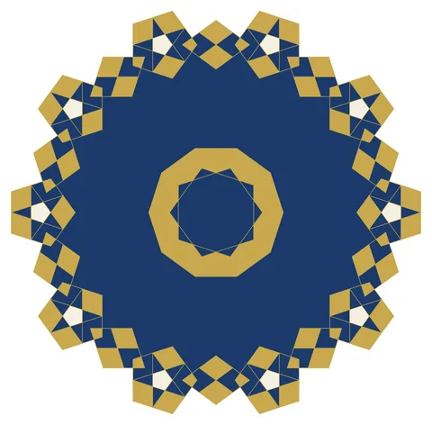 | [Darb-i Imam: Self-Similar Girih Subdivision](library/stars/darb-i-imam.md) | `Darb-i-Imam.bkr` | built |
| 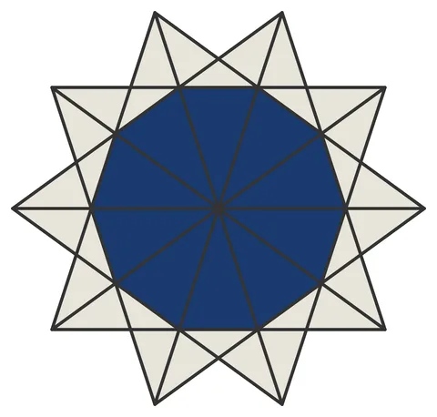 | [Gem Cut](library/stars/gem-cut.md) | `Gem-Cut.bkr` | built |
| 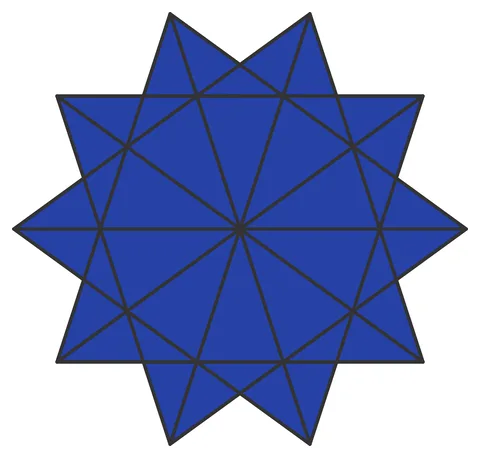 | [Girih 10](library/stars/girih-10.md) | `Girih-10.bkr` | built |
| 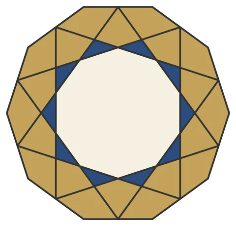 | [Girih-Decagon: Girih Tile Demonstration](library/stars/girih-decagon.md) | `Girih-Decagon.bkr` | built |
| 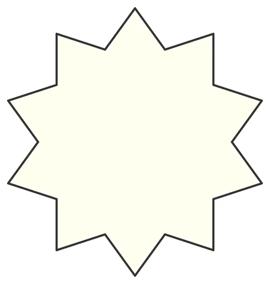 | [Hankin-Star: Kaplan Method (2005)](library/stars/hankin-star.md) | `Hankin-Star.bkr` | built |
| 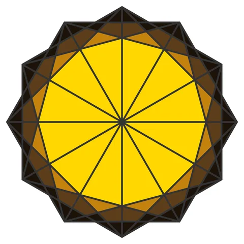 | [Radiant Rosette](library/stars/radiant.md) | `Radiant.bkr` | built |
| 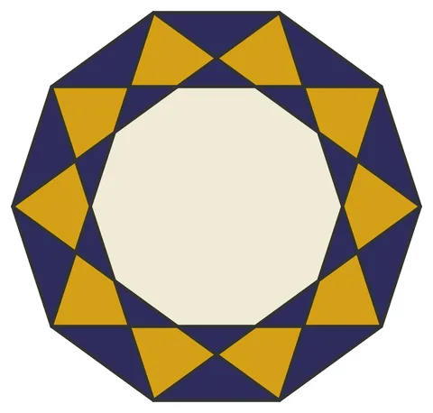 | [Star-10: Decagonal Star (corpus construction #2)](library/stars/star-10.md) | `Star-10.bkr` | built |
| 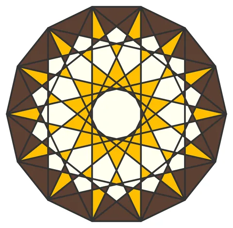 | [Star-14: Perfect Fourteen](library/stars/star-14.md) | `Star-14.bkr` | built |
| 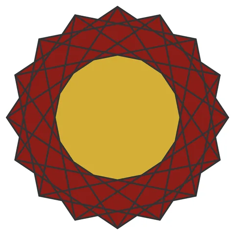 | [Star 16](library/stars/star-16.md) | `Star-16.bkr` | built |
| 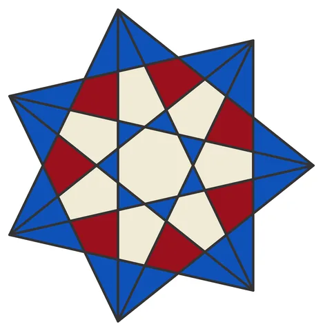 | [Star-7: Heptagonal Star](library/stars/star-7.md) | `Star-7.bkr` | built |
| 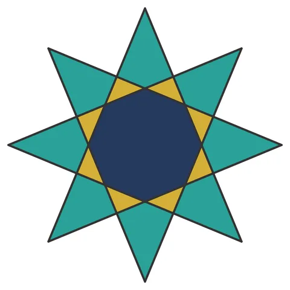 | [Star-N: the {n/k} star polygon, with both numbers on a dial](library/stars/star-n.md) | `Star-N.bkr` | built |
| 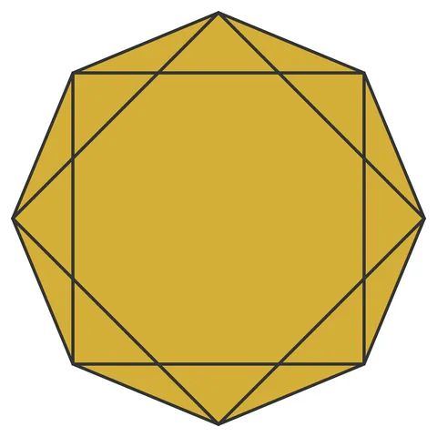 | [Styled Star-8](library/stars/styled-star.md) | `Styled-Star.bkr` | built |
| 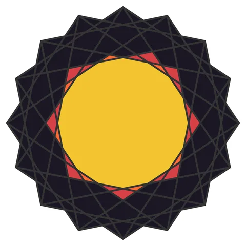 | [Sunburst](library/stars/sunburst.md) | `Sunburst.bkr` | built |
| 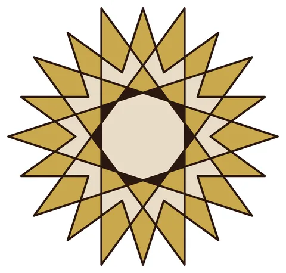 | [Topkapi Scroll Star](library/stars/topkapi-star.md) | `Topkapi-Star.bkr` | built |
| 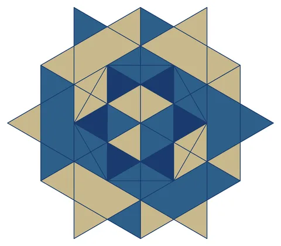 | [Yazd Star (15th century Iran)](library/stars/yazd-star.md) | `Yazd-Star.bkr` | built |

### Rosettes (8)

| Picture | Pattern | File | Status |
|---|---|---|---|
| 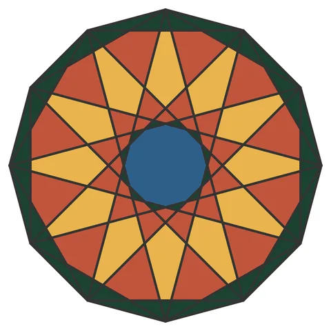 | [Andalusian](library/rosettes/andalusian.md) | `Andalusian.bkr` | built |
| 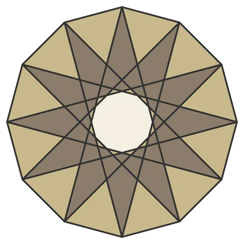 | [Flower of Life Rosette](library/rosettes/flower-rosette.md) | `Flower-Rosette.bkr` | built |
| 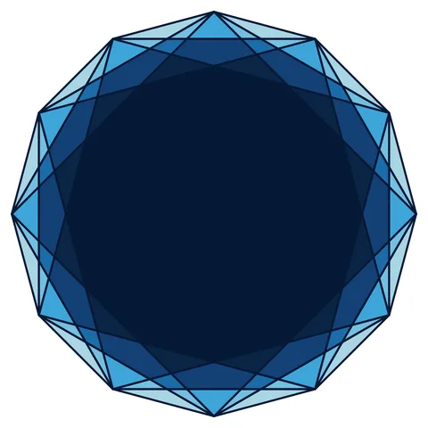 | [Ocean Rosette](library/rosettes/ocean-rosette.md) | `Ocean-Rosette.bkr` | built |
| 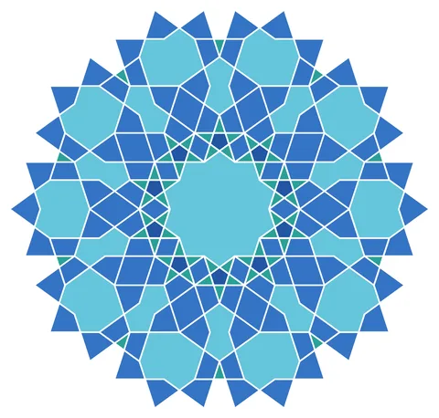 | [10-fold Rosette Ring](library/rosettes/rosette-10-ring.md) | `Rosette-10-Ring.bkr` | built |
| 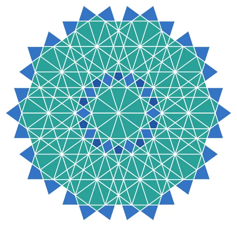 | [10-fold Rosette Tiled](library/rosettes/rosette-10-tiled.md) | `Rosette-10-Tiled.bkr` | built |
| 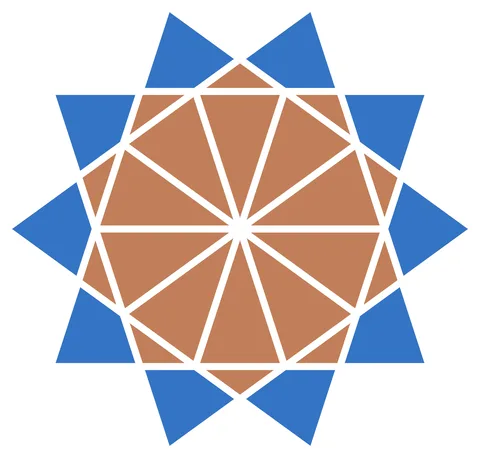 | [10-fold Rosette](library/rosettes/rosette-10.md) | `Rosette-10.bkr` | built |
| 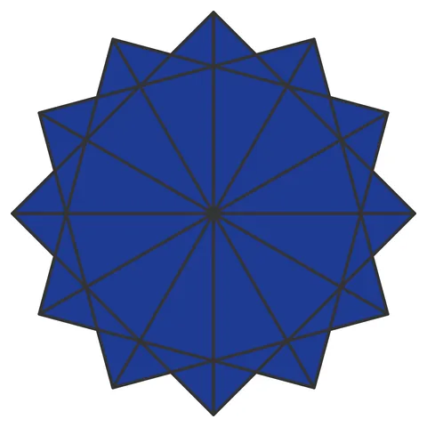 | [Rosette 12r](library/rosettes/rosette-12r.md) | `Rosette-12r.bkr` | built |
| 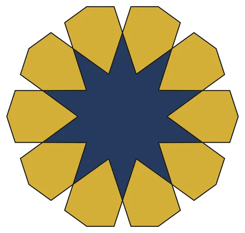 | [Rosette N](library/rosettes/rosette-n.md) | `Rosette-N.bkr` | built |

### Tiled Patterns (8)

| Picture | Pattern | File | Status |
|---|---|---|---|
| 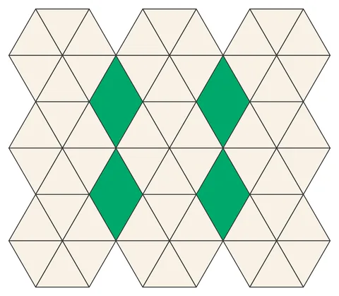 | [Hex Flower](library/tiled/hex-flower.md) | `Hex-Flower.bkr` | built |
| 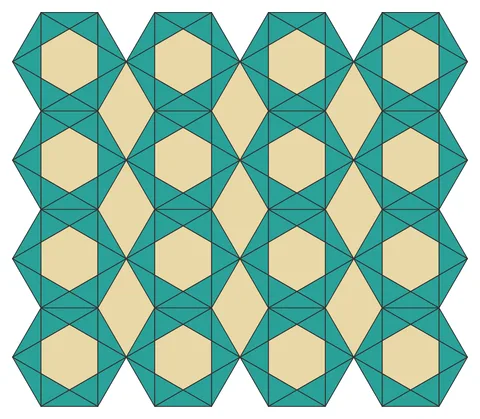 | [Hex Tiled](library/tiled/hex-tiled.md) | `Hex-Tiled.bkr` | built |
|  | [Moroccan 12-fold Rosette](library/tiled/moroccan-12-dense.md) | `Moroccan-12-Dense.bkr` | built |
|  | [Moroccan 12-fold Rosette](library/tiled/moroccan-12-tiled.md) | `Moroccan-12-Tiled.bkr` | built |
|  | [Moroccan 12-fold Rosette](library/tiled/moroccan-12.md) | `Moroccan-12.bkr` | built |
| 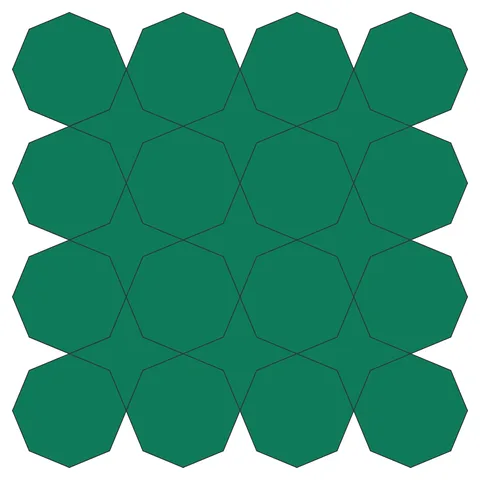 | [Oct Grid](library/tiled/oct-grid.md) | `Oct-Grid.bkr` | built |
| 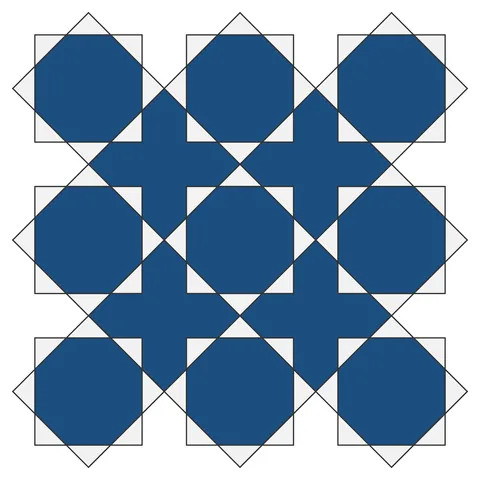 | [Star 8 Tiled](library/tiled/star-8-tiled.md) | `Star-8-Tiled.bkr` | built |
| 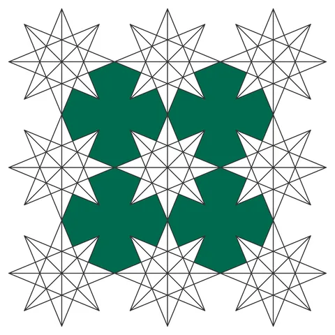 | [Zellige](library/tiled/zellige.md) | `Zellige.bkr` | built |

### Weave (5)

| Picture | Pattern | File | Status |
|---|---|---|---|
| 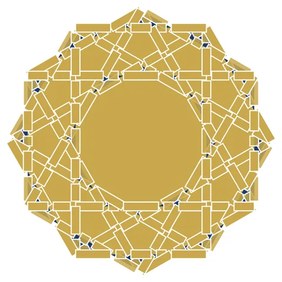 | [Mamluk Quran Illumination Border](library/weave/mamluk-border.md) | `Mamluk-Border.bkr` | built |
| 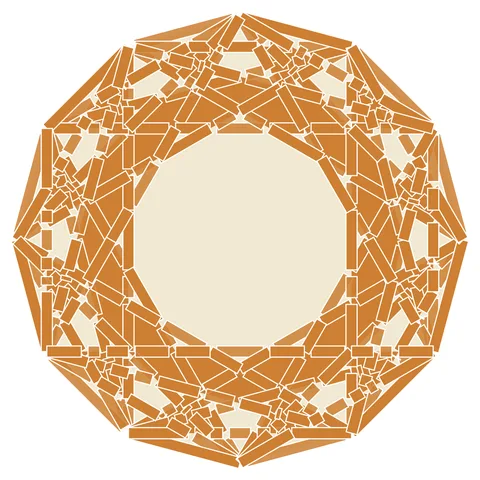 | [Weave-12: 12-Point Woven Rosette](library/weave/weave-12.md) | `Weave-12.bkr` | built |
| 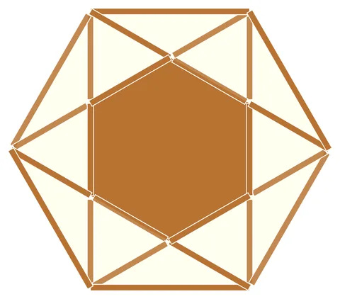 | [Weave-6: Hexagonal Woven Star](library/weave/weave-6.md) | `Weave-6.bkr` | built |
| 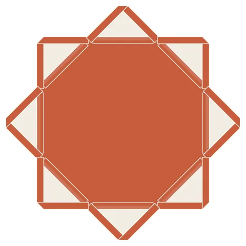 | [Weave-8: 8-Point Woven Star](library/weave/weave-8.md) | `Weave-8.bkr` | built |
| 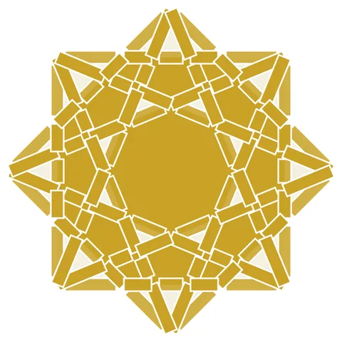 | [Weave-Border: Braided Border Strip](library/weave/weave-border.md) | `Weave-Border.bkr` | built |

### Orbs (17)

| Picture | Pattern | File | Status |
|---|---|---|---|
| 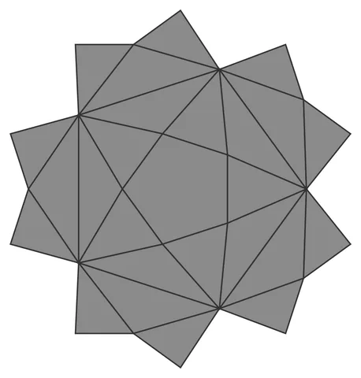 | [Dodeca-Orb](library/orbs/dodeca-orb.md) | `Dodeca-Orb.bkr` | built |
| 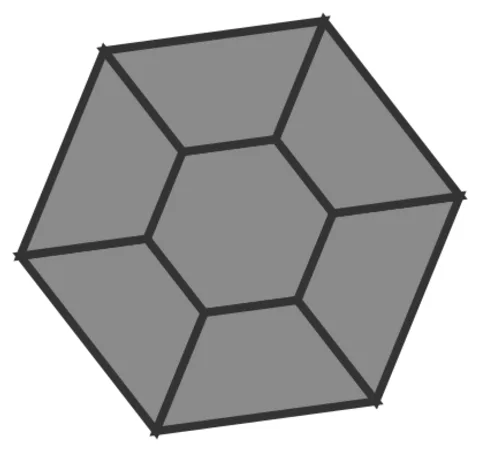 | [Donut-Hex-Orb](library/orbs/donut-hex-orb.md) | `Donut-Hex-Orb.bkr` | built |
| 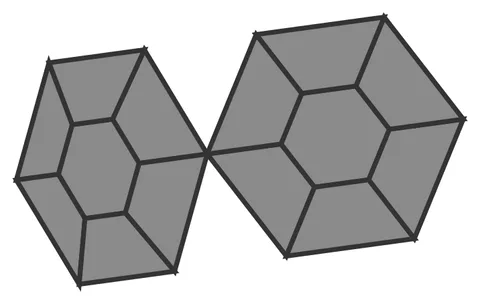 | [Donut-Hex-Weld](library/orbs/donut-hex-weld.md) | `Donut-Hex-Weld.bkr` | built |
|  | [Hankin-Orb](library/orbs/hankin-orb.md) | `Hankin-Orb.bkr` | built |
|  | [Maclado-9-Lattice](library/orbs/maclado-9-lattice.md) | `Maclado-9-Lattice.bkr` | built |
|  | [Maclado-9-Overlap](library/orbs/maclado-9-overlap.md) | `Maclado-9-Overlap.bkr` | built |
|  | [Maclado-9-Weave](library/orbs/maclado-9-weave.md) | `Maclado-9-Weave.bkr` | built |
|  | [Maclado-9](library/orbs/maclado-9.md) | `Maclado-9.bkr` | built |
|  | [Rosette-Cube-Orb](library/orbs/rosette-cube-orb.md) | `Rosette-Cube-Orb.bkr` | built |
|  | [Rosette-Orb](library/orbs/rosette-orb.md) | `Rosette-Orb.bkr` | built |
|  | [Rosette-Weave-Orb](library/orbs/rosette-weave-orb.md) | `Rosette-Weave-Orb.bkr` | built |
|  | [Star-Cube-Orb](library/orbs/star-cube-orb.md) | `Star-Cube-Orb.bkr` | built |
|  | [Star-Octa-Orb](library/orbs/star-octa-orb.md) | `Star-Octa-Orb.bkr` | built |
|  | [Star-Orb](library/orbs/star-orb.md) | `Star-Orb.bkr` | built |
|  | [Star-Tetra-Orb](library/orbs/star-tetra-orb.md) | `Star-Tetra-Orb.bkr` | built |
|  | [Weave-Dodeca-Orb](library/orbs/weave-dodeca-orb.md) | `Weave-Dodeca-Orb.bkr` | built |
|  | [Weave-Orb](library/orbs/weave-orb.md) | `Weave-Orb.bkr` | built |

### Lego (10)

| Picture | Pattern | File | Status |
|---|---|---|---|
|  | [Classic-Brick](library/lego/classic-brick.md) | `Classic-Brick.bkr` | built |
|  | [Edge-Stud-Tile](library/lego/edge-stud-tile.md) | `Edge-Stud-Tile.bkr` | built |
|  | [Grid-Field-Tile](library/lego/grid-field-tile.md) | `Grid-Field-Tile.bkr` | built |
|  | [Hex-Field-Tile](library/lego/hex-field-tile.md) | `Hex-Field-Tile.bkr` | built |
|  | [Pin-Rail](library/lego/pin-rail.md) | `Pin-Rail.bkr` | built |
|  | [Rational-Repeat-Tile](library/lego/rational-repeat-tile.md) | `Rational-Repeat-Tile.bkr` | built |
|  | [Rosette-Brick](library/lego/rosette-brick.md) | `Rosette-Brick.bkr` | built |
|  | [Seam-Coupon](library/lego/seam-coupon.md) | `Seam-Coupon.bkr` | built |
|  | [Star-Brick](library/lego/star-brick.md) | `Star-Brick.bkr` | built |
|  | [Star-Mural](library/lego/star-mural.md) | `Star-Mural.bkr` | built |

### Coupons (13)

| Picture | Pattern | File | Status |
|---|---|---|---|
|  | [Clip-Coupon](library/coupons/clip-coupon.md) | `Clip-Coupon.bkr` | built |
|  | [Clipseat-Fit-Coupon](library/coupons/clipseat-fit-coupon.md) | `Clipseat-Fit-Coupon.bkr` | built |
|  | [Dovetail-Coupon](library/coupons/dovetail-coupon.md) | `Dovetail-Coupon.bkr` | printed |
|  | [Fit-Coupon](library/coupons/fit-coupon.md) | `Fit-Coupon.bkr` | built |
|  | [Frame-Band-Coupon (W-P1)](library/coupons/frame-band-coupon.md) | `Frame-Band-Coupon.bkr` | built |
|  | [Lego-Clutch-Coupon](library/coupons/lego-clutch-coupon.md) | `Lego-Clutch-Coupon.bkr` | built |
|  | [Loose-Fit-Coupon](library/coupons/loose-fit-coupon.md) | `Loose-Fit-Coupon.bkr` | printed |
|  | [Machine-Card](library/coupons/machine-card.md) | `Machine-Card.bkr` | built |
|  | [Sampler-Cards](library/coupons/sampler-cards.md) | `Sampler-Cards.bkr` | built |
|  | [Split-Fit-Coupon](library/coupons/split-fit-coupon.md) | `Split-Fit-Coupon.bkr` | printed |
|  | [Split-Pocket-Coupon](library/coupons/split-pocket-coupon.md) | `Split-Pocket-Coupon.bkr` | printed |
|  | [Split-Trap-Coupon](library/coupons/split-trap-coupon.md) | `Split-Trap-Coupon.bkr` | printed |
|  | [Swatch-Chip](library/coupons/swatch-chip.md) | `Swatch-Chip.bkr` | built |
