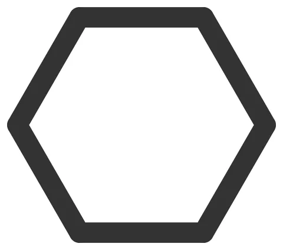

# Dovetail-Coupon

From bikar's pattern library: `bikar:patterns/Coupons/Dovetail-Coupon.bkr`, in the coupons family.



The file drawn at its default knobs.

## What the file says

```text
Dovetail-Coupon — SLD-1: can a small dovetail hold two piece halves together?

A split coaster piece is two 1.6 mm halves, each printed with its outside
face on the bed so both faces come out glossy. This coupon asks whether a
dovetail across the cut faces can join the two halves into one piece by
hand, with no glue and no tool (3d-models
docs/design/pieces/join-halves-design.md §2; Omar, 2026-10-05: "for joints
i want to try the dovetail", D-107).

Two pieces, printed face down:
  Rail  a hexagon half with a rail standing on its cut face (the top as
        printed), wider at its top than at its root.
  Slot  the matching half with a slot cut into its cut face, `gap`
        hundredths of a mm wider on each side, one layer deeper so the
        faces close flat.
Slide the rail into the slot from one end; the pair can then only slide
back out, not lift apart.

The plate prints three pairs, at gap 10, 15 and 20, each half engraved with
its gap so the pairs can be matched:

  bikar render patterns/Coupons/Dovetail-Coupon.bkr --piece Rail \
    --format stl --check --param gap=15 -o out/sld1-rail-15.stl
  bikar render patterns/Coupons/Dovetail-Coupon.bkr --piece Slot \
    --format stl --check --param gap=15 -o out/sld1-slot-15.stl

LAYOUT (mm, centred on the origin): a regular hexagon of circumradius 9.13,
points left and right, about 216 mm² at 1.25x gBV's hexagon. It stands in
for gBV's elongated hexagon by area only; its shape is not gBV's. The rail
runs left to right through the centre, 4 wide at its root and 0.8 tall in
four 0.2 mm layers, each 0.1 mm a side wider than the one under it
(slope 2). Slope 2, not woodworking's 4 to 8: at 0.8 mm tall, slope 6 gains
only 0.1 mm a side from root to top, no more than the clearance, and the
kernel refuses a rail that would lift straight out. The slot is 1.0 deep,
which leaves 0.6 mm of floor, the three-layer deboss floor (CAL-CST-03).
The labels sit in the wide strip above the rail, 3.5 mm tall, 0.4 deep.
```

## Knobs

| Knob | Default | Range |
|---|---|---|
| `gap` | 15 | 5..25 |
| `half_t` | 1.6 | 1.6..3.2 |

<!-- written by hand below this line; the sync tool stops here -->

## Notes

Nothing written by hand yet.
