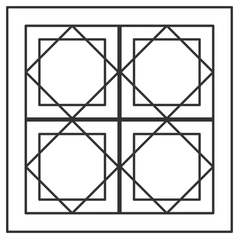

# Frame-Band-Coupon (W-P1)

From bikar's pattern library: `bikar:patterns/Coupons/Frame-Band-Coupon.bkr`, in the coupons family.



The file drawn at its default knobs.

## What the file says

```text
Frame-Band-Coupon (W-P1) — the band ladder that settles CAL-FRM-01.

What is at stake is not a fit, it is a proportion: does a band this wide
read as a deliberate margin, or as a wall that ran out of tiles? Nothing
in the mesh gate can answer that, and no source settles it either — so it
ships as a calibration bet (CAL-FRM-01, `FRAME_BAND_MM_CAL` in
packages/core/src/kernel/wall-frame.ts) and this file is the ladder.

The tile field is held fixed at 2×2 and the *boundary* grows with the
band, so every rung shows the same art at a different margin — the
controlled comparison. Holding the boundary fixed instead would change
the tile count between rungs and compare two things at once.

The rungs are the band in mm: B06 / B12 (the shipped guess) / B20 / B30.
The ladder is built to be able to fail at both ends. If B06 already reads
as intentional, the shipped 12 is over-wide and the wall is giving up a
tile's worth of field for nothing. If B30 still reads as thin, the default
is under-scaled to the module and the number should track the module size
rather than being a constant at all.

Render one SVG per rung at 1:1 and one printable module:
  bikar render patterns/Coupons/Frame-Band-Coupon.bkr --format svg \
    --param band=6  -o W-P1-B06.svg
  (and band=12, band=20, band=30)
  bikar render patterns/Coupons/Frame-Band-Coupon.bkr --format stl \
    --check --piece FrameTile -o W-P1-FrameTile.stl

The band is not a printed part — W3 renders it as the ring between the
boundary and the field, and there is no frame geometry to slice. So the
reading is taken on four printed FrameTiles laid out on the field
spacing against each rung's SVG at 1:1: the plastic supplies the tile's
real depth and sheen, the paper supplies the margin under test.
```

## Knobs

| Knob | Default | Range |
|---|---|---|
| `band` | 12 | 4..40 |

<!-- written by hand below this line; the sync tool stops here -->

## Notes

Nothing written by hand yet.
