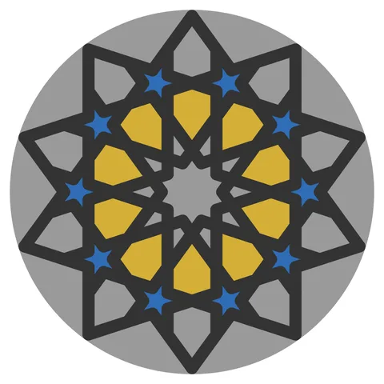

# Loose-Fit-Coupon

From bikar's pattern library: `bikar:patterns/Coupons/Loose-Fit-Coupon.bkr`, in the coupons family.



The file drawn at its default knobs.

## What the file says

```text
Loose-Fit-Coupon — sampler sheet 4: the gap a loose piece needs.

The gBV coaster (gBV_JTt3Kxk, CS-13) as the backed frame of the loose-pieces
design (F1: a solid slab, the straps standing on it, a pocket in every cell),
with two of its rings as loose pieces. The frame prints once; the pieces are
rendered once per gap, each set its own plate item, so one frame takes the
whole ladder.

  --piece Frame   the frame, one per sheet
  --piece Hex     orbit 2: the ten six-sided pieces of the middle ring, the
                  ring the gaps are read on (GAP 05, 10, 15, 20)
  --piece Star    orbit 3: the ten small five-point stars, at the default gap
                  only (STAR 15), to see whether the tips catch

Rings and orbits from `bikar bands` on the gBV coaster: orbit 2 is ten
hexagons at radius 19.9 mm, orbit 3 ten 10-sided stars at 28.3 mm.

The gap is the clearance a piece is moved in by on every face, all of it off
the piece, so the pocket keeps the drawn shape and the frame is the same at
every gap. The default 0.15 mm is the sliding step of CAL-FIT-01; the ladder
the sheet asks is 0.05, 0.10, 0.15, 0.20 (loose-pieces design, call 4, still
open). The real coaster's numbers are kept, size 90 and strap 3, so a gap read
here is read on the pieces the gBV coaster will have. Only the slab is thinner
than the coaster's, to save plastic; the fit is in the 1.2 mm pocket above it.

What sheets-04 showed (2026-10-02): its pieces were set into the baseless gBV
minimal coaster, a frame with no floor, and at every gap from 0.05 to 0.20
they fell right through. A frame with no floor holds a piece by friction
alone, so the gap now goes below zero: under 0 the piece is larger than its
hole, a press fit (CAL-FIT-01's press step is -0.10). And `height` makes the
pieces as tall as that coaster (4 mm, flush with its top), so more of each
wall is true size rather than the squashed first layers.

  bikar render patterns/Coupons/Loose-Fit-Coupon.bkr --format stl --check \
    --piece Hex --param height=4 --param gap=-0.05 -o out/hex-m05.stl

Design: 3d-models/docs/design/coaster/sampler-sheets-design.md §3, sheet 4,
and 3d-models/docs/design/coaster/loose-pieces-design.md §3.6.
Plate page: 3d-models/docs/design/plates/sheets-04.md.

The construction below is patterns/Constructions/gBV_JTt3Kxk-minimal-coaster.bkr
from its blueprint to the end of its pattern, copied unchanged (bikar
70df233); only the palette is added to the pattern.

Render:
  bikar render patterns/Coupons/Loose-Fit-Coupon.bkr --format stl --check \
    --piece Hex --param gap=0.05 -o out/gap-05.stl
```

## Knobs

| Knob | Default | Range |
|---|---|---|
| `size` | 90 | 80..120 |
| `strap` | 3 | 1.6..3.5 |
| `slab` | 2 | 1.4..4 |
| `height` | 1.2 | 1.2..4 |
| `gap` | 0.15 | -0.15..0.5 |
| `star_gap` | 0.15 | -0.15..0.5 |
| `peak` | 0 | 0..8 |
| `unit` | ($size | any |

<!-- written by hand below this line; the sync tool stops here -->

## Notes

Nothing written by hand yet.
