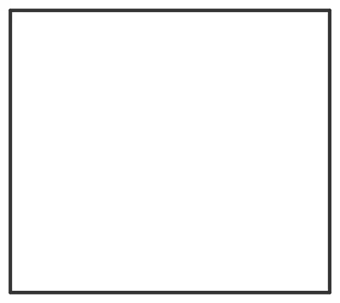

# Sampler-Cards

From bikar's pattern library: `bikar:patterns/Coupons/Sampler-Cards.bkr`, in the coupons family.



The file drawn at its default knobs.

## What the file says

```text
Sampler-Cards — the labeled cards the sampler sheets stand on.

A sampler sheet is one flat card with 30 mm windows of real 90 mm
coasters standing on it in a grid: rows are the values of one
technique, columns are shape subsets. The card carries every label,
engraved; nothing is engraved on a sample, so a label can never change
the thing being judged. The values behind each code live on the
sheet's review page in 3d-models (docs/design/plates/sheets-NN.md).

Design: 3d-models/docs/design/coaster/sampler-sheets-design.md §3-§5.
The samples are not in this file. Each is its coaster's own file
rendered with `--window 30@<x>,<y>` (bikar #293), and the bambu tool's
sheet plate stands it on its cell, so a sample cannot drift from its
coaster.

LAYOUT (mm, card centred on the origin, +y up). Three rows of 34 mm
cells under a 12 mm title band and an 8 mm column-head band, with a
32 mm row-code column on the left and a 4 mm margin on the right:

  card            138 x 122, thickness $card_t
  column centres  x = -20, 14, 48
  row centres     y = 24, -10, -44
  row codes       centred at x = -53

Sheet 2 has four rows, so its card is 34 mm taller (138 x 156), still
centred on the origin: title at y = 72, column heads at 62, row centres
y = 41, 7, -27, -61. The columns are the same.

The bambu sheet plate reads the same numbers from the sheet's plate
file; change one and change the other.

ROW D is left off sheets 1 and 5 on purpose. Sheet 1's D FINE needs a
grid-size option and sheet 5's D PIECE a piece-height option; neither
exists, and a labeled empty row would read as a sample that failed.
When one lands, that card grows a row (+34 mm in y), as sheet 2's did.

LABEL LIMITS. The face has capitals, digits, the dash and the space,
and no full stop, so a code names the row and the review page gives
the number. Under --check bikar blocks a label that mixes the letter O
with the zero.

Render:
  bikar render patterns/Coupons/Sampler-Cards.bkr --format stl --check \
    --piece Sheet1Card -o out/sheet-1-card.stl
```

## Knobs

| Knob | Default | Range |
|---|---|---|
| `card_t` | 1.4 | 1.2..3 |

<!-- written by hand below this line; the sync tool stops here -->

## Notes

Nothing written by hand yet.
