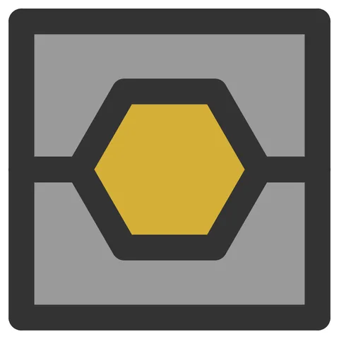

# Split-Trap-Coupon

From bikar's pattern library: `bikar:patterns/Coupons/Split-Trap-Coupon.bkr`, in the coupons family.



The file drawn at its default knobs.

## What the file says

```text
Split-Trap-Coupon — SPL-1: does a lip keep a loose piece in a split coaster?

A split coaster's loose pieces sit between its two halves, each half
narrowing the pocket by a lip at its outside face, so the glued coaster
holds them in from both sides (3d-models
docs/design/pieces/split-with-studs-design.md §9, §11, option A). This
coupon is one square tile with a single hexagonal piece trapped in the
middle, so a pair asks the four things the design leaves to the hand:
does the piece drop in without a push, does the pair close flat over it,
does it rattle when shaken, and does the lip hold when the piece is pushed
hard against it with a thumb.

Three parts, each printed flat:
  Lower  the bottom half, studs standing on its cut face.
  Upper  the top half, sockets in its cut face.
  Piece  the hexagon, 0.25 mm smaller than its pocket on every side.

The plate prints two pairs, at room 0 (a 3.2 mm piece, as tall as the
cavity) and room 0.2 (a 3.0 mm piece, which can rattle):

  bikar render patterns/Coupons/Split-Trap-Coupon.bkr --piece Lower \
    --format stl --check --param room=0.2 -o out/spl1-trap-lower.stl
  bikar render patterns/Coupons/Split-Trap-Coupon.bkr --piece Upper \
    --format stl --check --param room=0.2 -o out/spl1-trap-upper.stl
  bikar render patterns/Coupons/Split-Trap-Coupon.bkr --piece Piece \
    --format stl --check --param room=0.2 -o out/spl1-trap-piece-02.stl

`pair` is the pair's letter, cut into both cut faces, the lower half reading
<letter>B and the upper <letter>T, so the halves of one pair find each other
off the bed (3d-models feedback page 2026-10-06, Omar: "every prototype should
have an id"). The plate's bed map says which room each letter is.

The halves do not change with room, only the piece does. The third pair
the design asks for, a kite opening copied from gBV to see how blunt its
36° tip looks behind the lip, comes later.

LAYOUT (mm, centred on the origin): a square of side 23 (a circle of radius
16.2635 cut into four, turned 45°), plus a 2 mm strap round it, so 25 × 25.
4.4 tall, cut at 2.2, as the gBV split coaster is. The hexagon has
circumradius 7, points left and right, about 12.1 across its flats. The
frame round it is drawn as two faces, the halves above and below a line
from the square's left side through the hexagon's two points to its right
side, since a face cannot be a ring; both are filled, and a filled face
stays solid in a split coaster. The lip is 0.8 wide (the strap floor,
CAL-CST-01) and 0.6 thick (the deboss floor, CAL-CST-03), so the cavity is
4.4 - 2 × 0.6 = 3.2 tall and the piece overlaps each lip by 0.55. The
kernel puts studs at the roomiest points of the cut face, which lie on the
diagonals about 10.5 mm out from the centre; `spacing 20` keeps two of the
four, on opposite corners (opposite ones are about 21 apart, neighbours 15).
```

## Knobs

| Knob | Default | Range |
|---|---|---|
| `room` | 0 | 0..0.2 |
| `gap` | 0.25 | 0..0.5 |
| `stud` | 2 | 1.5..3 |
| `pair` | 1 | 1..26 |

<!-- written by hand below this line; the sync tool stops here -->

## Notes

Nothing written by hand yet.
