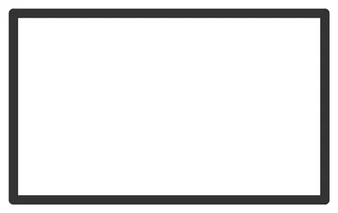

# Swatch-Chip

From bikar's pattern library: `bikar:patterns/Coupons/Swatch-Chip.bkr`, in the coupons family.



The file drawn at its default knobs.

## What the file says

```text
Swatch-Chip — one small card per filament color, its code engraved.

A swatch card shows a color as it really prints: the top surface, the
sheen, and the bed face underneath. One chip is printed per spool we own
or buy, in that spool, so the chip is the color. 3d-models decided this
on 2026-10-05 (D-105): our own printed card, not a bought sample pack,
and not tied to one brand.

The label is the filament's code, given at render time, so one file
makes every chip:

  bikar render patterns/Coupons/Swatch-Chip.bkr --format stl --check \
    --param code=10100 -o out/swatch-10100.stl

Bambu's codes are five digits (10100 is Jade White PLA Basic). A brand
with no number for its colors gets one from the 3d-models palette file,
so the label stays digits: the face has capitals, digits, the dash and
the space, and `text $code` engraves a whole number only.

LAYOUT (mm, chip centred on the origin): 50 x 30, thickness $chip_t,
the code centred and engraved 0.6 deep.
```

## Knobs

| Knob | Default | Range |
|---|---|---|
| `code` | 10100 | 0..99999 |
| `chip_t` | 2 | 1.2..4 |

<!-- written by hand below this line; the sync tool stops here -->

## Notes

Nothing written by hand yet.
