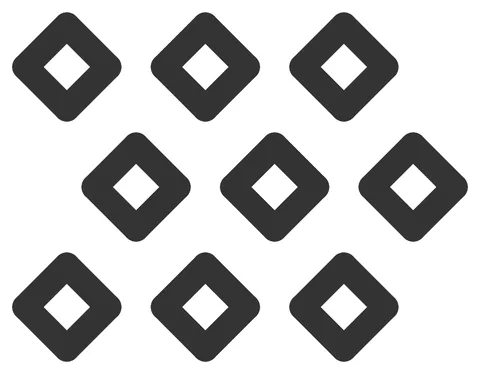

# Hex-Field-Tile

From bikar's pattern library: `bikar:patterns/Lego/Hex-Field-Tile.bkr`, in the lego family.



The file drawn at its default knobs.

## What the file says

```text
Hex-Field-Tile — the preset where the grid gate is *right* to score low.

This is `Grid-Field-Tile` with one word changed. Same diamond motif, same
cell size, same footprint class, same knobs — `mode hex` instead of
`mode rectangular`. Everything the two presets disagree about is the
lattice, which is exactly what the 3d-models design doc's §5.3 says decides
the score, so putting them side by side is the experiment.

The square one scores 1.00 at `pitch 8.0`. This one scores 0.48 there, and
the §5.3 sweep found a hexagonal basis tops out at 0.80 anywhere in
2..20 mm and never once reaches 1.0. No knob on this page fixes that.

The reason is readable straight off the geometry. The tiler's hexagonal mode
steps by `(offsetX, 0)` and `(offsetX/2, offsetY)` — the second vector
staggers odd rows by half a column. At `pitch 8.0` the first vector is
exactly one stud pitch, so that axis snaps dead on; the second carries an
x-component of 4 mm, which is *half* a pitch, which is the furthest from a
stud a point can get. One axis perfect, one axis maximally wrong, and
rotating the whole lattice cannot improve one without spoiling the other.
The 0.48 is the compromise, and the gate is reporting it honestly.

`H`'s radius sets `offsetY` to `pitch * sqrt(3)/2`, the true hexagonal row
height, so this is a real hexagonal lattice and not a squashed stand-in.

What the preset is *for*: a piece that scores low here is still a correct,
printable, clutching piece — V8 is a warning, not an error, because refusing
it would delete the hexagonal and 5-fold families from the Lab entirely.
What a low score costs is seamless extension: butt two of these edge to edge
and the art breaks at the join. That is a trade to make knowingly, and this
is where you see the number before making it.

Render:
  bikar render patterns/Lego/Hex-Field-Tile.bkr --format stl --check -o HexFieldTile.stl
  bikar render patterns/Lego/Hex-Field-Tile.bkr --format svg -o HexFieldTile.svg

Every dimension the clutch depends on is an unmeasured bet (CAL-RIB-01,
coupon LG-F1). Print the coupon before trusting the fit.
```

## Knobs

| Knob | Default | Range |
|---|---|---|
| `pitch` | 8.0 | 6.0..12.0 |
| `plates` | 3 | 2..9 |
| `engage` | 3.2 | 1.6..4.0 |
| `relief` | 0.8 | 0.8..2.0 |

<!-- written by hand below this line; the sync tool stops here -->

## Notes

Nothing written by hand yet.
