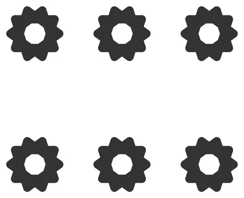

# Rational-Repeat-Tile

From bikar's pattern library: `bikar:patterns/Lego/Rational-Repeat-Tile.bkr`, in the lego family.



The file drawn at its default knobs.

## What the file says

```text
Rational-Repeat-Tile — a lattice that is not square and still lands perfectly.

It is easy to read `Grid-Field-Tile` (square, scores 1.0) beside
`Hex-Field-Tile` (hexagonal, never scores 1.0) and conclude that registering
on the stud grid means being square. It does not. What the 3d-models design
doc's §5.3 measures is the *ratio* of the two basis vectors, and any
**rational** ratio lands at the right scale — this one is 3/2.

The row vector is one and a half column vectors tall (`R`'s diameter is
`1.5 * pitch`), so the lattice steps 1 : 1.5. At `pitch 16.0` that is
16 mm × 24 mm — two studs by three — and the gate reports fit 1.0 with a
repeat unit of **3 × 2 studs**. Not a square cell, and a perfect score.

This matters beyond the arithmetic. The design doc's v1 claimed 5-/10-fold
designs can never register, which is false: those patterns are periodic and
many of them have a rectangular repeat unit — Cromwell describes a decagonal
design whose rose centres are opposite corners of a rectangle that repeats.
The thing that actually blocks a lattice is an *irrational* ratio, and the
irrational in the 5-fold case is cot 36° = 1.3764, not the golden ratio it is
usually blamed on. A 10-fold motif on a rational rectangular repeat is a
perfectly registerable brick.

Drag `pitch` and watch the score fall off and come back: the sweet spots are
periodic, not unique. That is the other thing this preset is here to show —
a sweep window that happens to straddle none of them draws a flat curve for
a lattice that registers exactly.

Render:
  bikar render patterns/Lego/Rational-Repeat-Tile.bkr --format stl --check -o RationalRepeatTile.stl
  bikar render patterns/Lego/Rational-Repeat-Tile.bkr --format svg -o RationalRepeatTile.svg

Every dimension the clutch depends on is an unmeasured bet (CAL-RIB-01,
coupon LG-F1). Print the coupon before trusting the fit.
```

## Knobs

| Knob | Default | Range |
|---|---|---|
| `pitch` | 16.0 | 8.0..20.0 |
| `plates` | 3 | 2..9 |
| `engage` | 3.2 | 1.6..4.0 |
| `relief` | 0.8 | 0.8..2.0 |

<!-- written by hand below this line; the sync tool stops here -->

## Notes

Nothing written by hand yet.
