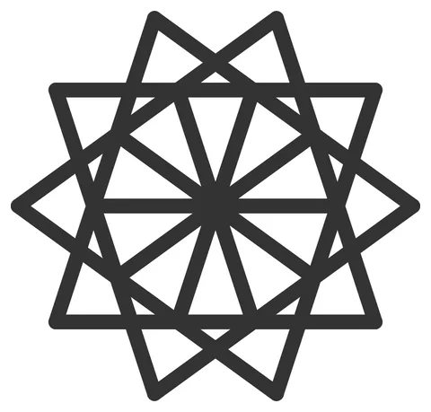

# Rosette-Brick

From bikar's pattern library: `bikar:patterns/Lego/Rosette-Brick.bkr`, in the lego family.



The file drawn at its default knobs.

## What the file says

```text
Rosette-Brick — LG-B2's coupon: a ten-fold rosette (the five-fold girih
family) whose *silhouette* is the piece, sitting on a square lattice it
does not obey. The load-bearing bet of the anchor-only approach: a printed
piece's outline need not follow the grid so long as its interface does.

`footprint outline` takes the body from the pattern's face union — here
the fully tiled rosette disc, whose boundary is the 20-vertex scalloped
ring through the kite tips (radius R) and the mid-ring shoulders
(~0.727·R). Measured on the shipped rosette corpus 2026-08-02: one
edge-connected component (V19 passes by construction) and a sharpest
convex angle of 72° at the tips — three times the ≈23.1° miter-clamp
floor, so the V18 wall check passes with no cusp-rounding.

There is deliberately no `relief depth`. On this piece the silhouette IS
the art; a relief would union every bounded face into one pocket — the
whole disc — and sink the entire top face uniformly, which is a recess,
not a pattern.

Coverage arithmetic, at the default radius 20: the body's closest
approach to centre is the shoulder ring at ~14.5 mm; the 5×5 centred
grid's centre cell and its four edge-neighbours have far corners at
≤ 12.7 mm, so five lattice cells are fully covered (the anchor gate
needs two) and the tube anchors land in them. At the range floor of 18
the same five cells clear by ~0.4 mm — below that the edge cells' far
corners poke past the shoulders and the gate rightly refuses.

Render:
  bikar render patterns/Lego/Rosette-Brick.bkr --format stl --check -o RosetteBrick.stl
  bikar render patterns/Lego/Rosette-Brick.bkr --format svg -o RosetteBrick.svg

What the print settles (both registered, both LG-B2): CAL-ANC-01 — the
retention ratio of an anchor-only body against a rectangular control at
the same profile; CAL-INW-01 — printed integrity of the 1.5 mm inset
cavity wall following a concave lobed outline. Until then every clutch
number here is provisional.

Construction is Rosette-10.bkr's wedge-and-rotate (after Sarah Brewer's
10-fold tutorial), parameterized: skip-3 chords of a decagon intersect in
the inner (R/φ) and middle (~0.727·R) rings, and three rotated cycles —
outer kites, inter-petal triangles, inner spokes — tile the disc.
```

## Knobs

| Knob | Default | Range |
|---|---|---|
| `radius` | 20 | 18..40 |
| `plates` | 3 | 2..6 |

<!-- written by hand below this line; the sync tool stops here -->

## Notes

Nothing written by hand yet.
