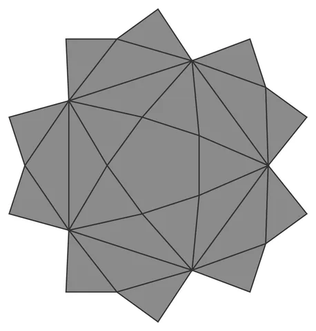

# Dodeca-Orb

From bikar's pattern library: `bikar:patterns/Orbs/Dodeca-Orb.bkr`, in the orbs family.



The orb seen straight on to one face.

## What the file says

```text
Dodeca-Orb — dodecahedral pierced-lattice sphere with a 5-fold star.
Each of the 12 pentagonal faces (pattern circumradius 100, corners at
90 + k*72 deg CCW) carries a corner-to-corner pentagram {5/2}: every
strut ends on a face corner or runs along a face edge, both shared with
the neighboring faces, so the lattice closes watertight (11 voids per
face: 5 star tips + 5 edge regions + the central pentagon).
Render with: bikar render Dodeca-Orb.bkr --format stl -o out.stl
```

## Knobs

| Knob | Default | Range |
|---|---|---|
| `radius` | 60 | 40..110 |
| `strut_width` (advanced) | 3 | 1.5..6 |
| `strut_depth` (advanced) | 2.4 | 1.2..4 |

<!-- written by hand below this line; the sync tool stops here -->

## Notes

Nothing written by hand yet.
