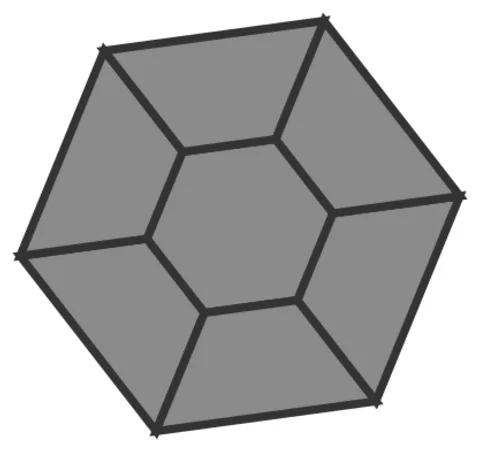

# Donut-Hex-Orb

From bikar's pattern library: `bikar:patterns/Orbs/Donut-Hex-Orb.bkr`, in the orbs family.



The orb seen straight on to one face.

## What the file says

```text
Donut-Hex-Orb — one round pattern placed on a sphere (round-pattern orb, v1).

WHAT THIS IS. Most orbs tile a POLYGON pattern across every face of a solid.
Some patterns aren't polygon-shaped, they're ROUND — a rosette, a wheel. You
can't tile a sphere with discs, but you can drop one at a chosen site and let
its rim close into a watertight cap. This is the simplest witness of that new
path: `base sphere` + `place rule`, placing THIS disc — not a kernel-generated
wheel — at one dodecahedron 3-fold vertex.

THE DISC — a "donut hexagon". A central hexagon void (C1) ringed by six
trapezoids out to the boundary (C0). Every interior edge is shared by exactly
two voids; only the six outer edges are exposed, and the rim wall closes them.

THE PLACEMENT LAW. A pattern with Cn rotational symmetry may be centred on a
k-fold axis IFF k | n. The donut hexagon has six outer contacts ⇒ C6, and a
dodecahedron vertex is a 3-fold axis; 3 | 6, so it is a legal candidate. (A
square disc — C4 — would be refused, naming both numbers: 4 % 3 ≠ 0.)

HOW THE PLACER FINDS THE RIM. The `contact .weld_ring` clause names the class
tagged onto the outer cycle; the placer reads those tagged points as the weld
ring and lands them at the cap edge. Declared, never guessed (Tenet 23).

Render:  bikar render Donut-Hex-Orb.bkr --format stl -o out.stl
See:     3d-models docs/design/orb/round-orb-placement-design.md ; bikar#98.
```

## Knobs

The file has no knobs: it draws one fixed pattern.

<!-- written by hand below this line; the sync tool stops here -->

## Notes

Nothing written by hand yet.
