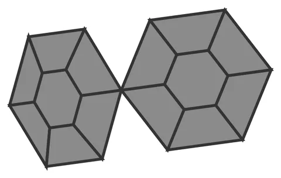

# Donut-Hex-Weld

From bikar's pattern library: `bikar:patterns/Orbs/Donut-Hex-Weld.bkr`, in the orbs family.



The orb seen straight on to one face.

## What the file says

```text
Donut-Hex-Weld — two round patterns at adjacent sites, fused (round-pattern orb, v1).

WHAT THIS IS. The whole round-pattern feature in miniature: two donut hexagons
(see Donut-Hex-Orb.bkr for the disc) placed at two EDGE-ADJACENT dodecahedron
vertices, each aiming a rim contact at the other. The `sites 2` clause asks the
rule for its adjacent pair; a shared VertexPool fuses their facing tips into one
welded vertex. That single shared vertex is the proof — it is what "the discs
touch and weld" means, made concrete.

WHAT THE STUDIO OVERLAY SAYS. `2 sites · 1 weld`. Two discs placed; one pair of
contacts fused. Measurements, never a verdict — a reviewer confirms the weld by
eye; the numbers just report what the placer counted.

ON WATERTIGHTNESS. Each cap closes on its own (capsWatertight = true). Their
UNION is deliberately a non-manifold pinch at the shared tip — the two rim walls
meet at one edge with no filler between them. Fillers (a closed two-body shell)
are the explicit follow-on, not v1; v1 proves the WELD, not a printable union.
So the studio reports `watertight` from the per-cap flag, and `--format stl`'s
aggregate mesh gate is not the gate that certifies this pair.

See:  3d-models docs/design/orb/round-orb-placement-design.md ; bikar#98 (Phase 1).
```

## Knobs

The file has no knobs: it draws one fixed pattern.

<!-- written by hand below this line; the sync tool stops here -->

## Notes

Nothing written by hand yet.
