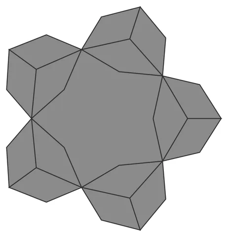

# Hankin-Orb

From bikar's pattern library: `bikar:patterns/Orbs/Hankin-Orb.bkr`, in the orbs family.



The orb seen straight on to one face.

## What the file says

```text
Hankin-Orb — dodecahedral polygons-in-contact star sphere (Kaplan 2005,
Bonner's Hankin method). Each pentagonal face launches two rays from
every edge midpoint at the contact angle theta to the edge; adjacent
rays intersect to form a five-pointed central star with kite cells at
the corners. The contact points are the edge midpoints — shared with
the neighboring face — so the lattice closes watertight across every
edge for any theta in the calibrated range.
Render with: bikar render Hankin-Orb.bkr --format stl -o out.stl
Sweep the star: bikar render Hankin-Orb.bkr --format stl --param theta=36 -o out.stl
```

## Knobs

| Knob | Default | Range |
|---|---|---|
| `radius` | 60 | 40..110 |
| `theta` | 54 | 18..80 |
| `strut_width` (advanced) | 3 | 1.5..6 |
| `strut_depth` (advanced) | 2.4 | 1.2..4 |

<!-- written by hand below this line; the sync tool stops here -->

## Notes

Nothing written by hand yet.
