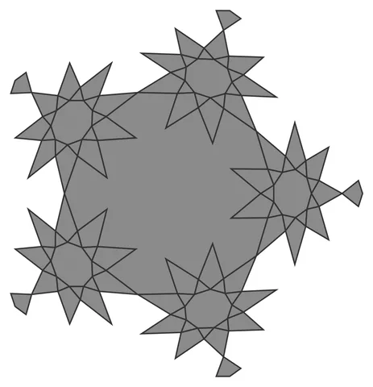

# Maclado-9-Weave

From bikar's pattern library: `bikar:patterns/Orbs/Maclado-9-Weave.bkr`, in the orbs family.



The orb seen straight on to one face.

## What the file says

```text
Maclado-9-Weave — the 9-spike maclado field as woven ribbons (Family 1
treatment of the Family 3 field). The welded seam graph has 390
degree-4 crossings and 120 degree-2 free tips; every strand closes with
an even crossing count, so strict alternation is globally consistent —
46 linked ribbon loops. See 3d-models docs/design/orb/maclado-orb-design.md §5.4.
Render with: bikar render Maclado-9-Weave.bkr --format stl -o out.stl
```

## Knobs

| Knob | Default | Range |
|---|---|---|
| `radius` | 60 | 40..110 |
| `amplitude` | 1.6 | 1.6..2.0 |
| `ribbon_width` (advanced) | 1.2 | 0.8..2 |
| `ribbon_depth` (advanced) | 1.2 | 0.8..2 |

<!-- written by hand below this line; the sync tool stops here -->

## Notes

Nothing written by hand yet.
