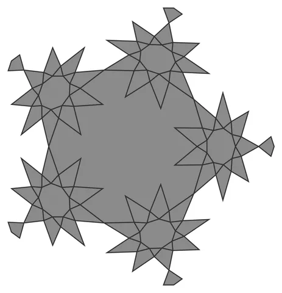

# Maclado-9

From bikar's pattern library: `bikar:patterns/Orbs/Maclado-9.bkr`, in the orbs family.



The orb seen straight on to one face.

## What the file says

```text
Maclado-9 — the 9-spike "maclado" wheel field (Family 3).
Ángel María Martín López's nine-fold wheel, placed by the divisor trick:
a 9-point wheel is C3-invariant (3 | 9), so its centre may sit on a
3-fold icosahedral axis — the 20 dodecahedron vertices — and 120 = 3·40
aligns one tip at all three neighbours at once, making the 30
dodecahedral edges exact tip-to-tip joins with 12 congruent 30-gon
fillers. See 3d-models docs/design/orb/maclado-orb-design.md (§2, corrected).
Render with: bikar render Maclado-9.bkr --format stl -o out.stl
```

## Knobs

| Knob | Default | Range |
|---|---|---|
| `radius` | 60 | 40..110 |
| `strut_width` (advanced) | 2 | 1.5..2.5 |
| `strut_depth` (advanced) | 2.4 | 1.2..4 |

<!-- written by hand below this line; the sync tool stops here -->

## Notes

Nothing written by hand yet.
