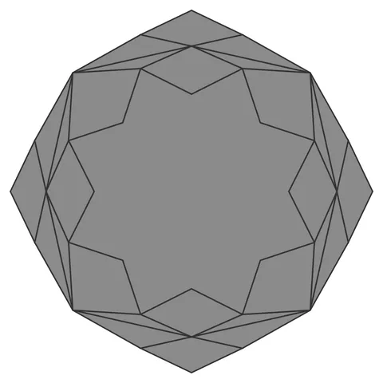

# Rosette-Cube-Orb

From bikar's pattern library: `bikar:patterns/Orbs/Rosette-Cube-Orb.bkr`, in the orbs family.



The orb seen straight on to one face.

## What the file says

```text
Rosette-Cube-Orb — cubic 8-petal rosette sphere.
The same rosette construction as Rosette-Orb on the cube's 6 square
faces: 8 kite petals per face reaching all 4 corners and all 4 edge
midpoints (both shared with the neighboring faces), joined
shoulder-to-shoulder so their inner edges zigzag into an 8-pointed
star core. 17 voids per face: 8 petals + 8 boundary cells + the
pierced star core.
Render with: bikar render Rosette-Cube-Orb.bkr --format stl -o out.stl
```

## Knobs

| Knob | Default | Range |
|---|---|---|
| `radius` | 60 | 40..110 |
| `inner` | 38 | 16..58 |
| `shoulder` | 60 | 48..76 |
| `strut_width` (advanced) | 3 | 1.5..6 |
| `strut_depth` (advanced) | 2.4 | 1.2..4 |

<!-- written by hand below this line; the sync tool stops here -->

## Notes

Nothing written by hand yet.
