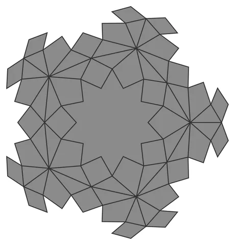

# Rosette-Orb

From bikar's pattern library: `bikar:patterns/Orbs/Rosette-Orb.bkr`, in the orbs family.



The orb seen straight on to one face.

## What the file says

```text
Rosette-Orb — dodecahedral 10-petal rosette sphere.
Each of the 12 pentagonal faces carries a classical rosette: 10 kite
petals reaching all 5 corners and all 5 edge midpoints (both shared
with the neighboring faces, so the lattice closes watertight), joined
shoulder-to-shoulder on a ring so their inner edges zigzag into a
10-pointed star core. 21 voids per face: 10 petals + 10 boundary
cells + the pierced star core.
Render with: bikar render Rosette-Orb.bkr --format stl -o out.stl
Sweep a knob: bikar render Rosette-Orb.bkr --format stl --param inner=50 -o out.stl
```

## Knobs

| Knob | Default | Range |
|---|---|---|
| `radius` | 60 | 40..110 |
| `inner` | 38 | 16..58 |
| `shoulder` | 60 | 48..76 |
| `strut_width` (advanced) | 3 | 1.5..6 |
| `strut_depth` (advanced) | 2.4 | 1.2..4 |

<!-- written by hand below this line; the sync tool stops here -->

## Notes

Nothing written by hand yet.
