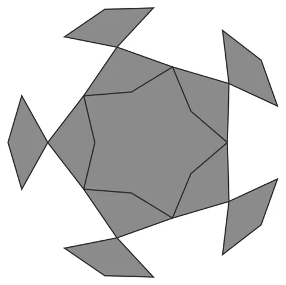

# Rosette-Weave-Orb

From bikar's pattern library: `bikar:patterns/Orbs/Rosette-Weave-Orb.bkr`, in the orbs family.



The orb seen straight on to one face.

## What the file says

```text
Rosette-Weave-Orb — dodecahedral woven flower sphere (Family 1).
Each pentagonal face carries only 5 midpoint kite petals chained
through shoulders placed under the corners (no face-boundary edges and
no corner petals — those would make odd-degree nodes, which cannot
weave). Petals fuse across edge midpoints and around shoulder points,
and strand tracing threads them into 10 closed ribbons that interlace
alternately into a linked chainmail flower-ball: all 45 ribbon pairs
have linking number 1, so nothing can be pulled off the assembly.
Render with: bikar render Rosette-Weave-Orb.bkr --format stl -o out.stl
```

## Knobs

| Knob | Default | Range |
|---|---|---|
| `radius` | 60 | 40..110 |
| `inner` | 38 | 24..50 |
| `shoulder` | 60 | 48..70 |
| `amplitude` | 2.0 | 2.0..2.6 |
| `strut_width` (advanced) | 3 | 1.5..6 |
| `strut_depth` (advanced) | 2.4 | 1.2..4 |

<!-- written by hand below this line; the sync tool stops here -->

## Notes

Nothing written by hand yet.
