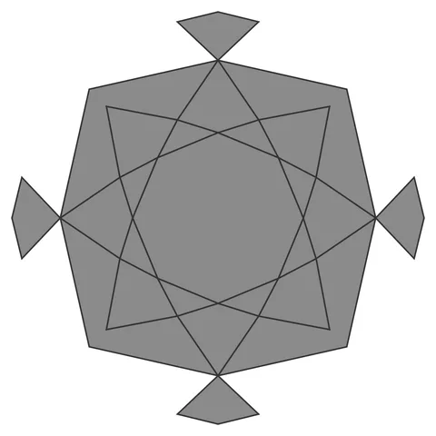

# Star-Cube-Orb

From bikar's pattern library: `bikar:patterns/Orbs/Star-Cube-Orb.bkr`, in the orbs family.



The orb seen straight on to one face.

## What the file says

```text
Star-Cube-Orb — cubic pierced-lattice sphere with an {8/3} octagram.
Each of the 6 square faces carries an eight-pointed star whose tips sit
on the face's inradius circle: 4 land exactly on the edge midpoints
(shared with the neighboring faces) and 4 under the corners, so the
lattice closes watertight across every edge.
Render with: bikar render Star-Cube-Orb.bkr --format stl -o out.stl
```

## Knobs

| Knob | Default | Range |
|---|---|---|
| `radius` | 60 | 40..110 |
| `strut_width` (advanced) | 3 | 1.5..6 |
| `strut_depth` (advanced) | 2.4 | 1.2..4 |

<!-- written by hand below this line; the sync tool stops here -->

## Notes

Nothing written by hand yet.
