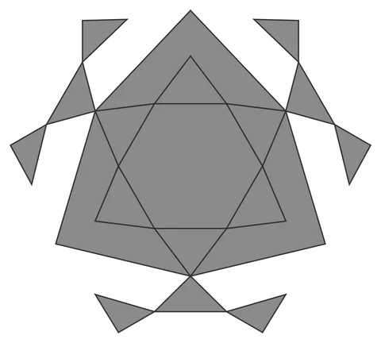

# Star-Octa-Orb

From bikar's pattern library: `bikar:patterns/Orbs/Star-Octa-Orb.bkr`, in the orbs family.



The orb seen straight on to one face.

## What the file says

```text
Star-Octa-Orb — octahedral pierced-lattice sphere with a {6/2} hexagram.
The same canonical triangle-face hexagram as Star-Orb, on the
octahedron's 8 faces: alternating tips land exactly on the triangle's
edge midpoints, so the lattice connects across every face boundary and
the shell closes watertight. Fewer, larger faces than the icosahedral
Star-Orb give a bolder, more open star field.
Render with: bikar render Star-Octa-Orb.bkr --format stl -o out.stl
```

## Knobs

| Knob | Default | Range |
|---|---|---|
| `radius` | 60 | 40..110 |
| `strut_width` (advanced) | 3 | 1.5..6 |
| `strut_depth` (advanced) | 2.4 | 1.2..4 |

<!-- written by hand below this line; the sync tool stops here -->

## Notes

Nothing written by hand yet.
