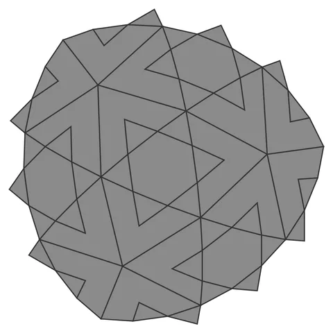

# Star-Orb

From bikar's pattern library: `bikar:patterns/Orbs/Star-Orb.bkr`, in the orbs family.



The orb seen straight on to one face.

## What the file says

```text
Star-Orb — icosahedral pierced-lattice sphere (the M0 spike, in DSL).
Each of the 20 triangular faces carries a {6/2} hexagram whose
alternating tips land exactly on the triangle's edge midpoints, so the
lattice connects across every face boundary and the shell closes
watertight. Render with: bikar render Star-Orb.bkr --format stl -o out.stl
```

## Knobs

| Knob | Default | Range |
|---|---|---|
| `radius` | 60 | 40..110 |
| `strut_width` (advanced) | 3 | 1.5..6 |
| `strut_depth` (advanced) | 2.4 | 1.2..4 |

<!-- written by hand below this line; the sync tool stops here -->

## Notes

Nothing written by hand yet.
