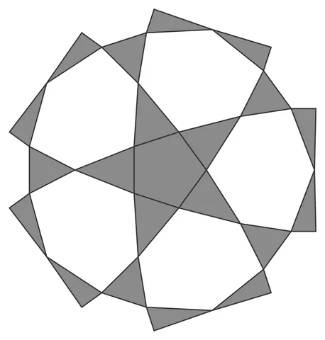

# Weave-Dodeca-Orb

From bikar's pattern library: `bikar:patterns/Orbs/Weave-Dodeca-Orb.bkr`, in the orbs family.



The orb seen straight on to one face.

## What the file says

```text
Weave-Dodeca-Orb — dodecahedral woven pentagram sphere (Family 1).
Each pentagonal face carries only a {5/2} pentagram connecting the 5
edge midpoints (no face-boundary edges — those would make odd-degree
nodes, which cannot weave). Midpoints are degree 2 in-face and weld to
degree 4 across the edge, so strand tracing runs each chord straight
through into the neighboring face, closing the lattice into ribbons
that interlace alternately — a linked chainmail star-ball.
Render with: bikar render Weave-Dodeca-Orb.bkr --format stl -o out.stl
```

## Knobs

| Knob | Default | Range |
|---|---|---|
| `radius` | 60 | 40..110 |
| `amplitude` | 2.2 | 2.2..2.6 |
| `strut_width` (advanced) | 3 | 1.5..6 |
| `strut_depth` (advanced) | 2.4 | 1.2..4 |

<!-- written by hand below this line; the sync tool stops here -->

## Notes

Nothing written by hand yet.
