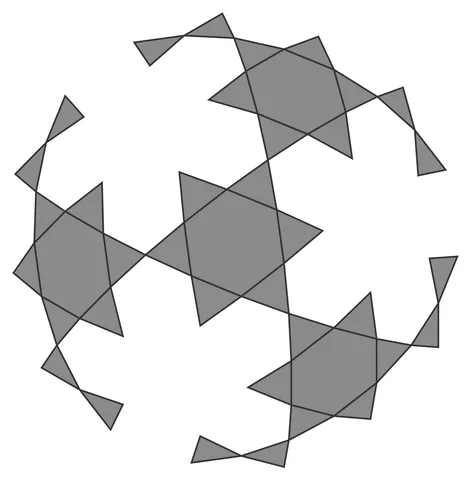

# Weave-Orb

From bikar's pattern library: `bikar:patterns/Orbs/Weave-Orb.bkr`, in the orbs family.



The orb seen straight on to one face.

## What the file says

```text
Weave-Orb — icosahedral woven-strapwork sphere (Family 1).
Each face carries only the {6/2} hexagram (no face-boundary edges — those
would make degree-6 nodes, which cannot weave). The hexagram's medial
triangle connects the face's edge midpoints, so its edges run straight
through into adjacent faces and close into 6 great-circle ribbons (the
icosidodecahedron's equators); the other triangle stays interior, giving
20 small triangular ribbons. All 26 ribbons interlace alternately into
a genuinely linked chainmail ball: every one of the 75 ribbon pairs has
linking number 1, so nothing can be pulled off the assembly.
Render with: bikar render Weave-Orb.bkr --format stl -o out.stl
```

## Knobs

| Knob | Default | Range |
|---|---|---|
| `radius` | 60 | 40..110 |
| `amplitude` | 2.6 | 2.6..3.0 |
| `strut_width` (advanced) | 3 | 1.5..6 |
| `strut_depth` (advanced) | 2.4 | 1.2..4 |

<!-- written by hand below this line; the sync tool stops here -->

## Notes

Nothing written by hand yet.
