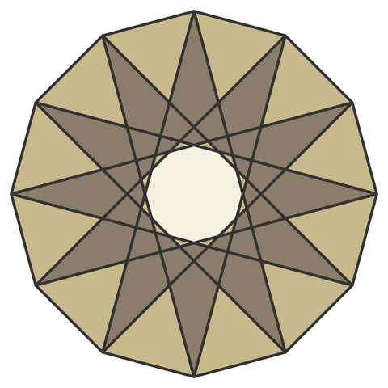

# Flower of Life Rosette

From bikar's pattern library: `bikar:patterns/Rosettes/Flower-Rosette.bkr`, in the rosettes family.



The file drawn at its default knobs.

## What the file says

```text
Flower of Life Rosette
Classic construction: 12-point star {12/5} inside dodecagon
Produces kites and triangles like the Topkapi Scroll patterns
```

## Knobs

The file has no knobs: it draws one fixed pattern.

<!-- written by hand below this line; the sync tool stops here -->

## Notes

Nothing written by hand yet.
