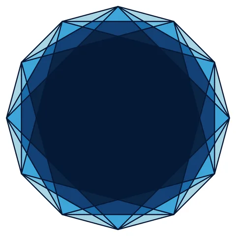

# Ocean Rosette

From bikar's pattern library: `bikar:patterns/Rosettes/Ocean-Rosette.bkr`, in the rosettes family.



The file drawn at its default knobs.

## What the file says

```text
Ocean Rosette — radiating blue fill animation
Technique: 12-fold rosette with style + animate blocks
Reference: classic 12-point rosette, ocean blue palette

A 12-point rosette colored in ocean blues that pulse
outward from the center ring by ring. Demonstrates
the style block with ring-based selectors and the
animate block with delay_per_ring for radiating effect.
```

## Knobs

The file has no knobs: it draws one fixed pattern.

<!-- written by hand below this line; the sync tool stops here -->

## Notes

Nothing written by hand yet.
