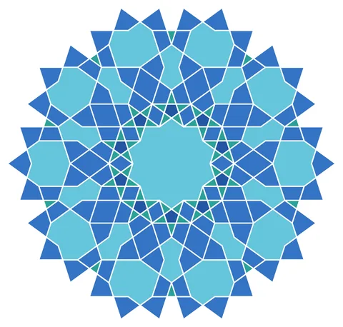

# 10-fold Rosette Ring

From bikar's pattern library: `bikar:patterns/Rosettes/Rosette-10-Ring.bkr`, in the rosettes family.



The file drawn at its default knobs.

## What the file says

```text
10-fold Rosette Ring — Simplified petal-only surround

Technique: Surround tiling with outer-kite-only rosette
Reference: Moroccan zellige with interlocking decagonal rosettes

A stripped-down version using only the outer kite cycle (no inner
triangles or star spokes). The surround at golden-ratio spacing
(R*phi = 161.8) interlocks the kite petals between neighbors.
```

## Knobs

The file has no knobs: it draws one fixed pattern.

<!-- written by hand below this line; the sync tool stops here -->

## Notes

Nothing written by hand yet.
