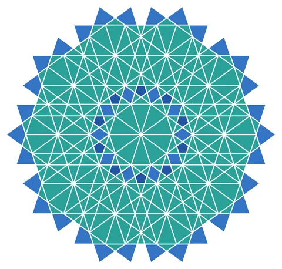

# 10-fold Rosette Tiled

From bikar's pattern library: `bikar:patterns/Rosettes/Rosette-10-Tiled.bkr`, in the rosettes family.



The file drawn at its default knobs.

## What the file says

```text
10-fold Rosette Tiled — Ring (surround) arrangement

Technique: Surround tiling — 1 center + 10 copies in a ring
Reference: Moroccan zellige with interlocking decagonal rosettes

The base rosette uses skip-3 construction lines whose intersections
define inner (r=R/phi) and middle (r~72.65) concentric rings.
Three rotated wedge cycles build the petals, inter-petal triangles,
and inner star spokes.

Tiling:
  Ring radius from cpt3 to cpt0 = R*phi = 161.8 (golden ratio!)
  At this spacing, adjacent rosettes' outer kite petals
  interlock, creating the zellige effect.
```

## Knobs

The file has no knobs: it draws one fixed pattern.

<!-- written by hand below this line; the sync tool stops here -->

## Notes

Nothing written by hand yet.
