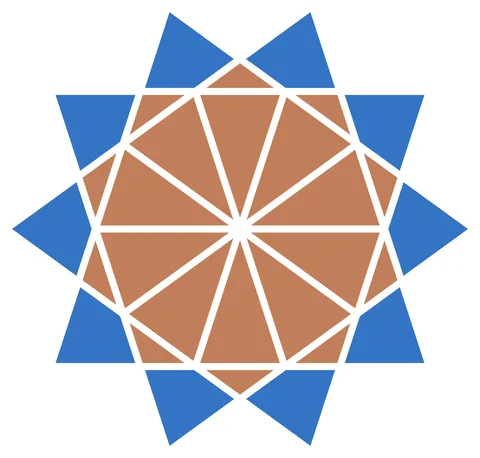

# 10-fold Rosette

From bikar's pattern library: `bikar:patterns/Rosettes/Rosette-10.bkr`, in the rosettes family.



The file drawn at its default knobs.

## What the file says

```text
10-fold Rosette — after Sarah Brewer tutorial

Technique: Wedge-and-rotate from construction line intersections
Reference: Sarah Brewer, "10-fold Rosette Tutorial" (mathemartiste.com)

Construction:
  1. Circle C0 divided into 10 — defines the outer ring of vertices
  2. 10 skip-3 construction lines (L0-L9): each connects cpt[i] to cpt[i+3]
  3. Line-line intersections form two concentric rings:
     - Inner ring (r ~ 61.80 = R/phi) — 10 pts aligned with division angles
       e.g. L9_L8.cpt0 at 0deg, L9_L0.cpt0 at 36deg, L1_L0.cpt0 at 72deg ...
     - Middle ring (r ~ 72.65) — 10 pts offset 18deg from division angles
       e.g. L8_L0.cpt0 at 18deg, L9_L1.cpt0 at 54deg, L2_L0.cpt0 at 90deg ...
  4. The golden ratio appears naturally: inner_r / R = 1/phi ~ 0.618

Pattern assembly (3 rotated wedge cycles):
  - Outer kites: circumference -> mid ring -> inner ring -> mid ring (4-gon)
  - Inter-petal triangles: mid ring -> inner ring -> next mid ring (3-gon)
  - Inner spokes: inner ring -> center -> next inner ring (3-gon)
Each cycle is rotated 10x around the center to complete the rosette.
```

## Knobs

The file has no knobs: it draws one fixed pattern.

<!-- written by hand below this line; the sync tool stops here -->

## Notes

Nothing written by hand yet.
