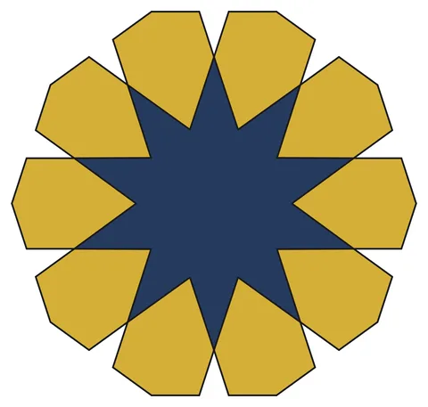

# Rosette N

From bikar's pattern library: `bikar:patterns/Rosettes/Rosette-N.bkr`, in the rosettes family.



The file drawn at its default knobs.

## What the file says

```text
Rosette-N: the standard rosette, with its two free choices on dials

Technique: the rosette — an n-pointed star ringed by n six-sided petals. It
  is the figure at the centre of most Islamic star patterns, and the other
  files in this folder are hand-built instances of it. This one is the family
  itself: `rosette` is a DSL statement, so the point count and both of the
  construction's free parameters turn on the studio's Dials tab.

Reference:
  - the rosette taxonomy (STANDARD category): "The four outer sides of a
    petal are all the same length"
  - Samira Mian: "four out of the six sides of this petal are equal"
  - Lee & Soliman, characteristic 4: terminal segment = subterminal segment
  All three sentences describe one property, and it is what makes a rosette
  correct rather than merely rosette-shaped. Mian calls the wrong version "a
  modern phenomena... something that's been miscommunicated" — a shortcut
  that lands "only a tiny bit away... but it has such an impact". The eye
  does not catch it, which is why the property is frozen as a test
  (packages/core/tests/dsl/rosette-witness.test.ts) instead of eyeballed.

Construction:
  1. One circle. Its radius is the circumradius of the limiting n-gon, and
     unlike `hankin` it does not need dividing first — the statement reads
     only the centre and the radius.
  2. `rosette $points ...` builds the petal ring and the star together. The
     petals meet each other at the proportioning radius R(1 - sin(180/n)),
     and the star's whole boundary IS the union of the petals' inner sides,
     so the two figures share edges rather than overlapping.
  3. Face extraction yields exactly $points petals plus one star.

Key geometric insight — why the proportioning radius is not a parameter:
  the petal's inner corner H and the contact point E are both half an n-gon
  edge away from the shared n-gon vertex. Both lie on one circle centred
  there, which makes the bisector at that vertex the perpendicular bisector
  of EH — so "the shoulder slides along the bisector" and "four sides are
  equal" are the same sentence. H therefore lands at R(1 - sin(180/n))
  whatever the crossover angle is. That is Lee & Soliman's published radius,
  reproduced by a construction that never uses their formula.

The dials, and why there are exactly two besides the point count:
  `crossover` is the angle each petal side leaves the contact point at,
    measured off the n-gon edge (Cromwell's incidence angle — the same
    convention `hankin angle` uses). Turning it swings the petals' shoulders
    in and out without moving where the petals meet, and which of the three
    petal types you get is decided by one number: at exactly 180/n a petal's
    two flanks are PARALLEL, below it they DIVERGE, above it they CONVERGE.
    Delete the `angle` clause and the statement uses 180/n for any n, which
    is 18 at the default 10 points and what this file opens on.

    That this dial opens ON the engine's default while `reach` below opens
    deliberately OFF it is not an oversight. The two are different kinds of
    number: the parallel angle is a landmark — it is the one crossover the
    construction names, and the two petal types are defined as being either
    side of it — so opening there puts the family's own origin on screen and
    both neighbours one drag away. Reach has no landmark; every source says
    it is the designer's free choice, so there is nothing to open on and the
    file picks a good-looking member instead.

    The dial stops at 50 because past 45 + 90/n the petal's shoulder turns
    REFLEX — the hexagon folds in on itself and stops being a petal. That
    onset is 54 at n=10 but only 50.6 at n=16, and one range serves every
    point count, so the tightest one sets the ceiling. It starts at 10
    because the smallest parallel angle in range is 11.25 (n=16), leaving
    room to reach divergent there too. So every stop on the `points` dial
    can be driven through all three petal types without ever folding.
    (All three numbers are frozen, not asserted here:
    packages/core/tests/kernel/rosette-petal-type.test.ts.)
  `petal_reach` is how far the petals reach inward, as a fraction of the
    proportioning radius — and all three sources agree this one is the
    designer's free choice, not a derived quantity. What it controls is how
    starry the middle is: the central figure alternates between the shared
    corners at the proportioning radius and the petals' inner points at
    `petal_reach` of it, so the closer the two radii, the rounder the middle.

  Where the dial opens, and why not on the engine's own default:
    leave `reach` off and the statement uses cos(360/n)/cos(180/n), the
    radius at which chords joining every SECOND contact point cross — the
    {n/2} figure, which is the shallowest star there is. It is the least
    opinionated default and the right one for a statement, but it renders a
    near-circle at n=10 (0.851) and a plain disc by n=16 (0.942). A starter
    exists to show the family, so this one opens on 0.53 = cos(72)/cos(54),
    the {10/4} crossing radius — the sharp ten-pointed star. Like `points`
    itself, that is a choice of family member rather than a magic number;
    turn the dial and the geometry stays exact at every stop.

  The upper bound is 0.80 because of the SMALLEST point count on the other
    dial: a petal's inner point may not pass cos(180/n), where it would
    cross its own flanks, and at n=5 that ceiling is cos(36) = 0.809. One
    range has to serve every n, so it is set by the tightest one.

Why the star is selected by side count rather than by a class tag:
  a face inherits every class on its edges, and the star's sides ARE the
  petals' inner sides. Tagging them `.star` would give every petal both
  classes. Side count separates them exactly instead: a petal is always a
  hexagon, and the star always has 2n >= 10 sides.
```

## Knobs

| Knob | Default | Range |
|---|---|---|
| `points` | 10 | 5..16 |
| `crossover` | 18 | 10..50 |
| `petal_reach` | 0.53 | 0.2..0.8 |

<!-- written by hand below this line; the sync tool stops here -->

## Notes

Nothing written by hand yet.
