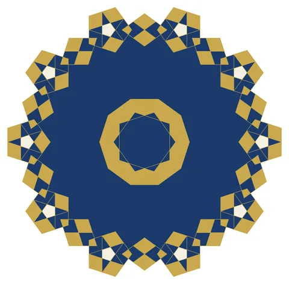

# Darb-i Imam: Self-Similar Girih Subdivision

From bikar's pattern library: `bikar:patterns/Stars/Darb-i-Imam.bkr`, in the stars family.



The file drawn at its default knobs.

## What the file says

```text
Darb-i Imam: Self-Similar Girih Subdivision
Technique: girih tile with recursive subdivision
Reference: Darb-i Imam shrine, Isfahan (1453 CE) —
  Lu & Steinhardt (2007) showed this pattern uses self-similar
  girih tile subdivision, predating Penrose tilings by 500 years
Construction:
  1. Start with a large decagon (edge length 200)
  2. subdivide 1 replaces it with smaller pentagons + rhombi
     at vertices and edges, plus a central decagon
  3. All child tiles scaled by 1/phi-squared (0.382)
Key insight: recursive subdivision produces increasingly complex
  non-periodic (quasicrystalline) patterns from simple rules
```

## Knobs

The file has no knobs: it draws one fixed pattern.

<!-- written by hand below this line; the sync tool stops here -->

## Notes

Nothing written by hand yet.
