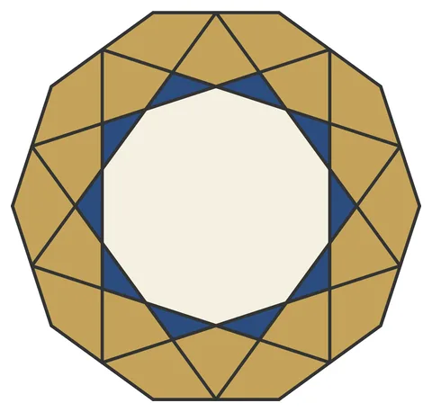

# Girih-Decagon: Girih Tile Demonstration

From bikar's pattern library: `bikar:patterns/Stars/Girih-Decagon.bkr`, in the stars family.



The file drawn at its default knobs.

## What the file says

```text
Girih-Decagon: Girih Tile Demonstration
Technique: girih tile placement
Reference: Lu & Steinhardt (2007), "Decagonal and Quasi-Crystalline
  Tilings in Medieval Islamic Architecture"
Construction:
  1. Central decagon with internal decoration lines
  2. The decoration lines form a {10/3} star pattern inside
Key insight: girih tiles have equal edge lengths and angles
  that are multiples of 36 degrees. Their internal decoration
  lines connect seamlessly when tiles are placed edge-to-edge.
```

## Knobs

The file has no knobs: it draws one fixed pattern.

<!-- written by hand below this line; the sync tool stops here -->

## Notes

Nothing written by hand yet.
