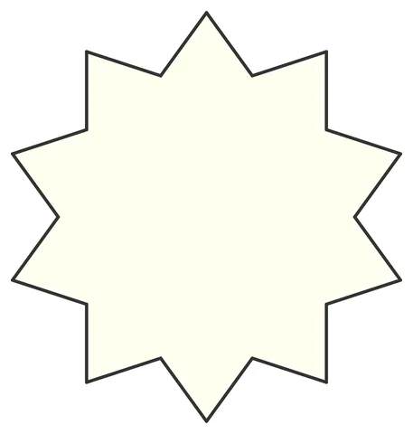

# Hankin-Star: Kaplan Method (2005)

From bikar's pattern library: `bikar:patterns/Stars/Hankin-Star.bkr`, in the stars family.



The file drawn at its default knobs.

## What the file says

```text
Hankin-Star: Kaplan Method (2005)
Technique: Hankin line construction (polygons in contact)
Reference: Craig Kaplan, "Islamic Star Patterns from Polygons in Contact"
Construction:
  1. Circle C0 divided into 10 (implicit decagon)
  2. hankin angle 54 — rays from each edge midpoint at 54 degrees
     to the edge, intersecting to form star points
  3. Ideal angle for N-gon = 90 - 180/N = 90 - 18 = 72 for decagon,
     but 54 produces a more elegant star
Key insight: a single angle parameter produces the complete star.
  Try changing the angle to see different star characters:
  - 30 = thin, elongated arms
  - 54 = balanced star (shown)
  - 72 = ideal/fat rosette
```

## Knobs

The file has no knobs: it draws one fixed pattern.

<!-- written by hand below this line; the sync tool stops here -->

## Notes

Nothing written by hand yet.
