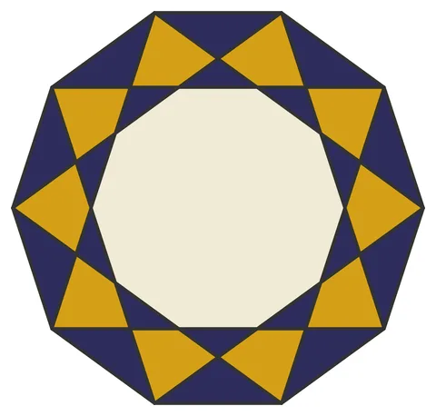

# Star-10: Decagonal Star (corpus construction #2)

From bikar's pattern library: `bikar:patterns/Stars/Star-10.bkr`, in the stars family.



The file drawn at its default knobs.

## What the file says

```text
Star-10: Decagonal Star (corpus construction #2)
Technique: multi-connect star overlay on a decagonal division
Reference: this construction was authored as part of the
  shape-identity-detection-cascade Phase 1.A corpus
  (see sacred-patterns/.claude/plans/shape-identity-detection-cascade.md).
  Purpose: a simple {10/3} star alone, no satellites or central decagon,
  to serve as a trivial-case sanity check for the qiyas detector's
  shape-identity signature work (cf. qiyas issue 2026-05-04-no-shape-identity-detection).
Construction:
  1. Single circle C0, divided into 10
  2. connect every 3 creates the {10/3} decagram (the simple star)
  3. Polygon edges frame the decagon
Key insight: the {10/3} star is the simplest cross-construction-comparison
  target — a regular decagram. A detector that can identify the 10
  star-tips as one identity-class with 10 instances arranged as
  10-fold rotation is doing the minimum useful thing.
```

## Knobs

The file has no knobs: it draws one fixed pattern.

<!-- written by hand below this line; the sync tool stops here -->

## Notes

Nothing written by hand yet.
