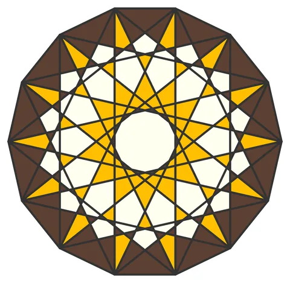

# Star-14: Perfect Fourteen

From bikar's pattern library: `bikar:patterns/Stars/Star-14.bkr`, in the stars family.



The file drawn at its default knobs.

## What the file says

```text
Star-14: Perfect Fourteen
Technique: multi-connect star overlay
Reference: Book p.40 "Perfect Fourteen" — Mamluk Sultan Qaytbay
  mausoleum carpentry panel (Cairo, 1496 CE)
Construction:
  1. Single circle C0, divided into 14
  2. connect every 4 creates the primary 14-pointed star
  3. connect every 6 creates a secondary star layer
  4. Polygon edges frame the tetradecagon
Key insight: 14-fold proportions are more complex than the
  golden section found in 10-fold — heptagram angles do not
  simplify as elegantly, making these patterns rarer and harder
  to design. Number 14 = full moon in Islamic calendar.
```

## Knobs

The file has no knobs: it draws one fixed pattern.

<!-- written by hand below this line; the sync tool stops here -->

## Notes

Nothing written by hand yet.
