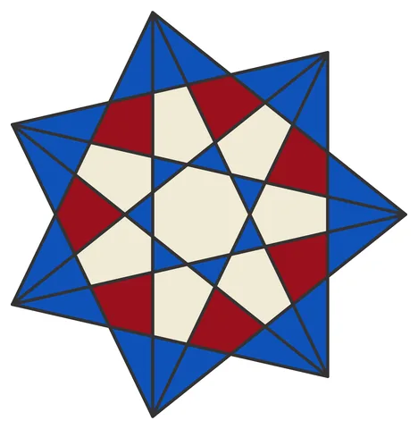

# Star-7: Heptagonal Star

From bikar's pattern library: `bikar:patterns/Stars/Star-7.bkr`, in the stars family.



The file drawn at its default knobs.

## What the file says

```text
Star-7: Heptagonal Star
Technique: odd-number stellation with mirror tiling
Reference: Book p.42 "Singular Stellations" — odd numbers
  are tricky because they cannot tile naturally. The technique
  is to place the motif half on each edge of a section, then
  reflect to tile.
Construction:
  1. Single circle C0, divided into 7
  2. connect every 2 creates the heptagram {7/2}
  3. connect every 3 creates the sharper heptagram {7/3}
  4. Both overlaid produce a rich star pattern
Key insight: 7 is prime and cannot divide 360 evenly into
  nice fractions, making these patterns inherently asymmetric
  when tiled. Single-motif display works perfectly.
```

## Knobs

The file has no knobs: it draws one fixed pattern.

<!-- written by hand below this line; the sync tool stops here -->

## Notes

Nothing written by hand yet.
