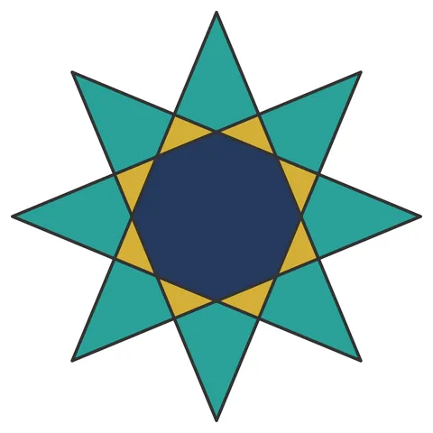

# Star-N: the {n/k} star polygon, with both numbers on a dial

From bikar's pattern library: `bikar:patterns/Stars/Star-N.bkr`, in the stars family.



The file drawn at its default knobs.

## What the file says

```text
Star-N: the {n/k} star polygon, with both numbers on a dial

Technique: Schläfli star polygon — take n points evenly spaced on a circle
  and join every kth one until the chord path closes. Every star polygon in
  this repo (Star-7, Star-8, Star-14, Star-16) is one member of that family
  with its two numbers written into the source. This file is the family
  itself: `points` and `skip` are params, so the studio's Dials tab turns a
  6-pointed star into a 7 into an 8 without touching the text.

Construction:
  1. One circle, divided into `points` — the only construction there is
  2. `connect every $skip` walks the chord path {n/k}
  3. Face extraction does the rest; the fills below read the result

Key geometric insight — why three fill rules cover the whole family:
  the face census obeys an exact law at every setting. Measured across
  {5/2} {6/2} {7/3} {8/3} {9/4} {10/3} {12/5} {16/7}:
    - triangles: exactly `points`
    - quadrilaterals: exactly (skip - 2) x points, so none at all at skip 2
    - one face with `points` sides, the core
  Three rules therefore cover every (n, k) the dial can reach, and the law
  is frozen as a test (packages/core/tests/canonical/star-n-family.test.ts).

  What the eye sees as you turn `skip` is those counts changing hands. At
  skip 2 the star tips ARE the triangles, so the points come out gold. From
  skip 3 on each tip is a kite instead — two long edges out to the rim, two
  short ones where the chords cross — so the points turn teal and the
  triangles retreat into the notches between them. Nothing about the fills
  changed; the shape under each tip did.

The dial's limits, and why they are what they are:
  skip must stay under half of points. At skip == points/2 the chords are
  diameters and the star collapses to one face; at skip == points each point
  joins itself and nothing is drawn at all. Neither errors — they just draw
  less and less — so the studio caps skip at (points - 1) / 2 before it
  evaluates (packages/knobs/src/constraints.ts). A hand-written override
  past that cap still renders; it renders a degenerate star.
```

## Knobs

| Knob | Default | Range |
|---|---|---|
| `points` | 8 | 5..16 |
| `skip` | 3 | 2..7 |

<!-- written by hand below this line; the sync tool stops here -->

## Notes

Nothing written by hand yet.
