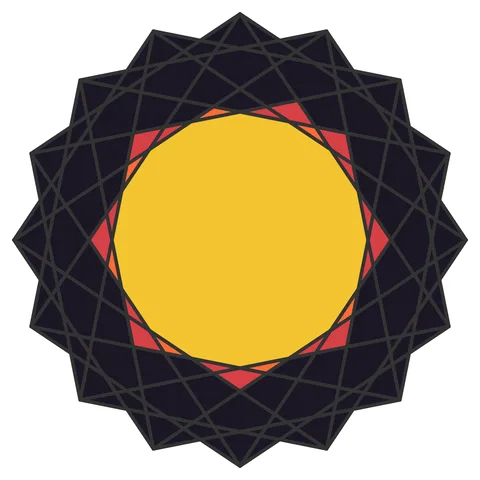

# Sunburst

From bikar's pattern library: `bikar:patterns/Stars/Sunburst.bkr`, in the stars family.



The file drawn at its default knobs.

## What the file says

```text
Sunburst
Combines ring depth with parity for a radiating spiral effect
```

## Knobs

The file has no knobs: it draws one fixed pattern.

<!-- written by hand below this line; the sync tool stops here -->

## Notes

Nothing written by hand yet.
