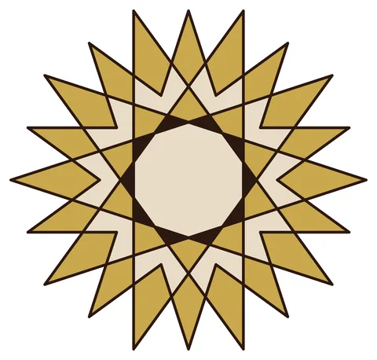

# Topkapi Scroll Star

From bikar's pattern library: `bikar:patterns/Stars/Topkapi-Star.bkr`, in the stars family.



The file drawn at its default knobs.

## What the file says

```text
Topkapi Scroll Star
Technique: compass-and-straightedge from historical diagrams
Reference: The Topkapi Scroll (15th century, Istanbul) contains
  medieval construction diagrams for Islamic geometric patterns.
  This recipe reproduces a 10-fold star from those diagrams.
Construction:
  1. Circle C0 divided into 10
  2. Hankin method at ideal_angle(10) = 72 degrees
  3. Additional connect every 4 for inner structure
Key insight: uses the ideal_angle() function to compute
  the optimal Hankin angle automatically
```

## Knobs

The file has no knobs: it draws one fixed pattern.

<!-- written by hand below this line; the sync tool stops here -->

## Notes

Nothing written by hand yet.
