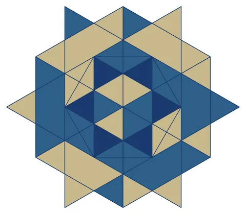

# Yazd Star (15th century Iran)

From bikar's pattern library: `bikar:patterns/Stars/Yazd-Star.bkr`, in the stars family.



The file drawn at its default knobs.

## What the file says

```text
Yazd Star (15th century Iran)
Derived from six regular divisions of the circle
Equal-radius circles at each vertex form the flower of life
Their intersections create a triangular grid for the star pattern
```

## Knobs

The file has no knobs: it draws one fixed pattern.

<!-- written by hand below this line; the sync tool stops here -->

## Notes

Nothing written by hand yet.
