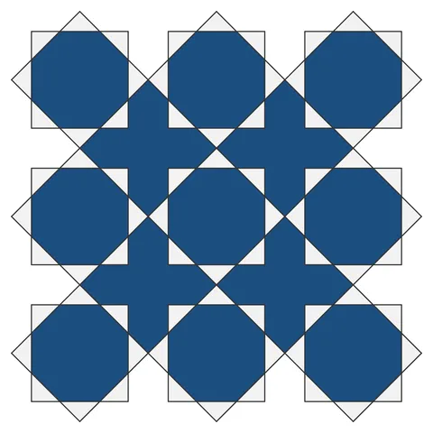

# Star 8 Tiled

From bikar's pattern library: `bikar:patterns/Tiled Patterns/Star-8-Tiled.bkr`, in the tiled family.

The file drawn at its default knobs.

## What the file says

The file opens with no comment.

## Knobs

The file has no knobs: it draws one fixed pattern.

<!-- written by hand below this line; the sync tool stops here -->

## Notes

Nothing written by hand yet.
