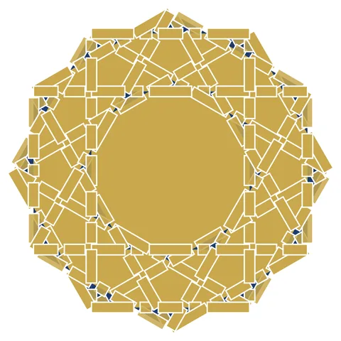

# Mamluk Quran Illumination Border

From bikar's pattern library: `bikar:patterns/Weave/Mamluk-Border.bkr`, in the weave family.



The file drawn at its default knobs.

## What the file says

```text
Mamluk Quran Illumination Border
Technique: strapwork on dense star pattern
Reference: Mamluk-era illuminated Qurans (13th-15th century)
  featuring gilded interlaced borders around text panels
Construction:
  1. Circle C0 divided into 12 for fine star geometry
  2. connect every 2 + every 4 creates dense interlacing
  3. strapwork width 4 renders as gilded interlaced bands
Key insight: the combination of high connect-every values
  with strapwork produces the dense knotwork characteristic
  of Mamluk manuscript illumination borders
```

## Knobs

The file has no knobs: it draws one fixed pattern.

<!-- written by hand below this line; the sync tool stops here -->

## Notes

Nothing written by hand yet.
