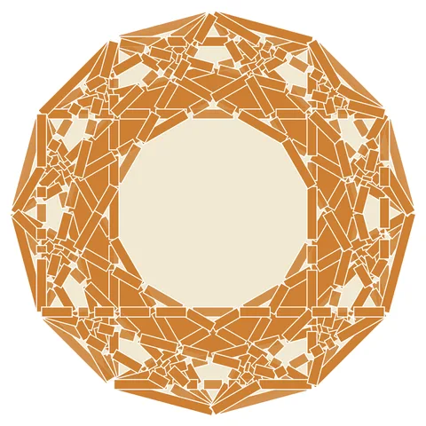

# Weave-12: 12-Point Woven Rosette

From bikar's pattern library: `bikar:patterns/Weave/Weave-12.bkr`, in the weave family.



The file drawn at its default knobs.

## What the file says

```text
Weave-12: 12-Point Woven Rosette
Technique: multi-connect overlay with strapwork
Construction:
  1. Single circle C0, divided into 12
  2. Three connect layers: every 2, every 3, every 4
     creates a dense web of intersecting chords
  3. edges from dodecagon adds outer frame
  4. strapwork width 5 renders all edges as interlaced bands
Key insight: multiple connect-every layers generate many
  degree-4+ crossings, creating a rich weave pattern
```

## Knobs

The file has no knobs: it draws one fixed pattern.

<!-- written by hand below this line; the sync tool stops here -->

## Notes

Nothing written by hand yet.
