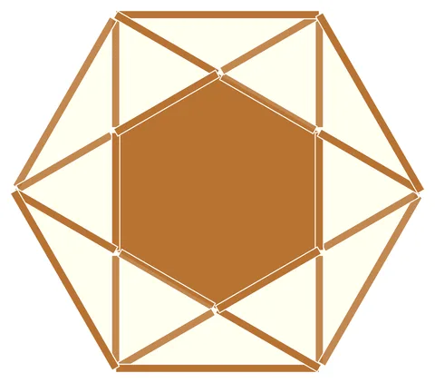

# Weave-6: Hexagonal Woven Star

From bikar's pattern library: `bikar:patterns/Weave/Weave-6.bkr`, in the weave family.



The file drawn at its default knobs.

## What the file says

```text
Weave-6: Hexagonal Woven Star
Technique: wedge-and-rotate + polygon outline with strapwork
Construction:
  1. Single circle C0, divided into 6
  2. connect every 2 creates the hexagram (Star of David, {6/2})
  3. edges from hexagon adds the outer hexagonal frame
  4. strapwork width 4 applies interlaced band rendering
Key insight: the hexagram + hexagon frame creates degree-4 nodes
  at every intersection, enabling clean alternating weave
```

## Knobs

The file has no knobs: it draws one fixed pattern.

<!-- written by hand below this line; the sync tool stops here -->

## Notes

Nothing written by hand yet.
