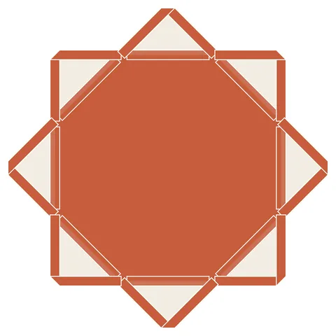

# Weave-8: 8-Point Woven Star

From bikar's pattern library: `bikar:patterns/Weave/Weave-8.bkr`, in the weave family.



The file drawn at its default knobs.

## What the file says

```text
Weave-8: 8-Point Woven Star
Technique: wedge-and-rotate with strapwork
Construction:
  1. Single circle C0, divided into 8
  2. connect every 2 creates the 8-pointed star (Schlaefli {8/2})
  3. strapwork width 6 crossing alternating turns edges into
     interlaced bands with over/under crossings
Key insight: the star's degree-4 crossings at each intersection
  create natural weaving points where bands alternate over/under
```

## Knobs

The file has no knobs: it draws one fixed pattern.

<!-- written by hand below this line; the sync tool stops here -->

## Notes

Nothing written by hand yet.
