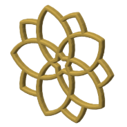

# A ten-petal blossom from one compass setting (CS-18)

Rebuilt step by step from [the video](https://www.youtube.com/watch?v=n_ICgwOr6qs), written in naqsh and made in 1 coaster style. Its catalog id is CS-18.

## Pictures

One heading per style, so each picture has its own link: the note's link plus the style
name, for example #minimal.

### minimal

The straps alone: no slab, every empty space in the pattern is a hole, top edges rounded over.

## Checks against the video

From the [constructions ledger](../../constructions/ledger.md).

2 of the three checks were run, and they pass:

- every labelled point and line: 34 compared, none failed (PASS);
- the drawn lines: recall 1.0, precision 1.0 (PASS);
- the solid coverage: none by design: no solid to compare (see notes).

## Coaster styles and plates

No plate uses this pattern yet.

## Prints

No print record names this pattern yet.

<!-- written by hand below this line; the sync tool stops here -->

## Notes

Every line is an arc of one compass setting: five petals in front (fa1, fa2) and five behind
(ba1, ba2), each pair turned five-fold. No straight line is drawn, so the coaster's straps are
the arcs' chords (sagitta a quarter of the grid pitch) — the first arc-only coaster. The 40 mm
mini keeps every window open (22,980 triangles, 2.8 cm³); the standard is 62,372 / 7.3 cm³.
