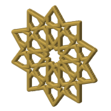
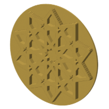
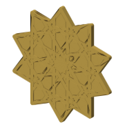
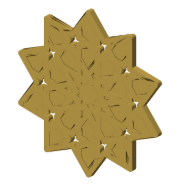

# The Itimad-ud-Daula ten-fold rosette in a rhombus tile (CS-13)

Rebuilt step by step from [the video](https://www.youtube.com/watch?v=gBV_JTt3Kxk), written in naqsh and made in 6 coaster styles. Its catalog id is CS-13.

## Pictures

One heading per style, so each picture has its own link: the note's link plus the style
name, for example #minimal.

### minimal

The straps alone: no slab, every empty space in the pattern is a hole, top edges rounded over.

### cup-band

No picture yet: Coaster Lab has no thumbnail for this file.

### minimal-pieces

Every hole of the ten-fold minimal coaster filled back in as a loose piece, one color per ring, set in a strap frame — the coaster to color piece by piece.

### split-flange

The pieces coaster cut into two printed halves with flush faces: each piece carries a thin flange at the cut that sits in an undercut in both halves, so it cannot fall out either way.

### split-lip

The pieces coaster cut into two printed halves that trap the pieces between them: each pocket has a lip on both faces and the pieces drop in from the cut, two halves joined by studs (the stars stay open).

### split-pocket

The pieces coaster cut into two printed halves, each printing its piece halves in place in closed pockets: a plug through each neck and a band in the room, air above and below, nothing placed by hand (the stars stay open).

## Checks against the video

From the [constructions ledger](../../constructions/ledger.md).

0 of the three checks pass and 2 fail; the ledger's notes say why.

- every labelled point and line: 134 compared, 20 failed (FAIL);
- the drawn lines: recall 0.997, precision 0.4291 (FAIL);
- the solid coverage: not run.

## Coaster styles and plates

| Plate | Styles of this pattern on it |
|---|---|
| [bedface-1](../../design/plates/bedface-1.md) | minimal, minimal pieces |
| [bedface-2](../../design/plates/bedface-2.md) | minimal |
| [bedface-3](../../design/plates/bedface-3.md) | minimal |
| [pkt-2](../../design/plates/pkt-2.md) | split pocket |
| [sheets-01](../../design/plates/sheets-01.md) | minimal |
| [sheets-02](../../design/plates/sheets-02.md) | minimal |
| [sheets-03](../../design/plates/sheets-03.md) | minimal |
| [sheets-04](../../design/plates/sheets-04.md) | minimal |
| [sheets-04c](../../design/plates/sheets-04c.md) | minimal |
| [sheets-04g](../../design/plates/sheets-04g.md) | minimal, minimal pieces |
| [sheets-04g-fit](../../design/plates/sheets-04g-fit.md) | minimal, minimal pieces |
| [sheets-04g-fit2](../../design/plates/sheets-04g-fit2.md) | minimal, minimal pieces |
| [sheets-04g-fit3](../../design/plates/sheets-04g-fit3.md) | minimal, minimal pieces |
| [split-01](../../design/plates/split-01.md) | split lip |
| [split-02](../../design/plates/split-02.md) | split flange |
| [stud-1](../../design/plates/stud-1.md) | split lip |
| [swatch-10101](../../design/plates/swatch-10101.md) | minimal |
| [swatch-10204](../../design/plates/swatch-10204.md) | minimal |
| [swatch-10501](../../design/plates/swatch-10501.md) | minimal |
| [swatch-13903](../../design/plates/swatch-13903.md) | minimal |
| [theme-iznik-tile-10100](../../design/plates/theme-iznik-tile-10100.md) | minimal, minimal pieces |
| [theme-iznik-tile-10205](../../design/plates/theme-iznik-tile-10205.md) | minimal pieces |
| [theme-iznik-tile-10604](../../design/plates/theme-iznik-tile-10604.md) | minimal pieces |
| [theme-iznik-tile-10605](../../design/plates/theme-iznik-tile-10605.md) | minimal pieces |
| [theme-midnight-blue-10101](../../design/plates/theme-midnight-blue-10101.md) | minimal, minimal pieces |
| [theme-midnight-blue-13903](../../design/plates/theme-midnight-blue-13903.md) | minimal pieces |
| [theme-night-sky-11600](../../design/plates/theme-night-sky-11600.md) | minimal pieces |
| [theme-night-sky-11602](../../design/plates/theme-night-sky-11602.md) | minimal pieces |
| [theme-night-sky-13101](../../design/plates/theme-night-sky-13101.md) | minimal, minimal pieces |
| [theme-night-sky-13402](../../design/plates/theme-night-sky-13402.md) | minimal pieces |
| [theme-terracotta-souk-10101](../../design/plates/theme-terracotta-souk-10101.md) | minimal, minimal pieces |
| [theme-terracotta-souk-10401](../../design/plates/theme-terracotta-souk-10401.md) | minimal pieces |
| [theme-terracotta-souk-11203](../../design/plates/theme-terracotta-souk-11203.md) | minimal pieces |
| [theme-terracotta-souk-11401](../../design/plates/theme-terracotta-souk-11401.md) | minimal pieces |

## Prints

| Print | Piece | Verdict | What was seen |
|---|---|---|---|
| [2026-10-02-sheets-04](../../prints/2026-10-02-sheets-04/index.md) | minimal | keep | no remark on the coaster itself; it is kept as the frame the next pieces plate is set into |
| [2026-10-04-sheets-04g](../../prints/2026-10-04-sheets-04g/index.md) | minimal, 112.5 mm | not-judged | no remark on the coaster itself yet |
| [2026-10-04-sheets-04g](../../prints/2026-10-04-sheets-04g/index.md) | minimal pieces, middle, 112.5 mm | adjust | adn the middle piece was too lose |
| [2026-10-04-sheets-04g](../../prints/2026-10-04-sheets-04g/index.md) | minimal pieces, kite, 112.5 mm, 10 of them | adjust | the small kits were too tight ti fit |
| [2026-10-04-sheets-04g](../../prints/2026-10-04-sheets-04g/index.md) | minimal pieces, hex, 112.5 mm, 10 of them | not-judged | no remark yet |
| [2026-10-04-sheets-04g](../../prints/2026-10-04-sheets-04g/index.md) | minimal pieces, star, 112.5 mm, 10 of them | not-judged | no remark yet |
| [2026-10-04-sheets-04g](../../prints/2026-10-04-sheets-04g/index.md) | minimal pieces, outer, 112.5 mm, 10 of them | not-judged | no remark yet |
| [2026-10-10-sheets-04g-fit](../../prints/2026-10-10-sheets-04g-fit/index.md) | minimal, 112.5 mm | not-judged | The fresh coaster, carved Z on its bottom. Every piece on this plate was tried in it; Omar said how the pieces fit, not how the coaster itself came out |
| [2026-10-10-sheets-04g-fit](../../prints/2026-10-10-sheets-04g-fit/index.md) | minimal pieces, kite, 112.5 mm, 10 of them | keep | The pile of ten kites cut at 0.05 mm (no id, no dots; one render gives the ring of ten). Fits well in the Z coaster; Omar, in chat: "smill kite wise, the biggest size fits well, rest too small/lost"; Worked out, not read off the piece: the kites carry no mark, and the biggest kites are the 0.05 pile, since a smaller gap makes a bigger kite; In the older sheets-04g coaster (no id) it is loose. Omar, in chat: "all small kites are loose" |
| [2026-10-10-sheets-04g-fit](../../prints/2026-10-10-sheets-04g-fit/index.md) | minimal pieces, kite, 112.5 mm, 10 of them | drop | The pile of ten kites cut at 0.10 mm (no id). Too small in the Z coaster; Omar, in chat: "the biggest size fits well, rest too small/lost" |
| [2026-10-10-sheets-04g-fit](../../prints/2026-10-10-sheets-04g-fit/index.md) | minimal pieces, kite, 112.5 mm, 10 of them | drop | The pile of ten kites cut at 0.15 mm (no id). Too small in the Z coaster; Omar, in chat: "rest too small/lost" |
| [2026-10-10-sheets-04g-fit](../../prints/2026-10-10-sheets-04g-fit/index.md) | minimal pieces, kite, 112.5 mm, 10 of them | drop | The pile of ten kites cut at 0.20 mm (no id). Too small in the Z coaster; Omar, in chat: "rest too small/lost" |
| [2026-10-10-sheets-04g-fit](../../prints/2026-10-10-sheets-04g-fit/index.md) | minimal pieces, kite, 112.5 mm, 10 of them | drop | The pile of ten kites cut at 0.25 mm (no id). Too small in the Z coaster; Omar, in chat: "rest too small/lost" |
| [2026-10-10-sheets-04g-fit](../../prints/2026-10-10-sheets-04g-fit/index.md) | minimal pieces, middle, 112.5 mm | adjust | Carved id 4GF 4A (gap 0, four dots). Fits the Z coaster but too tight; Omar, in chat: "middle peice wise, a fits but to tight"; In the older sheets-04g coaster it fits but comes out easily. Omar, in chat: "4a fits but easliy removable" |
| [2026-10-10-sheets-04g-fit](../../prints/2026-10-10-sheets-04g-fit/index.md) | minimal pieces, middle, 112.5 mm | adjust | Carved id 4GF 4B (gap 0.05, three dots). Good in the Z coaster, but comes out a little too easily; Omar, in chat: "B is good but comes off a bit to easy? is there a midway between a and b?"; In the older sheets-04g coaster it is loose. Omar, in chat: "4b on that oen is loose" |
| [2026-10-10-sheets-04g-fit](../../prints/2026-10-10-sheets-04g-fit/index.md) | minimal pieces, middle, 112.5 mm | not-judged | Carved id 4GF 4C (gap 0.10, two dots). Omar did not say how it fit |
| [2026-10-10-sheets-04g-fit](../../prints/2026-10-10-sheets-04g-fit/index.md) | minimal pieces, middle, 112.5 mm | not-judged | Carved id 4GF 4D (gap 0.15, one dot). Omar did not say how it fit |
| [2026-10-10-sheets-04g-fit2](../../prints/2026-10-10-sheets-04g-fit2/index.md) | minimal, 112.5 mm | not-judged | The fresh coaster, carved Z on its bottom. Every piece on this plate was tried in it; Omar said how the pieces fit, not how the coaster itself came out |
| [2026-10-10-sheets-04g-fit2](../../prints/2026-10-10-sheets-04g-fit2/index.md) | minimal pieces, kite, 112.5 mm, 10 of them | adjust | The pile of ten kites cut at 0.05 mm (no id; one render gives the ring of ten). Tough to push into the Z coaster, and once in, all three tried stay in upside down; Omar, in chat: "samll kites could be a bit smaller, tought to insert"; Omar, asked whether three kites stay in the Z coaster upside down: "All stay in"; On sheets-04g-fit the same 0.05 kites fit that plate's Z coaster well, so this coaster's kite holes came out tighter |
| [2026-10-10-sheets-04g-fit2](../../prints/2026-10-10-sheets-04g-fit2/index.md) | minimal pieces, middle, 112.5 mm | drop | Carved id 4GH 1A (gap 0, three dots), the tight control. Super tight in the Z coaster; Omar, in chat: "1a sauper tight" |
| [2026-10-10-sheets-04g-fit2](../../prints/2026-10-10-sheets-04g-fit2/index.md) | minimal pieces, middle, 112.5 mm | keep | Carved id 4GH 1C (gap 0.025, two dots), the halfway piece. The best fit of the three in the Z coaster; Omar, in chat: "4gh ic is winner" (read as 4GH 1C: the id has no I) |
| [2026-10-10-sheets-04g-fit2](../../prints/2026-10-10-sheets-04g-fit2/index.md) | minimal pieces, middle, 112.5 mm | drop | Carved id 4GH 1E (gap 0.05, one dot), the easy control. Loose in the Z coaster; Omar, in chat: "1e loose" |
| [2026-10-11-bedface-1](../../prints/2026-10-11-bedface-1/index.md) | minimal, 112.5 mm | adjust | The coaster carved F on its bottom, the same design as fit2's Z coaster, printed on the house preset. Its bottom is no cleaner than Z's: the rings close the slits along the strap edges but leave short dark dashes and small triangles down the middle of the straps and where straps meet, where the rings from the two sides come together (the photo); Omar, asked whether F has fewer slits than Z: "About the same"; Omar, beside the kites: "F as a coaster has more slits"; Omar, with the photo: "F has a lot of slits .."; The design is not at fault here: the verdict is on the first-layer settings it printed with, which go back to stock until a new fix is printed |
| [2026-10-11-bedface-1](../../prints/2026-10-11-bedface-1/index.md) | minimal pieces, kite, 112.5 mm, 10 of them | adjust | The pile of ten kites cut at 0.05 mm (no id; one render gives the ring of ten). No dent in the middle of the bottom: the 0.42 mm first line filled the core, as the plan said; Omar, in chat: "f's kites don't have dents"; Too tight in the F coaster; fit2's same 0.05 kites were already tough to push into the Z coaster; Omar, in chat: "kites too tight"; Whether they stay in upside down was not said |
| [2026-10-11-bedface-1](../../prints/2026-10-11-bedface-1/index.md) | minimal pieces, middle, 112.5 mm | not-judged | Carved id FC1 1A (gap 0, three dots). Omar named FC1 1E the winner and said nothing of 1A by itself |
| [2026-10-11-bedface-1](../../prints/2026-10-11-bedface-1/index.md) | minimal pieces, middle, 112.5 mm | not-judged | Carved id FC1 1C (gap 0.025, two dots), fit2's winner as 4GH 1C. Omar named FC1 1E the winner and said nothing of 1C by itself |
| [2026-10-11-bedface-1](../../prints/2026-10-11-bedface-1/index.md) | minimal pieces, middle, 112.5 mm | keep | Carved id FC1 1E (gap 0.05, one dot). The best fit of the three in the F coaster, where its fit2 twin 4GH 1E was loose in the Z coaster; Omar, in chat: "fc1 1e winner" |
| [2026-10-12-bedface-2](../../prints/2026-10-12-bedface-2/index.md) | minimal, 112.5 mm | keep | The coaster carved S, on the stock settings: diagonal lines on the first layer, as on fit2's Z. Its bottom has short dark slits running along the straps, a line or two in from each edge, where the diagonal fill turns short of the wall (the photo); Omar, with the photo: "these are the slits fot s"; Omar, asked whether R has fewer slits than S: "About the same", then "both have slits, byt in different places"; The page's row 1 reads "the same" as: the coaster stays on stock. So S is what keeps printing, slits and all; the slits Omar asked about on 2026-10-10 are not fixed by this plate |
| [2026-10-12-bedface-2](../../prints/2026-10-12-bedface-2/index.md) | minimal, 112.5 mm | drop | The coaster carved R: the same design, with rings on the first layer and the fill pushed 30% into the wall, on this coaster alone, at the stock 0.5 mm first line. The strap edges are closed, but small dark specks and triangles run down the middle of the straps and sit where straps meet, where the rings from the two sides come together (the photo), the same places bedface-1's F showed them; Omar, with the photo: "this for r"; Omar, beside S: "About the same", then "both have slits, byt in different places"; The page's row 1 reads "the same" as: the rings' meeting lines open in print at either line width, so rings are dropped for good. The drop is on the first-layer settings, not on the design, which prints on as S; Row 2 (are the dashes on F only, on both, or on neither?) and row 3 (does FC1 1E feel the same in S's middle hole as in R's?) were not judged yet |

<!-- written by hand below this line; the sync tool stops here -->

## Notes

Nothing written by hand yet. This is the place for what makes the pattern work, what went
wrong, and what to try next.
