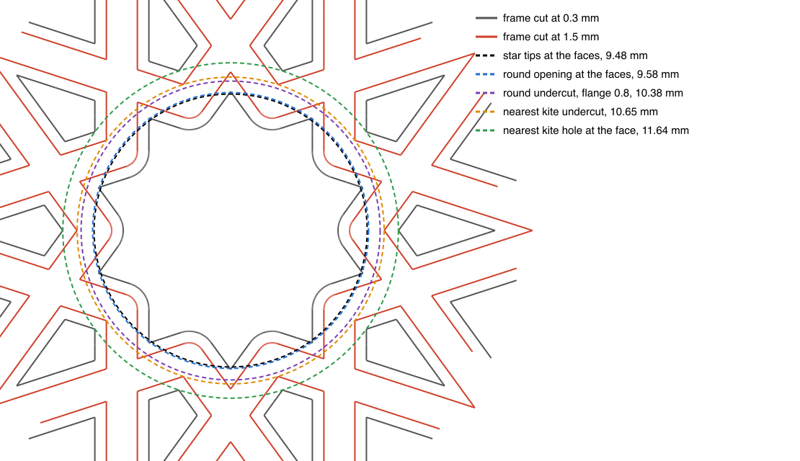

# A middle piece that turns

> Draft, 2026-10-27. The doc to act on. It consolidates two independent passes, researcher A
> ([research](../../research/2026-10-27-spinner-middle-research-a.md),
> [design](spinner-middle-design-a.md)) and researcher B
> ([research](../../research/2026-10-27-spinner-middle-research-b.md),
> [design](spinner-middle-design-b.md)), after a checker re-opened their sources and re-measured
> the coaster ([check](../../research/2026-10-27-spinner-middle-check.md)). Nothing here is built
> or printed.

**The ask** (Omar, 2026-10-27): what would it take to 3D print the inside pieces so the split flange
coaster's middle piece, the ten-pointed star, turns, making the pattern a spinner.

*The lower half round the middle, from bikar main at split-06's fit (gap 0.10). Gray is the frame
at the face (cut 0.3 mm up), red at the undercut the flanges sit in (cut 1.5 mm up). A turning disc
needs a round opening just outside the star's tips (blue) and a round undercut 0.8 mm beyond it
(purple). The small kites' undercuts (red triangles) come in to the orange circle, 0.27 mm past the
purple one. That thin wall is the whole design problem.*

## 0. The answer in one screen

**Yes, as a dial you turn with a fingertip; not, at this size and thickness, as a spinner you flick
and watch.**

1. **The middle has to become a round disc.** A star cannot turn in a star-shaped hole, so the
   opening must be a circle just outside the star's tips, 9.58 mm from the centre at a 0.10 mm gap.
   The ten wedges of frame between the star's points move onto the disc. The disc can show them in
   the frame's color (two colors on the disc) or show the star as a groove (one color).
2. **The disc turns on the flange it already has.** Every loose piece is held by a flange under the
   frame's lip. Make that flange and its undercut round and the disc turns on it, PLA on PLA. Nothing
   to buy, and the coaster stays 4.4 mm.
3. **One neighbour is in the way.** The small kites' undercuts reach in to 10.65 mm. A round undercut
   for today's 0.8 mm flange reaches 10.38 mm, leaving a 0.27 mm wall, under the 0.4 mm single line
   bikar allows as its least wall. So the kites' undercuts are filled where they come close, and the
   kites' flanges notched to match, the way bikar already fills the undercut round a peg.
4. **A steel bearing would spin, but not in this coaster.** Every bearing checked is 4 mm tall
   (6700, 6704, a needle cage with its washers). Hidden behind a face on each side it needs a coaster
   about 5.2 to 6 mm tall, and the 6704 that clears the star is 27 mm across, which cuts the ten
   small kites. That is a different, thicker product with a redrawn middle.
5. **Expect a turn that stops when you let go.** No source found gives a friction figure for PLA on
   PLA, and a disc 21 mm across holds very little spin: its resistance to slowing grows with the
   fourth power of its radius ([B §7](../../research/2026-10-27-spinner-middle-research-b.md#7-friction-and-spin-time)).

## 1. The options

| | A. Round disc on its own flange (recommended) | B. Turning ring round today's star | C. A or B on steel balls | D. A bought thin bearing |
|---|---|---|---|---|
| **What turns, on what** | A round disc carrying the star and the ten frame wedges, sliding PLA on PLA on its round flange | A frame-colored ring carrying the ten wedges, today's star loose inside it | The disc on a ring of 2 mm balls in a groove half in the disc, half in the frame | The disc pressed into a 6704 (20 × 27 × 4 mm), the bearing in the frame |
| **Pros** | Height and halves unchanged; nothing to buy; nothing to rust; built from the loose-piece code we have; testable as one slice | Looks exactly like today when lined up; the star keeps its own color | Likely smoother and longer-turning than A | A real spin, the feel of a hand spinner |
| **Cons** | Turns and stops, does not coast; the kites' undercuts near the middle must be filled; the star is drawn on a disc, either in two colors (a color swap per plate costs time and filament) or as a groove | **Does not fit.** At the band the star's own tips (10.84 mm) already overlap the kites' undercuts (10.65 mm); the ring would need to reach about 11.4 mm or more, through the kites ([check §1.3](../../research/2026-10-27-spinner-middle-check.md#13-what-the-render-does-to-bs-turning-ring-option)) | The groove crosses the cut, so four parts carry a quarter of it and the halves' line-up becomes the race; printed races are rough and balls work out ([A S16](../../research/2026-10-27-spinner-middle-research-a.md#3-bearings-that-could-fit-in-44-mm), [B S8](../../research/2026-10-27-spinner-middle-research-b.md#3-printed-bearings-and-rollers)); the groove reaches further into the kites; water reaches the balls, and even 440C stainless "may corrode" ([SCA Shinyei](https://sca-shinyei.com/ballbearing/bearing_aisi440c)) | Needs a coaster about 5.2 to 6 mm tall; its 27 mm outside cuts the ten small kites; metal in a wet coaster |
| **Implications** | Next comes the art call (two colors or a groove); a 36° click to bring the pattern back in line is a later add | Only possible if the ten kites round the middle are redrawn smaller, a pattern change | Balls bought, counted and stocked per coaster; only worth a round if A turns too briefly | A different product, thicker in the hand than every coaster printed so far, with a redrawn middle |
| **What a print of it verifies** | Whether a round piece in our flange turns cleanly by a fingertip, at which gap, without rattle, wet and dry, with the kites' undercuts trimmed | Nothing until the kites are redrawn | Whether rolling beats sliding at this size, and by how much | Nothing about this coaster; it is a product change, not a test |

**Recommendation: A.** It is the only option that fits the coaster as it is, and its first print
answers the question everything else depends on: does a round piece in our flange turn well enough
to be worth it. C is the next step only if A turns but feels too draggy; D only if Omar wants a real
flick-and-watch spinner enough to make the coaster thicker and redraw its middle.

Not offered: a centre axle. The middle goes through both faces, so an axle needs a floor or a bar
across one face, which hides the star on that face. Set aside, not ruled out.

## 2. The disc in detail

**Shape.** At both faces the disc is a circle just inside the round opening; at the band, a circle
0.8 mm wider that sits in a round undercut, as every piece's flange sits today. The disc is cut into
two halves and pinned like the middle piece is now (three 1.2 mm pins,
[cut-pieces-joins §2](cut-pieces-joins-design.md#2-the-room-in-each-piece)).

**The kites' undercuts give way near the middle.** Two ways, both measured in the
[check §1.2](../../research/2026-10-27-spinner-middle-check.md#12-the-frame-round-the-middle-as-m2):

- *Fill them where they come close* (proposed). Where a kite's undercut comes within one wall of the
  round undercut, fill it, and notch the kite's flange to match. bikar's `stud_boss` does exactly
  this round a peg today. The disc is held as well as any piece; the ten kites round the middle lose
  a little flange at their inner tips.
- *A narrower flange on the disc.* A 0.6 mm undercut reaches 10.18 mm and leaves 0.47 mm of wall.
  The disc is held by less, and the coaster file's `flange` range starts at 0.8, so it would need a
  per-ring flange.

**Both faces sit one layer in.** Today a piece rests on its flange with one face flush with the
coaster's face. A turning disc that touches the table drags, and one the mug stands on can turn the
mug. Each face block is made one 0.2 mm layer thinner, so the disc stands 0.2 mm in from both faces
and only the frame touches the table and the mug. A few shallow dimples on the disc's face would
give a fingertip grip; a later add.

**The flange step prints poorly on the middle already.** split-07's middle had a "webbed" feel at
its flange step, and split-10 is testing a 45° `slope` and supports for it
([split-10](../plates/split-10.md)). A round flange has the same step over air, so whatever split-10
finds applies here too.

## 3. The fit

Two gaps do two jobs. The **side gap**, between the disc's edge and the frame, decides whether it
turns or binds. The **up-and-down play** (`room`, how much shorter the disc is than the space
between the halves) decides whether it rattles. Omar did not take a pin that "shakes a bit"
(split-05), so rattle is a failure, not a trade.

**Default:** side gap 0.15 mm per face, with 0.10 and 0.20 beside it on the same bed. This is a
starting ladder under the open bets CAL-FIT-01 and CAL-LSE-01, not a result. The nearest machine
found, a Bambu X1 Carbon with a 0.4 mm nozzle, 0.2 mm layers and PLA, had joints "moveable at 0,15"
([Fab Academy Ísafjörður](https://fabacademy.org/2025/labs/isafjordur/group_assignments/group_week05/));
a Bambu A1 with PLA moved "with friction" at 0.15 and freely at 0.20 to 0.25
([Fab Academy Kochi](https://fabacademy.org/2026/labs/kochi/students/mishael-sharaf/assignments/week05.html)).
Neither page says whether its figure is per side or across, so reading them as per face is our
interpretation, not theirs. Our own loose pieces drop in at 0.10 per face but were never asked to
turn ([split-06](../plates/split-06.md)). **This transfers because** the nozzle, layer height and
material match ours. **It does not transfer as is because** those parts were printed in place,
touching, and had to break apart, while ours are printed apart: they cannot fuse, so the web figures
are an upper bound on what we need. What a separate part fights instead is the first layer's flare
on its bottom edge, the layer ridges of two upright walls rubbing, and a round hole printing smaller
than drawn (CAL-HOL-01, unmeasured). The test in §6 reads it on our printer.

**Default:** up-and-down play 0.2 mm, today's `room`, under CAL-FIT-01 until the test reads rattle
at it. A 0.2 mm layer is the smallest step the slicer makes, and the rung below, `room` 0, is not
a rung: the coaster file records that split-02's full-height pieces held its halves apart, which
would clamp a disc that has to turn.

## 4. Living with a mug

- **Flat, no wobble.** The disc stands 0.2 mm in from both faces, so the coaster rests on its frame
  and the mug never stands on the disc.
- **Wet.** Water gets into a round hairline as it gets into every piece's gap today. For A that is
  PLA in water, as now; nothing rusts. For C or D it is steel in water; 440C stainless resists
  rust better than chrome steel but "may corrode", and the maker points to 304 or 630 stainless for
  more ([SCA Shinyei](https://sca-shinyei.com/ballbearing/bearing_aisi440c)). A sealed bearing is the
  cautious pick for D.
- **Heat.** PLA softens from about 60 °C by hobby sources
  ([A S24](../../research/2026-10-27-spinner-middle-research-a.md#5-living-with-a-mug)), a snippet. The
  disc is held at its edge and carries no mug, so it is no worse than today's pieces; still no
  dishwasher.
- **Cleaning.** A rinse and a shake. Grime in a 0.1 to 0.2 mm gap comes out only by opening the
  halves, which the pegs make hard on purpose. The validator turns the disc again after a rinse.

## 5. What bikar would need

All new geometry in the split kernel, which owns the hole, the undercut and the halves, and in
`patterns/Constructions/gBV_JTt3Kxk-split-flange-coaster.bkr`:

1. **A round piece for one ring.** A word on the `loose` line (working name `spin`) that replaces
   that ring's piece and opening by circles: the opening at the faces as the circle round the piece's
   tips plus the gap, the undercut that circle plus the flange. Refused for a ring not centred on the
   coaster's centre, which leaves only the middle (orbit 0) here.
2. **Fill the neighbours' undercuts that come too close.** Where another ring's undercut comes within
   `stud_wall` of the round undercut, fill it and notch that ring's flange, as `stud_boss` does round
   a peg. Refuse by name, with the room found, if the face holes themselves come too close.
3. **Faces set in.** How far the turning piece's faces stand in from the coaster's, in whole layers,
   0.2 mm when `spin` is on.
4. **Pegs kept out of the round undercut.** Refuse a peg, or its filled disc, that cuts it. Today's
   ring of pegs at 13.0 mm does not ([check §1.2](../../research/2026-10-27-spinner-middle-check.md#12-the-frame-round-the-middle-as-m2)).
5. **The disc's halves and pins**, as any piece, with the pins inside the face circle.
6. **The test slice.** `wedge_center 1` must keep the round middle and its round opening in a
   `wedge 36` slice; check it on the render.
7. **The art, after Omar's call.** Two colors need the disc's face drawn as two regions; a groove
   needs an engraved line on a piece's face, which the loose-piece code does not do today.

## 6. The smallest test print

**One repeat of the shape, several settings, a stock control beside it** (Omar, 2026-10-12: not a
whole coaster per round, not a tiny coupon either). bikar's `wedge 36 wedge_from 9 wedge_center 1`
prints a 36° slice of both frame halves with the middle and its opening, as split-04 did. On one bed:

| Slice | Middle | Side gap per face | What it shows |
|---|---|---|---|
| 1 | round disc (A) | 0.10 | today's piece gap, asked to turn |
| 2 | round disc | 0.15 | the default bet |
| 3 | round disc | 0.20 | the free end of the print-in-place figures, an upper bound |
| 4 | today's star (stock) | 0.10 | today's slice as split-06 would print it, the control |

All at `room` 0.2, split-10's pegs, the disc's faces 0.2 mm in, its halves pinned with three 1.2 mm
pins, one color, each disc with its carved id. Two of each if the bed holds them, so one bad piece
does not decide a rung; the plate page checks the fit on the bed. The stock slice also shows whether
filling the kites' undercuts near the middle changed how the kites sit.

**Validator:** each slice is closed with its disc in, set flat on a table, and judged by hand.
PASS: one fingertip turns the disc a full turn without catching and without the slice moving on the
table; it turns as freely with the slice turned over; shaken beside an ear it makes no click; and it
still turns the same after a rinse under the tap and a dry.
FAIL: it binds anywhere in the full turn (the first layer's flare and the seam on the circle are the
likely spots), or the slice slides along with it, or it turns more stiffly face down, or it rattles,
or a face of the disc stands proud of the frame, or it sticks after the rinse. The hard case is the
tightest gap that passes dry: it may bind wet, and a gap wide enough to turn that also rattles is a
FAIL, not a pass with a note.

What it does not read: spin time with a flick, since none is expected (count turns per flick anyway,
as the number C would have to beat), the art, and steel balls.

**Printable before bikar grows `spin`:** only researcher B's round OpenSCAD coupon
([B §6](spinner-middle-design-b.md#6-the-smallest-test)). It reads the side gap and the rattle but
not the thin wall to the kites, the filled undercuts, the real pegs or the set-in faces inside the
real frame, so it is the fallback if the bikar work in §5 waits, not the recommendation.

## 7. Open

- Pictures still to draw once §5 step 1 renders: a top view of the middle with the round opening in
  each art choice, and a side view of the disc in its round undercut with its faces set in
  (`draw-side-view`).
- No PLA-on-PLA friction figure and no measured spin time for a printed plain bearing were found by
  either pass; the test is the measurement.
- The turning coasters found (a three-ring kinetic coaster, a moiré coaster, a gear coaster, a
  kaleidoscope coaster) were seen only as search summaries; none is a split coaster with loose
  pieces. That is "none of the four found", not "none exists".

## Yours to do

- Say what "spinner" should mean: a centre you turn with a finger and that may click back into line
  every 36° (in reach at this size, option A), or one you flick and watch spin for seconds (likely
  needs a steel bearing and a thicker coaster, option D).
- Once a disc turns: two colors on the disc, or one color with the star as a groove.
