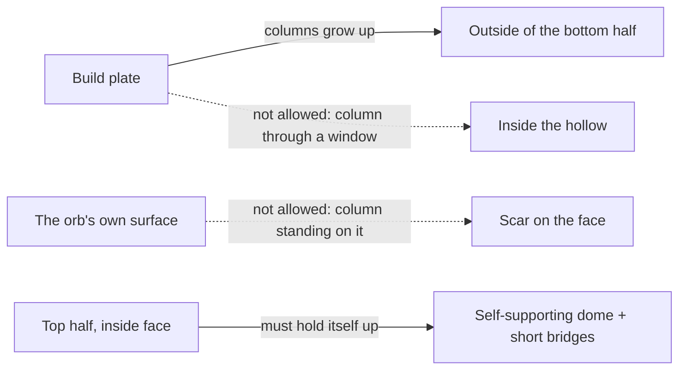
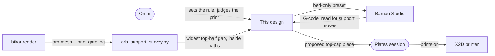
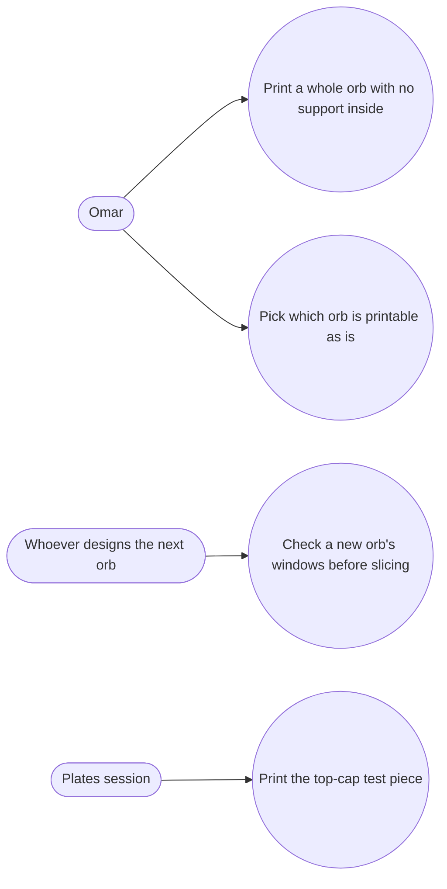
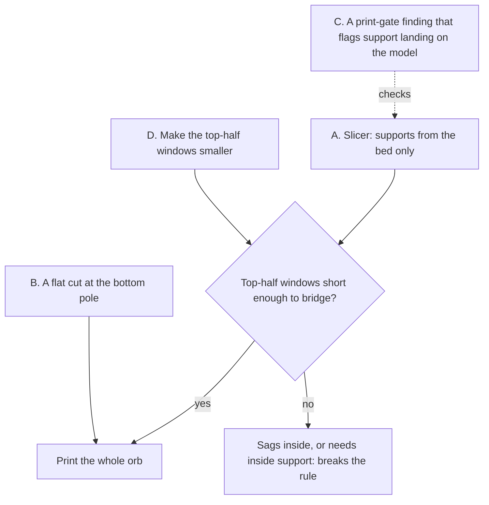

# Printing a whole orb with supports only on the outside — design doc

**Premise.** How to print one of our pierced-lattice orbs[^orb] in one piece, the way the airless
ping-pong ball on [toys-1](../plates/toys-1.md) is printed, with every support[^support] standing on
the bed and none inside the hollow.

**Status:** draft, 2026-11-08. Nothing here has been printed. The ball's mesh and our orbs were
measured with a new script, `tools/orb_support_survey.py` (how to run it is in
[Appendix C](#appendix-c--how-the-numbers-were-made)). What the supports on toys-1 actually did is
not known yet: that plate is not judged, and this doc makes no claim about it.

---

## 1. The rule: supports grow only from the bed

Omar, after the ball: "i only want support outside the orb, not inside". Read as a rule a slicer
can follow and a person can check:

> **Every support column starts on the build plate and stays outside the shell. Nothing is built
> inside the hollow, and no support stands on the orb itself.**

Why it matters. Support inside a closed lattice ball cannot be pulled out without breaking struts,
and what is left rattles or shows through the windows. Support that stands on the orb's own surface
leaves scars on the face people look at. Support from the bed, outside, touches only the outside of the bottom half, where a hand
can reach it and pull it off.

What the rule leaves us. Once nothing may be built inside, every surface of the top half that faces
the hollow has to hold itself up while it prints. So the real question of this doc is: **can our
orbs' top halves print with nothing under them, the way the ball's top half has to?**

Who and what this touches. Omar sets the rule and judges the print; bikar renders the orb; the
survey script measures it; Bambu Studio slices it; the plates session books the print on the X2D.

Use cases it enables:

**User-facing surface.** None new. Option A is a preset file in `tools/bambu/presets/`; option B
would add a bikar keyword, option C a print-gate warning; the survey script is a command-line tool.

*Legend:* solid arrows are what the rule allows; dashed are what it forbids. "Bridge"[^bridge] and
"dome" are in the glossary.

## 2. The ball, measured

The ball is someone else's model (MakerWorld 376496, see [toys-1](../plates/toys-1.md)); its mesh
stays out of git and was read as data only. Measured in the orientation it ships in:

| What | Ball |
|---|---|
| Size | about 40.0 × 39.9 × 39.3 mm |
| Shell | inner radius 17.8 mm, outer 19.7 mm, so a wall about 1.9 mm thick |
| First-layer contact[^contact] | 20.1 mm² (the "6 mm foot" toys-1 describes) |
| Strut width round a ring | 1.05 mm (10th percentile), 1.3 mm median, 4.2 mm (90th) |
| Share of each ring that is material | mostly 45–77% |
| Gap width round a ring[^gap] | 1.7 mm median; **the widest anywhere in the top half is 3.8 mm** |
| Top-half faces steeper than the slicer's 30° support threshold | 173 mm² inside landing on the inside wall, 8 mm² inside with a straight drop to the bed, 138 mm² outside landing on the ball, 1 mm² outside reaching the bed |

The one number that explains why the ball works is the last gap: **no window in its top half is
wider than 3.8 mm.** Each window is a short bridge. And the solid part of a thick dome holds itself
up: going up one 0.2 mm layer at latitude φ, the inside edge of the wall steps inward by about
0.2·tan φ, while the wall is t / cos φ wide in plan, so each new layer sits on roughly
1 − 0.2·sin φ / t of the one below. For the ball (t ≈ 1.9 mm) that is 89% near the pole and more lower down.
That is geometry, not a print result; whether the overhanging inside edge sags is
[open question 2](#8-open-questions-for-omar).

The 138 mm² "outside landing on the ball" is the underside of struts at the window edges, outside
the inner radius. With supports from the bed only, the slicer drops a straight column there (it would
stand on the ball); a tree from the bed may still lean round to some of them from outside, so
which of them hold themselves up is for a slice to show. An earlier research note quoted 57 mm² for
"lands on the model"; that came from a different threshold and did not split inside from outside,
so the two numbers do not contradict each other, they count different faces.

## 3. Our orbs, measured

Every orb source in bikar's `patterns/Orbs/` (17 of them, bikar `fe6b109e`, 2026-11-06) was rendered
at its defaults and measured the same way. None was left out. The woven ones fail bikar's print
gate by design (many separate bodies), so they were rendered without it.

| Orb | Width mm | Bed mm² | Gap median mm | Widest top-half gap mm | Mid-air starts above the equator[^f3] | Inside faces with a straight drop to the bed mm² |
|---|---|---|---|---|---|---|
| **Ball (reference)** | 40 | 20.1 | 1.7 | **3.8** | – | 8 |
| Star-Orb | 122 | 7.9 | 6.9 | 26.4 | 10 of 20 | 0 |
| Star-Orb at radius 40 (its smallest) | 82 | 5.2 | 3.7 | 16.3 | 10 of 20 | 0 |
| Maclado-9 | 122 | 3.8 | 4.3 | 21.9 | 0 of 0 | 0 |
| Dodeca-Orb | 119 | 1.3 | 7.9 | 31.0 | 0 of 0 | 0 |
| Star-Cube-Orb | 115 | 35.1 | 9.1 | 38.7 | 4 of 12 | 0 |
| Rosette-Orb | 122 | 9.2 | 5.1 | 41.6 | 12 of 24 | 0 |
| Hankin-Orb | 122 | 5.8 | 11.3 | 55.4 | 2 of 4 | 0 |
| Rosette-Cube-Orb | 110 | 0.4 | 7.3 | 65.1 | 4 of 4 | 0 |
| Star-Octa-Orb | 122 | 2.2 | 10.4 | 68.2 | 8 of 12 | 0 |
| Star-Tetra-Orb | 122 | 3.5 | 15.5 | 73.2 | 0 of 2 | 290 |
| Maclado-9-Lattice | 122 | 3.0 | 4.5 | 87.8 | 8 of 15 | 519 |
| Donut-Hex-Orb (one disc, not a full ball) | 17 | 0.2 | 5.2 | 36.6 | 0 of 0 | 11 |
| Donut-Hex-Weld (two discs) | 34 | 0.4 | 4.8 | 55.7 | 0 of 0 | 23 |
| Weave-Orb (woven) | 128 | 1.1 | 16.5 | 62.7 | 1 of 3 | 58 |
| Weave-Dodeca-Orb (woven) | 127 | 1.5 | 18.1 | 51.4 | 0 of 0 | 103 |
| Rosette-Weave-Orb (woven) | 126 | 1.6 | 18.4 | 67.6 | 1 of 1 | 35 |
| Maclado-9-Weave (woven) | 124 | 0.6 | 9.0 | 66.5 | 0 of 2 | 217 |
| Maclado-9-Overlap (woven) | 124 | 1.1 | 10.5 | 60.4 | 0 of 4 | 258 |

The full table, with strut widths and all four overhang counts, is in
[Appendix B](#appendix-b--the-full-survey).

What it says, in plain words:

- **Every one of our 15 full orbs has top-half windows far wider than the ball's.** (The two
  Donut-Hex pieces are discs, not balls; their widest "gap" is the empty part of the ring.) The narrowest
  widest-gap is Maclado-9 at 21.9 mm, almost six times the ball's 3.8 mm. Star-Orb's widest gap
  per ring runs 7–26 mm from the equator up to 75°, and only falls under 5 mm from 82.5° up.
- **The ball's trick is not size alone.** Star-Orb at its smallest radius (82 mm wide) still has a
  16.3 mm widest gap: shrinking scales the windows down only in proportion.
- **"Inside faces with a straight drop to the bed"** is where supports from the bed could still get
  into the hollow, by rising through a window in the bottom half. It is zero for eight of the ten full
  lattice balls. Star-Tetra-Orb and Maclado-9-Lattice have it, and so do the two Donut-Hex pieces and
  every woven orb.
- **Bed contact** is under 25 mm² for every orb but Star-Cube-Orb. Star-Orb's authored "up" is an
  edge axis; turned onto a face axis it reaches 30.17 mm²
  ([hemisphere-split §3.5](hemisphere-split-design.md)).

How far to trust the gaps. Each gap is the straight line across a window, measured round a circle
of latitude, at the depth in the wall that holds the most material. That is a lower bound on the
span a bridge must cross, not the span itself: a window's top edge may be slanted, and a slanted
edge closes gradually rather than as one bridge. For woven orbs the ribbon bows in and out of the
wall, so the numbers lean high there. The overhang split assumes a straight-down column; Bambu's
tree supports[^tree] lean, so a real slice can find a path the straight line does not.

## 4. Options

Four ways to get from here to an orb that prints under the rule. They stack; they are not
exclusive.

*Legend:* A and D decide whether the top half holds up; B helps it stay on the bed; C checks A
before anything prints.

### A. A slicer preset with supports from the bed only, plus a face-axis turn

Bambu Studio has the switch already: **"Don't create support on model surface, only on build
plate"** (`support_on_build_plate_only`). Our X2D 0.20 mm profile has it off, with tree supports,
a 30° threshold, and `max_bridge_length` at 0, meaning every bridge gets support where the slicer
is allowed to put one (read from the installed Bambu Studio 02.08.02.61 and the in-repo fixture,
[Appendix A](#appendix-a--anchors)). The toys-1 preset, `tools/bambu/presets/supports-0.20.json`,
turns supports on and changes nothing else, so it allows support on the model.

A new preset would set `enable_support` and `support_on_build_plate_only` both to 1. The orb is
turned onto a face axis first, for bed contact.

- **What it costs.** One small preset file, and a turn in the slicer or at render time.
- **What it verifies.** Nothing by itself. A slice shows where the slicer put support; only the G-code
  can say whether any support sits inside.
- **What it does not do.** Bed-only supports do not ban the hollow: a column from the bed can rise
  through a window in the bottom half into the inside. The survey finds that path for Star-Tetra-Orb,
  Maclado-9-Lattice and all the woven orbs, and finds none for Star-Orb.
- **What it commits us to.** The inside of the top half prints with nothing under it, so A only works
  where D's gap ceiling already holds.
- **Sub-variant A′: support blockers.** Bambu Studio has a "Support Blocker" part type, a shape that
  bans support inside it. A sphere just inside the inner radius would ban support in the hollow
  outright, even where a window gives a path. Our `tools/bambu` does not write blockers today; it
  would be new work in the 3MF writer.

### B. A `foot` keyword: a flat cut at the bottom pole

A small flat at the bottom, like the ball's foot, gives the first layer more to hold.

- **What it costs.** New grammar and kernel work in bikar. bikar has no plane cut or boolean today
  ([hemisphere-split](hemisphere-split-design.md) measured this), so this is a real feature.
- **What it verifies.** Bed contact, through the existing F7 bed-contact check.
- **What it does not do.** Nothing for the top half, which is the hard part of this doc.
- **What it commits us to.** A new keyword everyone must learn, and a cookbook recipe for it. A face-axis
  turn (A) already gets Star-Orb past the bed-contact floor, so B waits until an orb needs more.

### C. A print-gate finding: "support lands on the model"

bikar's print gate already reports where material starts in mid-air (F3). A new finding would
report the part of that which only a support standing on the orb, or inside the hollow, could
reach.

- **What it costs.** Kernel work. The ray test is simple; the gate's bridge and overhang checks
  (F4–F6) are themselves still waiting on polygon offsetting, so C should share their timeline.
- **What it verifies.** The first validator in §6, per orb, before any slice.
- **What it does not do.** It cannot tell whether a bridge holds. That stays with the print.
- **What it commits us to.** One more warning that most orbs in the table would raise today; Dodeca-Orb
  and Maclado-9 would not (no mid-air starts above the equator, no inside path to the bed).

### D. A ceiling on the widest top-half gap

Design the orb so no window in its top half is wider than a bridge can cross. That means denser
layouts (more, smaller windows), wider struts, or a smaller orb.

- **What it costs.** Design work per orb, and a different look: a denser lattice is a different
  orb. Wider struts hit bikar's own limit first; Star-Orb at radius 40 refuses strut width 4.5 mm
  ("void 3 ... degenerates").
- **What it verifies.** The second validator in §6, measured on the mesh.
- **What it commits us to.** A number. **Default:** the widest top-half gap may be at most 10 mm,
  the same span ceiling the bridge check uses, bet CAL-BRG-01 (provisional, settled by the
  bridge-plate coupon MC-3 in [calibration-design](../printing/calibration-design.md)). Today every
  orb in the table fails it.

**Recommendation.** A (with the blocker sub-variant once one orb shows a window path), plus D as
the design rule, checked by the two validators in §6. C is the right home for the check later. B
waits.

## 5. Transfer conditions: from a 40 mm ball to an 80–220 mm orb

The ball is evidence for our orbs only where these hold. Each line says what must be true.

- **Wall overlap transfers.** The self-supporting dome argument (each layer on about
  1 − 0.2·sin φ / t of the one below) depends on wall thickness and layer height, not on the orb's
  size. It carries over because our walls (2.4 mm strut depth by default) are at least as thick as
  the ball's 1.9 mm and we print the same 0.2 mm layers.
- **Bridge span does not transfer.** A bridge's limit is set by the length of the span, not its
  share of the orb. The ball's windows are under 3.8 mm; ours are 22–88 mm at the widest. Nothing
  the ball shows about its windows tells us about a 20 mm window.
- **Strut width transfers only with the same filament and nozzle.** The ball's thinnest struts
  (about 1.05 mm) are two to three lines of a 0.4 mm nozzle. That carries to us only on the same
  0.4 mm nozzle and PLA; it is [open question 4](#8-open-questions-for-omar).
- **Bed hold transfers only at a similar height and weight.** The ball's 20 mm² foot holds a
  40 mm, light print, with the slicer's automatic brim. A 122 mm orb of the same shape would be about 28 times the
  volume and leverage its foot from three times as high. The ball does
  not show that 20 mm² holds that; see [open question 3](#8-open-questions-for-omar).
- **The woven orbs are a different case.** They are separate ribbons that cross with a
  clearance between them (0.4–0.64 mm by the linkage gate), not one shell. A ribbon's underside
  over a crossing is a bridge across the clearance on top of the window spans, so the ball tells
  us nothing about them.

## 6. Validators

The first validator alone is empty: with supports from the bed only, no slicer *puts* support on
the model, so it would always pass. It only means something together with the second, which says
the top half needs none.

**Validator:** no support lands on the model or inside the hollow. For the orb in its print
orientation, count the bikar mid-air starts (F3) above the equator, and the survey's "inside, drops
to bed" area. Then slice with the bed-only preset and read the G-code: every `;TYPE:Support` move
must lie outside the inner radius from the centre (plus half a line width).

This is stricter than the rule on purpose. An F3 start above the equator sits on the top edge of a
window; a support reaching it from outside would fill the window and mark the face the rule
protects, so the validator counts it as a failure.

PASS: zero F3 starts above the equator, zero inside-drops-to-bed area, and no support move inside
the inner radius in the G-code. Dodeca-Orb and Maclado-9 pass the first two today; the G-code part is
not yet run on any orb.

FAIL: Star-Orb today: 10 of its 20 F3 starts are above the equator. Maclado-9-Lattice fails twice:
8 of 15 starts above the equator, and 519 mm² of inside faces with a straight drop to the bed
through a bottom window.

**Validator:** the widest top-half gap is no wider than the bridge ceiling. Run
`tools/orb_support_survey.py` on the oriented mesh and read the widest gap from 2.5° to 87.5°
latitude, gap by gap, not a total area: one wide window sags no matter how small the rest are.

PASS: the ball, whose widest top-half gap is 3.8 mm against the 10 mm ceiling (`CAL-BRG-01`).

FAIL: Maclado-9, the best of our orbs, at 21.9 mm; and Star-Orb at its smallest radius, 16.3 mm,
which shows shrinking alone does not pass.

## 7. A small first print (proposed, not booked)

Omar's rule from 2026-10-12 is to test a print question on one piece of the shape, not a whole one,
so this tests one top cap, not a whole orb. Plates belong to the plates-and-feedback session; this is only the proposal for it.

1. **First, a slice, no print.** Slice Star-Orb and Maclado-9-Lattice whole with the bed-only preset
   and read the G-code per the first validator. This answers, at no cost in filament, whether the
   slicer's tree supports find a way into the hollow. Untested today.
2. **Then one piece.** The top cap of the default Star-Orb above 50° latitude: about 79 mm across and
   14 mm tall, its widest gap per ring there 2–25 mm. It is cut flat and printed cut-face down, supports off, so its inside surface is
   printed exactly as it would be inside the whole orb. Beside it, as a control, the same cap from
   Maclado-9 (same size, gaps 1.5–22 mm), so one bed shows a narrow-window cap and a wide-window one.
3. **What it answers.** Whether the inside of the dome sags, and at what window width the window
   tops droop, measured on real windows, not a coupon.

**Transfer.** This carries to the whole orb because above 50° the cap's layers sit on the same cap
below them whether or not the rest of the orb is there. It does not carry the bed hold, which the
cap does not test.

A flat cut is not something bikar can do today (option B). The cap would be cut in the slicer, which
the hemisphere-split doc already names as the route.

## 8. Open questions for Omar

1. **How far can PLA bridge on the X2D?** The 10 mm ceiling is a bet, `CAL-BRG-01`, from a slicer
   default, never printed here. And that default itself is in doubt: the bet's note and
   [print-validation](../printing/print-validation-design.md) say Bambu ships `max_bridge_length`
   at 10 mm, but the installed profile ships 0. The bridge-plate coupon MC-3 settles the span.
2. **Does the top half sag?** The wall-overlap argument says the dome holds; only a print says the
   inside edge does not droop. The cap in §7 answers it.
3. **Is the 25 mm² bed-contact floor too strict?** It is bet `CAL-BED-01`. The ball printed with a
   20 mm² foot and a brim, which is under the floor. **Default:** keep 25 mm² until coupon MC-6
   settles CAL-BED-01, since the ball is much lighter and shorter than our orbs (§5).
4. **Is a 1.05 mm strut fine?** The ball's thinnest struts are about 1.05 mm. Star-Orb's strut width goes
   down to 1.5 mm at its narrowest setting. A denser layout (option D) at a small radius would push ours toward it.
5. **Can the woven orbs get windows that small?** Their median gap is 9–18 mm and the ribbons need
   their crossing clearance. A ceiling of 10 mm may simply not fit a woven orb, which would mean
   woven orbs stay split or supported inside.

---

## Glossary

[^orb]: **Orb.** A hollow ball made of a lattice of struts with windows between them, drawn in
    bikar (our pattern language and geometry engine) and printed in one piece.
[^support]: **Support.** Throwaway material the slicer adds under a part that would otherwise
    print onto thin air; it is broken off after the print.
[^bridge]: **Bridge.** A line of plastic printed across a gap between two supported ends, with
    nothing under its middle. A dome is the opposite case: each layer rests mostly on the one below.
[^contact]: **First-layer contact.** The area of the part touching the build plate, which is what
    holds it down while it prints.
[^gap]: **Gap width.** The straight-line width of a window, measured round a circle of latitude.
[^f3]: **Mid-air start (F3).** bikar's print check that reports where a new piece of material
    starts with nothing under it, so support is needed there.
[^tree]: **Tree support.** Bambu Studio's support style that grows thin trunks from the bed and
    branches them toward the overhang, so the columns lean rather than drop straight.

## Appendix A — anchors

- Bambu Studio 02.08.02.61, installed: `fdm_process_common.json` sets `max_bridge_length` "0",
  `support_on_build_plate_only` "0", `support_threshold_angle` "30". The X2D 0.20 mm chain
  (0.20mm Standard @BBL X2D → fdm_process_dual_0.20_nozzle_0.4 → fdm_process_dual_common →
  fdm_process_common) does not override them. The tooltips in the app read: "Max length of bridges
  that don't need support. Set it to 0 if you want all bridges to be supported"; "Don't create
  support on model surface, only on build plate".
- `3d-models:tools/bambu/test/fixtures/minis-04/process.flat.json:L109 "max_bridge_length"`,
  `3d-models:tools/bambu/test/fixtures/minis-04/process.flat.json:L196 "support_on_build_plate_only"`,
  `3d-models:tools/bambu/test/fixtures/minis-04/process.flat.json:L206 "support_threshold_angle"`.
- `3d-models:.claude/skills/calibrate/bets.md:L182 "Bambu Studio's shipped"`: the
  `CAL-BRG-01` basis that says 10 mm.
- `bikar:packages/core/src/kernel3d/print-gate.ts:L28 "F4 (overhang margin), F5 (neck scan) and F6 (bridges) are V2"`,
  `bikar:packages/core/src/kernel3d/print-gate.ts:L47 "MIN_BED_CONTACT_MM2_CAL"`,
  `bikar:packages/core/src/kernel3d/print-gate.ts:L526 "V3 work"`,
  `bikar:packages/core/src/kernel3d/grid-gate.ts:L860 "BRIDGE_SPAN_MAX_MM_CAL"`.
- Star-Orb's knobs: `bikar:patterns/Orbs/Star-Orb.bkr:L10 "param radius = 60 range 40..110"`.

## Appendix B — the full survey

Default render of each orb, bikar `fe6b109e`, in its authored orientation; the ball as it ships.
Areas are of top-half faces steeper than 30° from level, sorted by where a straight-down column
from each would go.

| mesh | width mm | shell radius mm | bed mm² | strut mm (10th / median / 90th) | ring covered | gap median mm | gap max mm | F3 above equator | inside, lands on wall mm² | inside, drops to bed mm² | outside, lands on model mm² | outside, reaches bed mm² |
|---|---|---|---|---|---|---|---|---|---|---|---|---|
| ball | 40 | 17.8-19.7 | 20.1 | 1.1 / 1.3 / 4.2 | 0-77% | 1.7 | 3.8 | - | 173 | 8 | 138 | 1 |
| Dodeca-Orb | 119 | 58.8-61.2 | 1.3 | 0.6 / 3.6 / 10.3 | 0-69% | 7.9 | 31.0 | 0/0 | 1499 | 0 | 141 | 0 |
| Donut-Hex-Orb | 17 | 16.7-19.1 | 0.2 | 0.7 / 1.6 / 3.4 | 0-14% | 5.2 | 36.6 | 0/0 | 0 | 11 | 0 | 13 |
| Donut-Hex-Weld | 34 | 27.1-28.8 | 0.4 | 0.7 / 1.5 / 3.5 | 0-15% | 4.8 | 55.7 | 0/0 | 0 | 23 | 0 | 19 |
| Hankin-Orb | 122 | 58.8-61.2 | 5.8 | 3.0 / 3.4 / 7.8 | 13-96% | 11.3 | 55.4 | 2/4 | 1053 | 0 | 0 | 0 |
| Maclado-9-Lattice | 122 | 58.8-61.2 | 3.0 | 1.0 / 4.9 / 27.0 | 43-100% | 4.5 | 87.8 | 8/15 | 1345 | 519 | 214 | 0 |
| Maclado-9-Overlap | 124 | 58.0-62.0 | 1.1 | 0.6 / 1.2 / 2.0 | 4-30% | 10.5 | 60.4 | 0/4 | 685 | 258 | 263 | 70 |
| Maclado-9-Weave | 124 | 57.8-62.2 | 0.6 | 0.6 / 1.2 / 2.0 | 4-23% | 9.0 | 66.5 | 0/2 | 514 | 217 | 226 | 71 |
| Maclado-9 | 122 | 58.8-61.2 | 3.8 | 2.2 / 10.2 / 35.7 | 51-100% | 4.3 | 21.9 | 0/0 | 1789 | 0 | 285 | 0 |
| Rosette-Cube-Orb | 110 | 58.8-61.2 | 0.4 | 1.1 / 4.7 / 10.1 | 0-69% | 7.3 | 65.1 | 4/4 | 1537 | 0 | 0 | 0 |
| Rosette-Orb | 122 | 58.8-61.2 | 9.2 | 3.1 / 3.9 / 12.7 | 28-93% | 5.1 | 41.6 | 12/24 | 1796 | 0 | 300 | 0 |
| Rosette-Weave-Orb | 126 | 56.8-63.2 | 1.6 | 2.8 / 3.3 / 7.1 | 7-41% | 18.4 | 67.6 | 1/1 | 895 | 35 | 268 | 128 |
| Star-Cube-Orb | 115 | 58.8-61.2 | 35.1 | 1.2 / 4.8 / 14.4 | 0-100% | 9.1 | 38.7 | 4/12 | 1966 | 0 | 354 | 0 |
| Star-Octa-Orb | 122 | 58.8-61.2 | 2.2 | 1.1 / 4.8 / 9.6 | 0-74% | 10.4 | 68.2 | 8/12 | 1529 | 0 | 0 | 0 |
| Star-Orb | 122 | 58.8-61.2 | 7.9 | 2.9 / 4.0 / 9.1 | 20-100% | 6.9 | 26.4 | 10/20 | 1451 | 0 | 100 | 0 |
| Star-Orb, radius 40 | 82 | 38.8-41.2 | 5.2 | 3.3 / 5.2 / 14.0 | 31-100% | 3.7 | 16.3 | 10/20 | 925 | 0 | 105 | 0 |
| Star-Tetra-Orb | 122 | 58.8-61.2 | 3.5 | 1.3 / 5.1 / 10.2 | 10-100% | 15.5 | 73.2 | 0/2 | 484 | 290 | 0 | 0 |
| Weave-Dodeca-Orb | 127 | 56.6-63.4 | 1.5 | 3.0 / 3.4 / 6.7 | 6-42% | 18.1 | 51.4 | 0/0 | 878 | 103 | 263 | 254 |
| Weave-Orb | 128 | 56.2-63.8 | 1.1 | 1.6 / 3.1 / 5.8 | 10-40% | 16.5 | 62.7 | 1/3 | 795 | 58 | 126 | 172 |

A ring reading 0% covered is one that passes through a window all the way round (the ball's
topmost ring, at 87.5°, sits in a 1.6 mm hole at the pole). The large "inside, lands on wall" areas
are the inside of each dome above about 60°, which the slicer flags and the wall-overlap argument in
§2 expects to hold up; they are not a failure by themselves.

## Appendix C — how the numbers were made

- Render: `node <bikar>/packages/cli/dist/index.js render <bikar>/patterns/Orbs/<Name>.bkr --format stl --check print -o <out>.stl`,
  with the log kept for the F3 count; the woven ones without `--check print`, which refuses to
  write them. Star-Orb at radius 40 with `--param radius=40`.
- Measure: `uv run tools/orb_support_survey.py <mesh.stl>... --gate-log <name>.stl=<log>`;
  `--json` for every ring's numbers; `--self-test` checks the method on a closed hollow sphere and
  on eight 2 mm struts round a ring.
- The ball was measured from the gitignored imports folder and nothing of it was copied into git.
