# Cable spiral: a thin disc you press a cable into, and stack

**A cable spiral is a flat printed disc, about the size of a coaster, with an open spiral channel on
top: you fold a charging cable in half, press it down into the channel, and it stays there until you
pull it out. Discs stack, so a drawer of cables becomes a neat pile.**

**Status:** design, 2026-11-11. Nothing here has been printed. Every number is a starting value for
the first test print, marked "a guess to test" or traced to its source, not a settled one.

**The ask** (Omar[^omar], 2026-11-11): "i want to create our own top open cable spral that I can wrap a
cable around and it can stay in palce, thin, stackable".

## The problem

Loose charging cables tangle. Anyone who keeps a drawer of phone and laptop cables pulls out one and
gets three. Today we have nothing of our own for this. Two downloaded designs wait on the
[cables-1](../plates/cables-1.md) plate[^plate], which has not been printed: a holder and some clips.
Neither holds a whole cable flat and neither stacks.

A concrete case. Omar has a 1 m USB-C cable, about 4 mm thick, with a plug at each end. He wants to
wind it onto something thin, drop it in a drawer, put the next cable's disc on top, and later lift
one off with the cable still in place. It should not unwind when the disc is tipped or carried.

## Why it matters

- **It is our own design, not a download.** We can size it to each cable we own, and it could be
  sold in the store[^store] beside the coasters if it works.
- **It is cheap to find out.** The test piece is a few short bars of channel, about 15 to 20 g of plastic (a rough estimate; the slicer[^slicer] will say),
  and it answers the grip question before anyone prints a whole disc.
- **If we get the grip wrong, it fails in a way you notice.** Too loose and the cable falls out when
  the disc tips. Too tight and the channel's thin walls crack after a few weeks of daily use.

## The idea

Think of a vinyl record whose groove is wide enough for a cable, with a slightly narrow top edge. The
cable is pressed down through the narrow top, the edges spring back, and the cable sits in the
groove underneath. The cable is folded in half, so the fold sits in an S-shaped curve at the centre,
the S-bend[^sbend].
The two halves run outward side by side, so **both plugs come out at the edge**, never in the middle.

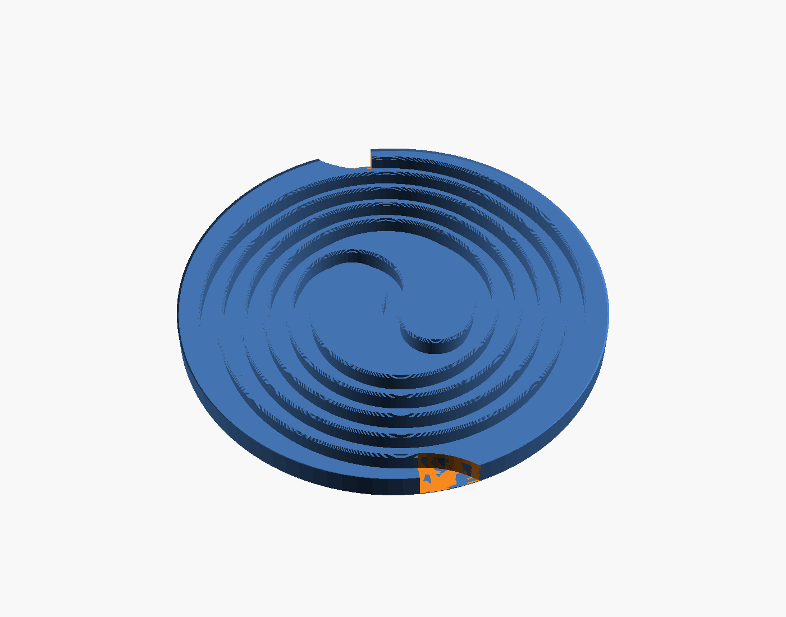

*The disc for a 4 mm cable, 96.7 mm across and 6.2 mm thick (6.6 mm with the stacking ring[^ring], which
sits inside the disc above, so each disc adds 6.2 mm to a pile). It holds 1.0 m of cable. The two
exits[^exit] are where the channel leaves through the rim[^rim], one at the bottom of the picture
and one at the top;
the OpenSCAD[^openscad] preview colors the cut faces orange, and at this angle only a sliver of the
top exit's orange shows.*

Stacking needs no lid or clip. The flat underside of the disc above lies on the tops of the channel
walls of the disc below, so it closes every channel, and a stacked cable cannot lift out at all
(for discs of the same diameter; see [How the discs stack](#how-the-discs-stack)). A
low stacking ring[^ring] round the top edge sits in a chamfer[^chamfer] on the bottom edge of the
disc above, so the pile stays roughly lined up; a firm sideways push can ride the disc above up and
over the 0.4 mm ring.

## Context: who uses it and what it touches

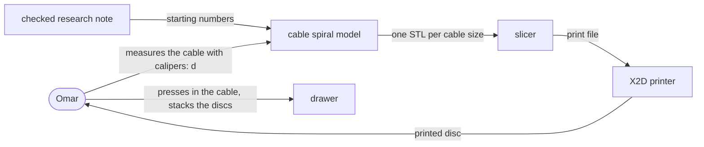

**In the diagram:** Omar[^omar]; the model[^model]; d[^d]; STL[^stl]; slicer[^slicer]; X2D
printer[^x2d]; checked research note[^research].

Two settings: d, the cable's thickness, and the cable's length. d sets the channel; the length sets
how wide the disc grows.

## Use cases

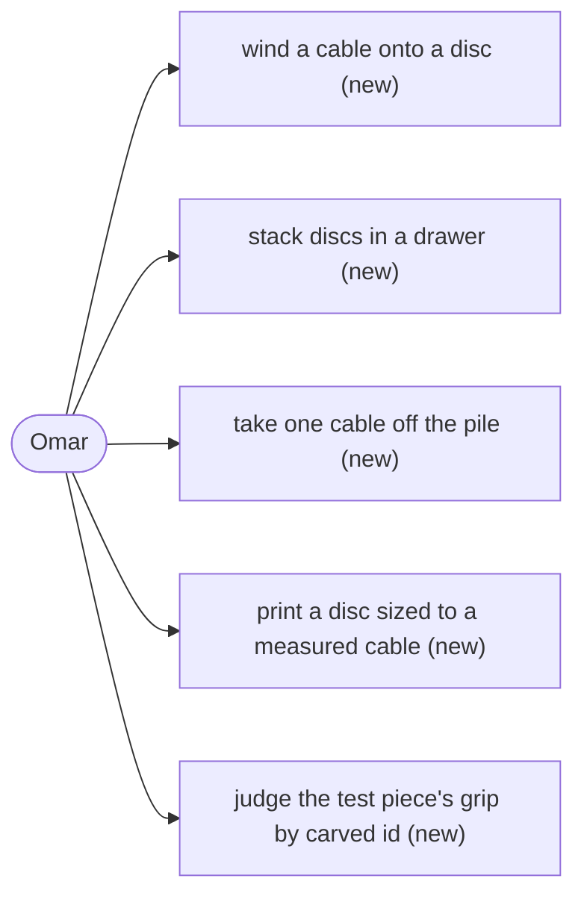

**In the diagram:** Omar[^omar]; carved id[^id]. All five are new; nothing existing changes.

- **Omar winds a cable onto a disc.** Fold it at the middle, lay the fold in the S-bend[^sbend], press each
  half down into its spiral with a thumb, let the plugs hang out of the two exits.
- **Omar stacks discs in a drawer.** Each disc sits on the one below and closes its channels. Turn
  each disc so its exits miss the ones below. A plug head is about 6.3 mm thick, thicker than a disc
  for a small cable, so plugs from neighbouring discs would hit if lined up.
- **Omar takes one cable off the pile** and unwinds it by pulling the plugs.
- **Omar prints a disc sized to a measured cable.** Two settings, d and the length.
- **Omar judges the test piece** by the ids carved into it (see
  [the first test piece](#the-first-test-piece)).

## The user-facing surface

**No app, page or button.** This is a printed object and one OpenSCAD file,
`src/CableSpiral/cable-spiral.scad`. The whole interface is two settings, d and `cable_length`, and two commands:

```
openscad -D 'part="disc"'   -D d=4.0 -o disc.stl   src/CableSpiral/cable-spiral.scad
openscad -D 'part="coupon"' -D d=4.0 -o coupon.stl src/CableSpiral/cable-spiral.scad
```

`cable_length` (1000 mm by default) sets how much cable one disc holds; the disc grows to fit.
`coupon` is the model's name for the test piece[^coupon].

## The pieces and where they live

This is one small file in one repo, with no other program or package involved, so there is no
diagram of components or data. The file has eight parts: `disc` (the product), `coupon` (the first
test piece), and `plan`, `zones`, `section`, `grip`, `bend` and `sizes`, which draw the
pictures in this doc.

## How it works

### How the cable is held

**In plain words: the channel is a little wider than the cable, and its top edge is a little
narrower.** The cable presses past the narrow top, the walls bend outward a fraction of a
millimetre, then spring back over it.

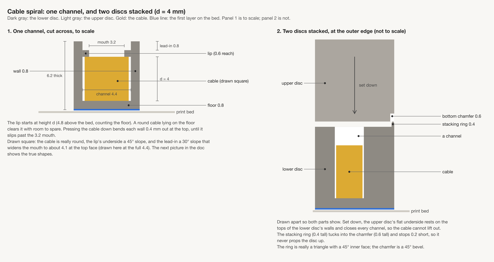

*Left: one channel cut across, to scale, with each size the table below gives. Right: two discs at
the outer edge, drawn apart so both show and not to scale; it leaves out the lower channel's lip[^lip].
This drawing tool draws only boxes, so the cable and the sloped faces are drawn square, and the square
cable's top corners seem to touch the lip. A round cable does not: the next picture shows the
channel's true shape, and the grip picture further down shows round cables in it. The ring and the
chamfer are 45° bevels.*

**In the picture:** mouth[^mouth], lip[^lip], lead-in[^leadin], chamfer[^chamfer].

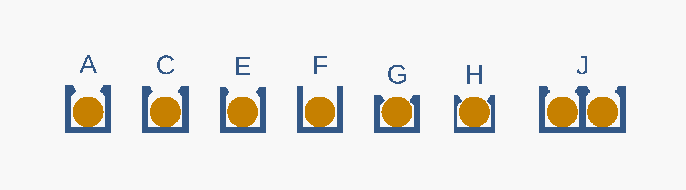

*A cut across each test bar of the test piece, with a 4 mm cable drawn on each channel floor. A, C
and E differ in how narrow the top is; a narrower top also puts the lip tip, and so the bar's top,
higher (6.3, 6.2 and 6.1 mm thick). F has no lip at all. G and H are the thin version: the lip sits lower, so the disc is 1.2 mm thinner for a 4 mm cable. J is
two channels sharing one wall. Each letter is the id carved into that bar.*

**In the picture:** mouth[^mouth], lip[^lip], tip high[^tiphigh] (A, C, E, J; F is the same height with no lip), tip low[^tiplow]
(G, H), carved id[^id].

All sizes in mm; d is the cable's thickness. Worked values are for d = 4. The sources named in the
last column are the published print guides listed under [Sources](#sources)[^sources].

| Part | Rule | d = 4 | Where it comes from |
|---|---|---|---|
| Channel width | d + 0.4 | 4.4 | A guess to test. 0.2 mm a side is the low end of Sovol's 0.20 to 0.40 mm starting gap for mating parts, so the walls do not press on the cable all the time; PLA[^pla] creeps under a steady load. |
| Mouth[^mouth] | 0.80 × d | 3.2 | Inside the 0.70 to 0.85 band (the mouth's width as a fraction of the cable's thickness), a little above its middle (0.775), seen only in a search snippet[^snippet] for one clip design. That clip flexes along its layers[^layer] and ours bends across them, so the band carries over only as the range to test. The test piece tries 0.75, 0.80 and 0.85. |
| Lip[^lip] reach, each side | (width − mouth) / 2 | 0.6 | Arithmetic. |
| Lip underside | 45° slope, starting at height d | 0.6 tall | 45° prints with no support[^support] (Hubs and Prusa). Starting at height d means a cable lying on the floor never touches it. |
| Lip tip height | d + reach | 4.6 | Arithmetic. |
| Lead-in[^leadin] above the tip | 0.2 × d tall, 30° from upright | 0.8 | The height is geometry: a cable of size d lifted up against the lip tips has its top 0.2 × d above them, exactly level with the disc's top face. A thinner cable lifts a little further (0.09 mm above the face at 0.94 × d), so in a stack the disc above simply holds it that much lower; nothing is forced. The 30° is a guess inside Sovol's 25° to 35° range, which Sovol gives as a starting value for a snap-fit[^snapfit] arm and does not say whether it is measured from upright or from flat. The two readings give very different slopes, so this transfers only as a value to test. |
| Floor | 0.8 (four layers) | 0.8 | A guess to test. |
| Wall between turns of the spiral | 0.8 (two lines[^line]) | 0.8 | A guess to test. One line, about 0.45, is the least that prints (Prusa's line width). |
| **Disc thickness** | floor + tip + lead-in = **1.3 × d + 1.0** | **6.2** | Arithmetic. The reach is (d + 0.4 − 0.8 d) / 2 = 0.1 d + 0.2, so the tip is 1.1 d + 0.2, and 0.8 + (1.1 d + 0.2) + 0.2 d = 1.3 d + 1.0. For d = 4: 0.8 + 4.6 + 0.8. |

**How hard the wall bends.** Pressing a cable in bends each wall outward a little. The estimate below
says that bend is within the top of what PLA can take, but it is a rough estimate, and only a print can confirm
it. The arithmetic: the cable pushes the top of each wall sideways by (d − mouth)/2, 0.4 mm for a
4 mm cable. Treating the wall as a single bending strip (a beam sum[^beam]) puts the stretch[^stretch]
at the wall's foot at about 2.3%. Fictiv's snap-fit guide allows PLA 4 to 8%, halved for a part that
bends across its layers, so 2 to 4%; Bambu's data sheet gives 7.5% as the point where PLA breaks
across layers. Neither source says where its 4 to 8% comes from, and the beam sum treats the wall as
a lone strip when it is one long wall, so **the figure ranks options; it does not promise the wall
survives daily use.** This doc uses the top of that band, 4%, as the limit. By its low end, 2%, every
disc is already over at its own size (2.1 to 2.8%; the three sizes are under [One disc per cable size](#one-disc-per-cable-size)), so the ranges below are the generous reading.

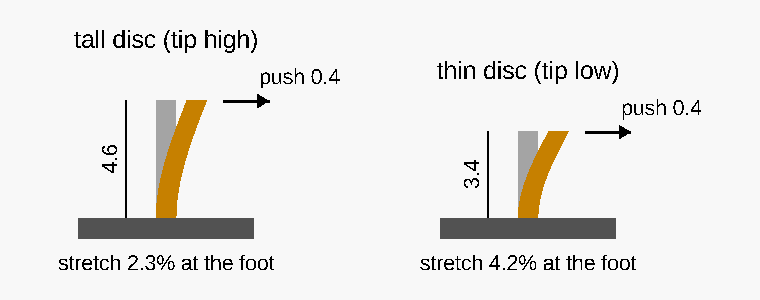

*One wall, for d = 4. The cable pushes the wall's top sideways at the lip tip; the stretch is worst
at the wall's foot and grows as the height shrinks, so the thin disc's shorter wall bends harder for
the same push. Gray: the wall at rest. Orange: bent, with the push drawn three times larger so it
shows. Heights are from the channel floor to the lip tip.*

**In the picture:** lip[^lip]; beam sum[^beam]; stretch[^stretch]; tip high[^tiphigh]; tip low[^tiplow].

**Those figures hold only where both walls can bend.** On the test bars every wall has open air
behind it: each bar's carved id[^id] sits on a small tab that stands 1 mm clear of its bar and joins it only at floor height. On the
disc, three places do not:

- **The S-bend:** solid plastic on its inner side all the way, and on its outer side except for the
  last few millimetres at each end, where one wall separates it from the next spiral arm[^arm] (one
  of the two channels winding out from the centre). So neither wall bends over most of it, and the
  cable has to squeeze through the 3.2 mm mouth.
- **The first half turn of each arm**, beside the solid centre, and **the outermost half turn**,
  beside the rim: only one wall bends.

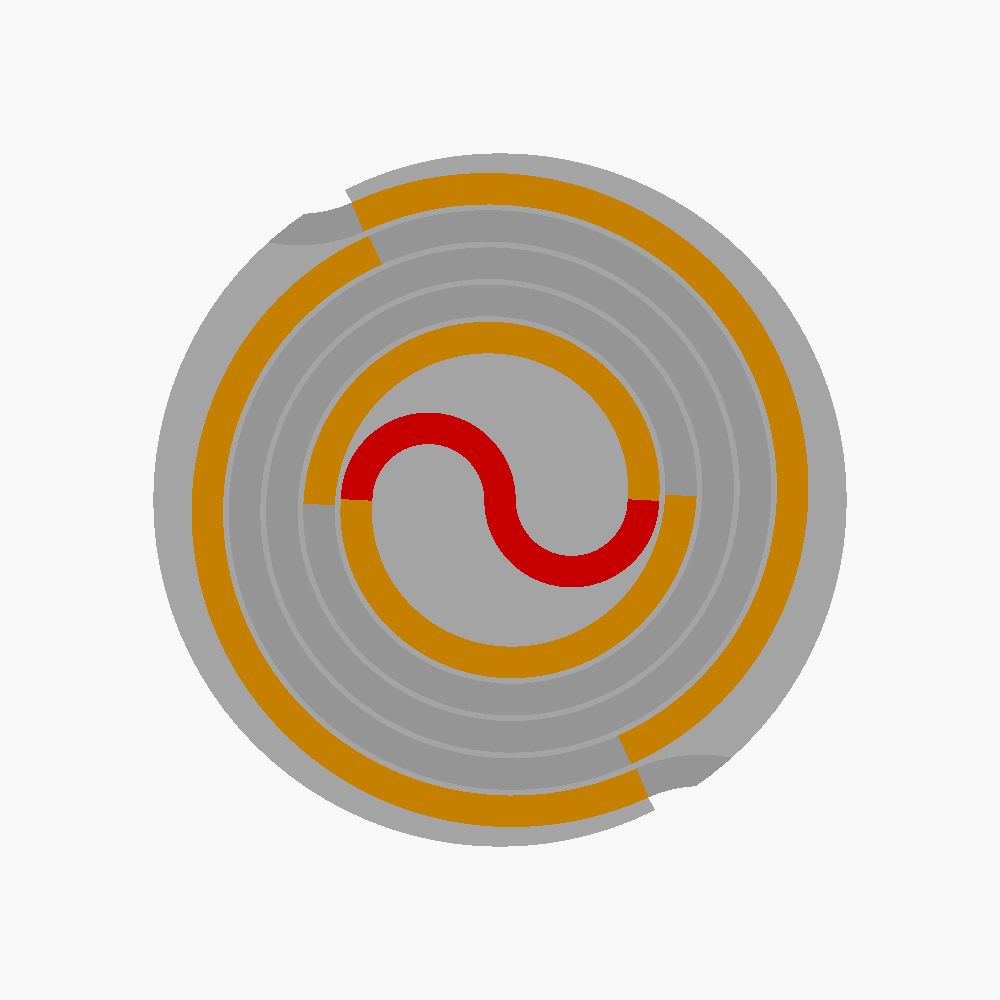

*Where the walls can bend, for d = 4. Red: neither wall can bend (the S-bend; at its two ends a
few millimetres of the outer side are a single wall, too short to show here). Orange: only one wall
can bend. Gray: both walls bend, as on the test bars.*

**In the picture:** S-bend[^sbend]; spiral arm[^arm]; rim[^rim]; exit notch[^exit].

On the half turns where only one wall bends, that wall alone has to move the whole d − mouth, 0.8 mm
for a 4 mm cable, if the cable does not squash. By the same rough beam sum that is about 4.5% stretch
at d = 4 and 5.5% at d = 3.2, over the 4% limit. In the S-bend neither wall can move, so no stretch
figure applies: the cable itself has to squash by 0.8 mm, a fifth of its thickness, to pass the
mouth. So the press in both places is harder than on any test bar, and may not go at all. This is
[open question 1](#open-questions); the test piece checks it on K, a curved bar with solid on one side, and on P, a small disc whose
channel has solid on both sides.

### The path the cable takes

The cable is folded in half: the fold sits in an S at the centre, and the two halves spiral outward
side by side to two exits in the rim.


*The channel layout from above. The fold sits in the S at the centre, the two halves run outward
between each other, and each ends in an exit cut through the rim.*

**In the picture:** S-bend[^sbend]; spiral arm[^arm]; exit notch[^exit].

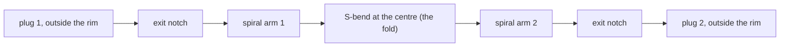

**In the diagram:** S-bend[^sbend]; spiral arm[^arm]; exit notch[^exit].

- **The S-bend** is two half-loops of radius 2.5 × d (10 mm for a 4 mm cable). That radius is a
  guess: no source we found gives how tightly a USB-C cable can bend.
- **The two arms** start at twice that radius and wind outward. One lap of an arm moves it
  2 × (d + 1.2) outward, because the other arm's channel and wall (d + 1.2) sit in between.
- **The exits.** At the end of each arm the channel starts to turn outward round a curve of twice
  the S-bend's radius, and leaves the disc about halfway round that turn, crossing the edge at about 45°
  (for d = 4). Leaving along the spiral would cross the rim almost flat and leave a thin sliver of
  rim; turning out first crosses it more steeply, and the notch ends the thin side of the rim in a
  square cut. Each exit opens to about 13 mm at the edge, three channel widths: the cut also takes
  away the rim on the outside of the turn, so no thin point of rim is left. It has no lip, so the
  cable near the plug lifts
  out freely.
- **The rim** outside the last turn is at least 2 mm, a guess. The spiral's radius grows as it winds,
  so the rim is 2 mm thin only just before each of the two exits, about 4.6 mm a quarter turn from each exit, and up to 7.2 mm just past one.

**Disc size against cable length**, from the model for d = 4: 1 m of cable needs a disc 96.7 mm
across. The research note's table says about 92 mm. The difference is that the note measured to the
middle of the outermost channel and added the rim, while the model adds half a channel width too.
The model's figure is the one that prints. A 2 m cable needs a disc about 128.5 mm across.

### How the discs stack

Each disc's flat underside is the lid for the disc below, and the stacking ring on the top edge keeps
the pile lined up. The right half of the labeled cut above shows both.

- **The bottom edge** has a 0.6 mm 45° chamfer. Hubs and Prusa both advise a chamfer, not a rounded
  edge, where a part meets the bed.
- **The top edge** has the stacking ring, 0.4 mm tall with a sloped inner face. It tucks into the chamfer of the
  disc above, 0.2 mm short of filling it, so it never holds the disc above off the channel walls.
  0.2 mm is Prusa's stated accuracy for its own printers; on the X2D it is only a starting guess.
- **No bridges[^bridge] anywhere.** The underside is flat.
- **Only discs of the same diameter line up.** The diameter depends on both the cable size and the
  length: 87.3 mm for 1 m at d = 3.2, 93.2 mm at d = 3.7, 96.7 mm at d = 4, 100.2 mm at d = 4.3, and about 128.5 mm
  for 2 m at d = 4. In a mixed pile the ring meets no chamfer. A smaller disc set on a larger one
  leaves the larger disc's outer turns open, held by their lips alone. A larger disc set on a
  smaller one is worse: it rests on the smaller disc's ring, 0.4 mm above its walls. The cables still cannot lift out,
  but nothing keeps the two discs lined up. So stack like with like, or put the largest disc at the bottom and
  accept that the smaller ones above can slide.

## One disc per cable size

**A disc holds cables from about 6% thinner than the size it was drawn for to up to 0.4 mm
thicker (less for the smallest disc, see the table), so three disc sizes cover the USB-C cables we found from 3.01 to 4.7 mm.** A
cable in the channel is never
squeezed while it rests: it has room to move sideways and to lift until it meets the lip tips. What
changes with its size is how much room, and how hard it is to press in.

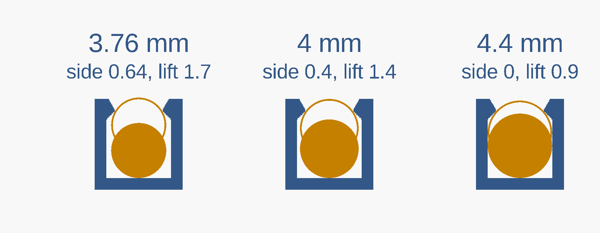

*The channel for d = 4, three times over, with a round cable of 3.76, 4 and 4.4 mm. The filled circle
is the cable lying on the floor; the outline is the same cable lifted until it meets the lip tips.
"side" is the room left between the cable and the walls; "lift" is how far it can rise. Drawn by the
model's `grip` part, which also prints these numbers.*

**In the picture:** lip[^lip]; mouth[^mouth]; tip high[^tiphigh].

- **Easy press, more play: from about 0.94 × d up to d.** The lower end is where the mouth, 0.80 × d,
  is 0.85 of the cable: the top of the 0.70 to 0.85 band, so a thinner cable is outside even the
  snippet's range. For d = 4 the cable has 0.4 to 0.64 mm of room sideways and can lift 1.4 to
  1.7 mm before the tips stop it, so it can move about in its channel; it cannot come out. (At d the
  lift is 0.3 × d + 0.2 for any size: 1.16 mm for the 3.2 disc, 1.49 mm for the 4.3.)
- **Firm press, little play: from d up to d + 0.4.** The wider cable fills more of the channel: for
  d = 4, no room sideways at d + 0.4 and 0.9 mm of lift. The lip's sloped underside still clears it as it
  lies on the floor (a round cable lying there touches the slope only once it is about 1.3 × d
  across, wider than the channel), so it is not squeezed at rest. Pressing it past the mouth bends
  each wall further: 0.6 mm at d + 0.4 against 0.4 mm at d.

Both ranges rest on the snippet-only 0.70 to 0.85 band, so they are guesses until the test piece
shows them. They are for the full-height disc (tip high); the thin version has a narrower range,
given under [Alternatives](#alternatives-and-the-decision).

The firm end is also where the wall stretches most, and the stretch grows as the disc gets smaller,
because a smaller disc has shorter walls. So the smallest disc's firm range stops where the stretch
reaches 4% (the beam sum, as above):

| Drawn for (d) | Easy press, more play | Firm press, little play | Stretch at d | Stretch at the firm end | Disc thickness |
|---|---|---|---|---|---|
| 3.2 | 3.01 to 3.2 | 3.2 to 3.48 (4.5% at 3.6, over the limit) | 2.8% | 4% | 5.2 |
| 3.7 | 3.48 to 3.7 | 3.7 to 4.1 | 2.4% | 3.8% | 5.8 |
| 4.3 | 4.05 to 4.3 | 4.3 to 4.7 | 2.1% | 3.1% | 6.6 |

Three sizes cover the USB-C cables we found figures for from 3.01 to 4.7 mm with no gap. The thinnest,
Apple's 3.0 mm (1 m, one
user's measurement on Apple's community forum, not Apple's figure), falls 0.01 mm below the
smallest disc's range, well inside caliper error; the thickest is Anker's 4.7 mm (its stated size). Between them sit StarTech's 4.0 mm and
ChargerLAB's 4.6 mm figures (sources in the appendix).
**They cover it only just.** The exact lower end of the easy range is 0.8 / 0.85 = 0.941 × d, so the
3.2 disc starts at 3.01: Apple's 3.0 mm cable sits 0.01 mm below it, and Apple's 3.5 mm cable only 0.02 mm inside the 3.7 disc's range, so both depend on the mouth test. The 3.2 disc's firm range reaches
4% stretch at 3.48, exactly where the 3.7 disc's easy range starts, so those two meet with no margin.
The 3.7 and 4.3 ranges overlap from 4.05 to 4.1, and Anker's 4.7 mm cable sits at the very top of
the 4.3 disc's range; a thicker cable needs a larger d. All of this assumes the 0.80 mouth: if the
test piece picks 0.75 or 0.85, recompute the sizes. Earbud wire, about
2 mm from a snippet, would need its own size. **Omar's own cables need measuring with calipers
before any disc is printed.**

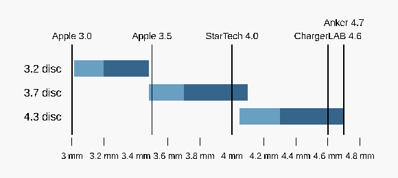

*Which cables each disc takes. Light: easy press. Dark: firm press. The 3.2 and 3.7 discs meet at
3.48 with no margin; the 3.7 and 4.3 discs overlap from 4.05 to 4.1. Apple's 3.0 mm cable sits
0.01 below the smallest disc, and Anker's 4.7 at the very top of the largest.*

**In the picture:** easy and firm press (the two ranges above).

## Alternatives and the decision

**We picked the folded cable path with both plugs at the edge, the flat-underside stack lined up by
the stacking ring, and the full-height disc; the thin disc goes on the test piece beside it.** The
table weighs the three real choices. Letters in it are the test parts described under
[The first test piece](#the-first-test-piece): K is the curved bar, L and P the two small stacking
discs, C the middle-mouth bar, and G and H the thin bars. The 20-press test is the last step of the
check after printing. Two researchers answered the question without reading each other, and a
checker re-opened the sources and settled the differences.

| Choice | Picked | Rejected | What the rejected one would buy | Why it lost | What could block the pick this month | What each verifies |
|---|---|---|---|---|---|---|
| **Cable path** | Fold at the middle: S-bend plus two spirals, both plugs at the rim | One spiral from the centre out | A smaller centre, slightly more cable per disc | The inner plug sits in the middle. A plug head is about 6.3 mm thick, as thick as the disc, so it cannot sit inside a stack. No variant keeps one spiral and gets the plug out: a plug pocket needs a thicker disc. | The S-bend's 2.5 × d radius is a guess; a stiff braided cable may not lie in it. K on the test piece checks one cable. | The fold is checked by K and by the first disc; the single spiral is not tested. |
| **Stacking** | Flat underside closes the channels below; the stacking ring lines them up | A 10 mm stub on top and a pocket underneath, at the centre | A stronger lock against sliding | Mainly, the stub sits exactly where the S-bend has to go, so it cannot be combined with both plugs at the rim. Also, the pocket's roof (10.4 mm, the stub plus a gap) would print as a bridge: within the 30 mm Bambu gives as the most it will span, but over the 5 mm Hubs gives for a roof with no sag. A better version of the same idea was also looked for and found: a stacking ring at the edge keeps the lining-up and leaves the centre free for the S-bend. | The 0.4 mm ring may be too thin for the slicer to print ([open question 3](#open-questions)). Slicing L and P shows it before any print. | L and P on the test piece test the stacking ring; the stub is not tested. |
| **Thickness** | Tip high[^tiphigh], 1.3 × d + 1.0 (6.2 mm) | Tip low[^tiplow], d + 1.0 (5.0 mm) | 0.3 × d thinner (1.2 mm for a 4 mm cable), the "thin" in the ask | A shorter wall bends harder: about 4.2% stretch with a 0.8 wall, over the 4% limit. A 0.45 single-line wall brings it back to 2.3% but is about a sixth as stiff, so it may not grip. Its lip tips also press on any cable a little over d (below). | Where both walls bend, little: 2.3% at d = 4. But on the first and last half turn of each arm one wall has solid behind it and has to move the whole 0.8 mm, about 4.5% stretch, over the limit. In the S-bend neither wall can move, so the cable itself must squash 0.8 mm to pass the mouth, and the press may not go at all ([open question 1](#open-questions)); K and P test it before any disc is printed. The thin version could crack at the wall's foot; G, H and the 20-press test show it. | Both go on the test piece (C against G, H), so the print decides, not the arithmetic. |

**The thin version lowers the lip so the disc is 0.3 × d thinner (1.2 mm for a 4 mm cable); the cost is a shorter wall that bends
harder, and a narrower range of cables.** In numbers: its lip tip drops from 1.1 × d + 0.2 to
0.8 × d + 0.2 (3.4 mm for a 4 mm cable), so the disc is floor + tip + lead-in =
0.8 + 0.8 d + 0.2 + 0.2 d = d + 1.0. The lip tips then sit below the top of the cable but above its
widest point, so the cable still cannot lift out past them. The wall bends harder because the same
0.4 mm push acts on a shorter strip. And because the tips sit so low, a round cable lying on the floor
touches them once it is more than about d + 0.15 across (4.15 mm for d = 4); a d-size cable clears
the lip tips by only about 0.13 mm (the shortest distance; straight up from the tip it is 0.2 mm). So the thin version holds about 0.94 × d to d + 0.15
without pressing on the cable at rest, not the full-height disc's 0.94 × d to d + 0.4. Past d + 0.15
the tips would press all the time, which the channel width is chosen to avoid because PLA creeps.
The stretch narrows it further: with the 0.8 wall (G) the stretch passes 4% at about 3.97 mm, just
below d, and reaches 4.9% at 4.15. So the 0.94 × d to d + 0.15 range holds only for the one-line wall
(H); with G, only cables thinner than d stay inside the band.

**Decided: the fold, the stacking-ring stack, and tip high as the first disc, with the thin version on the
test piece beside it.** Thin enough is part of the ask, so if G or H grips as well as C, the disc
moves to the thin version. Ownership is ours either way: there is no third-party part in it.

Both rejected options are still recorded in the two research passes, so nobody needs to re-derive
them.

## The first test piece

**Not a whole disc.** Bars of channel, each 40 mm long, with an id carved on a tab beside each one
and **open at both ends**, so a real cable with plugs lies flat through them. Ids skip B, D, I, M, N
and O, which look alike when carved small (I reads as 1).

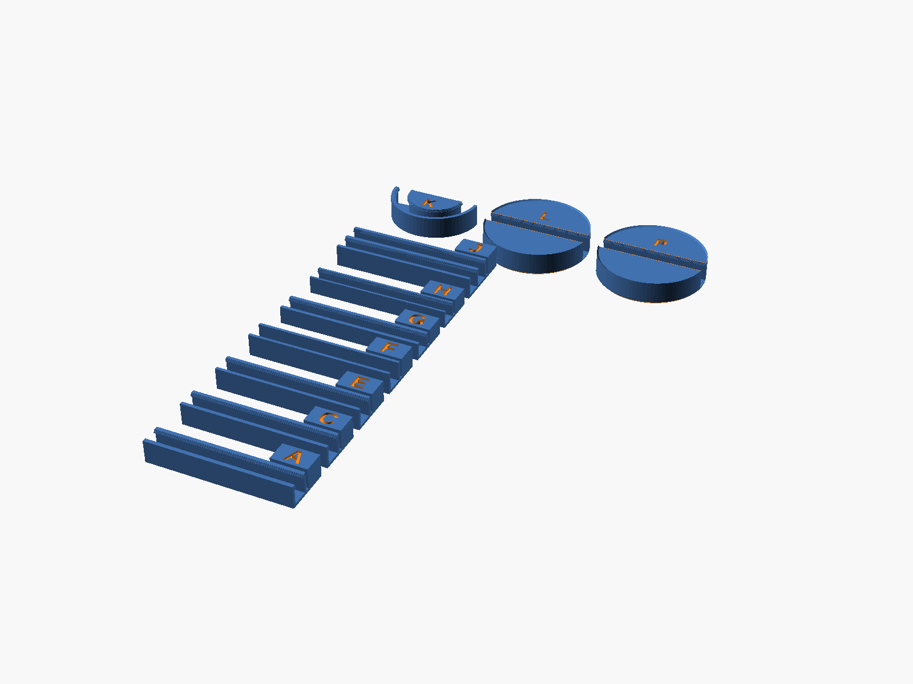

*The test piece: seven straight bars, A to J, each with its id on a tab that stands clear of the bar;
the curved bar K; and the two stacking discs L and P.*

**In the picture:** carved id[^id]; stacking ring[^ring] (on L and P; too thin to make out at this angle, see the disc picture); lip[^lip].

| Id | What it is | What it answers |
|---|---|---|
| A, C, E | Mouth 0.75, 0.80, 0.85 × d, tip high, 0.8 wall | Which mouth grips with a thumb press and still lets go |
| F | No lip at all | The control: does any lip matter |
| G | Thin version, tip low, 0.8 wall | Can the disc be 0.3 × d thinner (1.2 mm at d = 4) |
| H | Thin version, tip low, 0.45 wall (one line) | Does a softer wall fix the thin version's stretch, and still grip |
| J | Two channels sharing one 0.8 wall, as on the disc | A wall with a cable on both sides: press one cable in, then the second beside it, and note if the second is harder (on the disc the inner turn is already full when the next is pressed in) |
| K | A half-loop at the S-bend radius, solid on its inner side | The tightest curve: does the cable sit in it, and does it press in where only one wall bends |
| L, P | Two small discs, 30 mm across, with the stacking ring, the chamfer and one straight channel across, solid on both sides | Does the cable press in where neither wall bends, as in the S-bend; does one disc sit flat on the other and stay lined up, with a length of cable lying in the lower one's channel |

**After the print, for each bar A to J and the curve K:**

1. Press the cable in with a thumb. Note if it would not go in.
2. Turn the bar upside down and shake it gently. Note if the cable falls out.
3. Pull the cable up and out. Note if it took a firm pull.
4. Repeat the press and pull 20 times (the low end of Sovol's 20 to 30 cycles for testing a snap
   fit), then look at the foot of each wall for a crack or a white stress mark.

**For L and P:** first press a length of cable into P's channel with a thumb, and note if it would
not go in; neither wall bends there, as in the S-bend. P is the one pressed; L has the same channel but is kept clean to set on top. Then set L on P. Does it sit flat, does the cable
stay put, and does L slide when pushed sideways?

The test piece can share a bed with the [cables-1](../plates/cables-1.md) holder and clips, so one
print shows the bought designs and ours on the same cable. That plate is for the plates
session[^plates] to lay out and send.

## Open questions

1. **Will the cable press in where the walls cannot bend?** This is the biggest risk. The S-bend
   has solid plastic on both sides over most of its length, and the half turns beside the centre and the rim have it on one
   (see [How the cable is held](#how-the-cable-is-held)). If P or K will not take the cable,
   untested ways out are: a narrow open slot behind each such wall so it can bend like a test bar's;
   no lip in the S-bend, leaving the disc above to hold the fold; or a wider mouth there only. Each
   would go on a second test piece before it goes on the disc.
2. **What does Omar's own cable measure?** Everything scales from d; it is set to 4.0 until then.
3. **Will the stacking ring print?** It is a triangle 0.4 mm wide at its base and 0.4 mm tall, so it
   prints as two layers about 0.3 mm and 0.1 mm wide, both narrower than one line (about 0.45 mm).
   The slicer may leave out the whole ring, not just its top. Slice
   the test piece and look at L before printing; if it vanishes, widen the ring and the chamfer together.
   This holds as drawn at d = 4 (6.2 mm thick). The other sizes come out 5.16, 5.81 and 6.59 mm, not
   whole 0.2 mm layers, so their top layer and ring slice a little differently; slice each before printing it.
4. **Is 2.5 × d tight enough for the S-bend, or too tight for a stiff braided cable?** K answers
   this for one cable.
5. **Does the grip last?** PLA creeps; a month in a drawer may loosen it. PETG[^petg] is the usual
   fix, untested here.

## Glossary

[^plate]: **plate** — one print job: the set of pieces laid out together on the printer's bed, with
    a page in `docs/design/plates/` saying what is on it and why. cables-1 is the plate for cable
    holders.
[^store]: **the store** — Naqsh Coffee's online shop, which sells our printed coasters.
[^chamfer]: **chamfer** — a flat 45° bevel cut along an edge, instead of a sharp corner.
[^openscad]: **OpenSCAD** — a free program that builds 3D shapes from a short text file; its preview
    is the picture shown here.
[^ring]: **stacking ring** — a low ridge, 0.4 mm tall, round the top edge of each disc. It sits in the
    chamfer under the disc above, so a pile of same-size discs stays lined up.
[^omar]: **Omar** — the one person in every use case: he measures the cables, prints the discs, uses
    them, and judges the test piece.
[^model]: **the model** — the OpenSCAD file that draws the disc and the test piece. See
    OpenSCAD above.
[^d]: **d** — the cable's thickness (outside diameter) in mm, measured with calipers. One of the
    model's two settings; the other is the cable's length.
[^stl]: **STL** — the common file format for a 3D shape, the input a slicer reads.
[^slicer]: **slicer** — the program that turns a 3D shape into the layer-by-layer moves a 3D
    printer makes. Here, Bambu Studio.
[^x2d]: **X2D printer** — our Bambu Lab X2D 3D printer: 0.4 mm nozzle, 0.2 mm layers, printing PLA.
[^research]: **checked research note** — the write-up where a third person re-opened the sources
    behind two independent research passes and settled where they differed. Linked under
    [Where the numbers came from](#where-the-numbers-came-from).
[^coupon]: **coupon** — the model's setting name for the test piece: a small print that tries one
    question (here, the grip and the stacking) without printing the whole object.
[^snippet]: **search snippet** — seen only in a search engine's summary of a page, not on the page
    itself, so the figure is unconfirmed.
[^layer]: **layer** — the printer builds a part as flat 0.2 mm layers stacked up; plastic is weaker
    pulled apart across layers than along them.
[^support]: **support** — throwaway scaffolding the printer adds under an overhang, removed after
    printing.
[^snapfit]: **snap-fit** — a plastic catch that bends aside as parts are pushed together, then
    springs back to hold them.
[^line]: **line** — one bead of plastic the nozzle lays down, about 0.45 mm wide; a wall "two lines"
    thick is two beads side by side.
[^tiphigh]: **tip high** — the lip tips sit above the cable's top; the 6.2 mm disc for a 4 mm cable.
[^tiplow]: **tip low** — the thin version: the lip tips sit below the cable's top but above its
    widest point; a 5.0 mm disc for a 4 mm cable.
[^arm]: **spiral arm** — one of the two channels that wind outward from the S-bend, one for each
    half of the cable. A *turn* (or lap) is one full circuit of an arm round the centre.
[^id]: **carved id** — a letter cut into each test part (on a tab beside the bar for A to J,
    on the top face for K, L and P), so a question after the print can name the part exactly.
[^sources]: **Sovol, Fictiv, Hubs, Prusa, Bambu** — a printer maker (Sovol), two manufacturing
    services that publish design guides (Fictiv, Hubs), and two more printer makers (Prusa, and
    Bambu Lab, who make our X2D). Each published a guide or data sheet that a number here comes
    from.
[^pla]: **PLA** — the common plastic we print with. Stiff, a little brittle, and it slowly deforms
    under a load held for a long time (creep).
[^mouth]: **mouth** — the narrowest gap at the top of the channel, between the two lip tips. Narrower
    than the cable, so the cable has to be pressed past it.
[^lip]: **lip** — the small ledge on each side at the top of the channel that narrows it to the
    mouth.
[^leadin]: **lead-in** — the slope above the lip that funnels the cable toward the mouth, so it is
    pressed in rather than caught on a sharp edge.
[^beam]: **beam sum** — the textbook estimate of the stretch at the foot of a strip fixed at one end
    when its free end is pushed sideways a set distance: stretch = 1.5 × wall thickness × push ÷ height².
[^stretch]: **stretch** — how much longer the plastic on the outside of a bend gets, as a percentage
    of its length. Past a limit for each plastic, it cracks.
[^sbend]: **S-bend** — the S-shaped curve at the centre of the disc where the cable's fold sits.
[^rim]: **rim** — the solid band of plastic round the outside of the disc, outside the last turn of the channel; the exits cut through it.
[^exit]: **exit, exit notch** — the cut through the rim where each end of the cable leaves the disc, with
    its plug hanging outside.
[^bridge]: **bridge** — a stretch of plastic printed in mid-air between two supports. Long ones sag.
[^plates]: **plates session** — the separate Claude session that lays out plates, sends them to the
    printer once Omar approves, and records his verdicts on the prints.
[^petg]: **PETG** — another common printing plastic, tougher and more flexible than PLA, and
    slower to creep.

## Appendix

### Where the numbers came from

- **The research.** Pass A, [PR #1020](https://github.com/omars-lab/3d-models/pull/1020); pass B,
  [PR #1021](https://github.com/omars-lab/3d-models/pull/1021); the checker's consolidated note,
  [PR #1022](https://github.com/omars-lab/3d-models/pull/1022), which is the one this doc follows.
  Each claim there is marked as re-opened (the checker downloaded and read the page), closed (the
  page answered with a bot check and was not read) or snippet (seen only as a search summary).

### Sources

- **Re-opened by the checker:** the Bambu PLA Basic data sheet (break stretch 12.2% along layers and
  7.5% across; overhang 55°; bridge 30 mm, with no stated angle convention); Fictiv's snap-fit guide
  as republished on Core77 (PLA 4 to 8%, halved across layers, the beam formula 1.5 · t · Y / L²);
  Sovol on snap fits (0.20 to 0.40 mm a side, lead-in 25° to 35° and 20 to 30 cycles as starting
  values for a snap arm, with no stated direction for the angle; PLA creep); Prusa (45° to 60°
  overhangs, 0.45 mm line, 0.2 mm accuracy); Hubs (45° overhangs, bridges under 5 mm do not sag,
  chamfer bed edges); StarTech (4.0 mm cable); Apple Community (3.0 and 3.5 mm, one user's
  measurement); Anker (4.7 mm cable, 6.3 mm plug head); ChargerLAB (4.6 mm).
- **Prior art.** All three pages that might show a design like this answered with a bot check and
  were not read. A search summary for MakerWorld (Bambu Lab's site for sharing printable models) 3056379 describes a disc with an S-shaped slot and
  both plugs left outside, which matches this layout; it may be closed on top. None of the roughly
  40 sources the two passes read shows an open-topped channel disc that stacks. That is a claim
  about those sources, not about the web.
- **Porting.** Prusa's 0.2 mm accuracy and 0.45 mm line width come from Prusa printers and
  PrusaSlicer. They carry over to the X2D only as starting values, because both printers use a
  0.4 mm nozzle, and the test piece is what checks them. Sovol's lead-in angle and cycle count are
  for a free snap arm, not a channel wall, so they carry over only as values to test.

### Model notes

- Built for OpenSCAD 2021.01. The sloped lip and lead-in are stacked 0.1 mm slabs, half a print
  layer each, so the slicer sees a slope. Each slab overlaps the next by 0.01 mm: without it, a
  rounding gap between two slabs splits the part into separate solids.
- A channel that stops exactly at an outer edge leaves faces of zero thickness that 2021.01 cannot
  close into a solid, so every channel runs 1 mm past the shape it is cut from.
- A repeated point where two path pieces join has no direction and breaks the channel outline; the
  path drops repeated points before it is drawn.
- `-D 'only="K"'` with the coupon part renders one test piece on its own, which is how a render
  error is traced to one piece.
- Pictures: `part="plan"`, `"zones"`, `"section"`, `"grip"`, `"bend"` and `"sizes"` draw six of the pictures above
  (`zones` in preview, not `--render`, so its colors show; `bend` and `sizes` also print their numbers);
  `grip` also prints each cable's side room, lift and how far its top sits above the disc's face. The section's cable
  circles are drawn d across, sitting on the channel floor. The labeled cut is
  `cable-spiral-media/cut-and-stack.side.yaml`, drawn by the draw-side-view skill.
